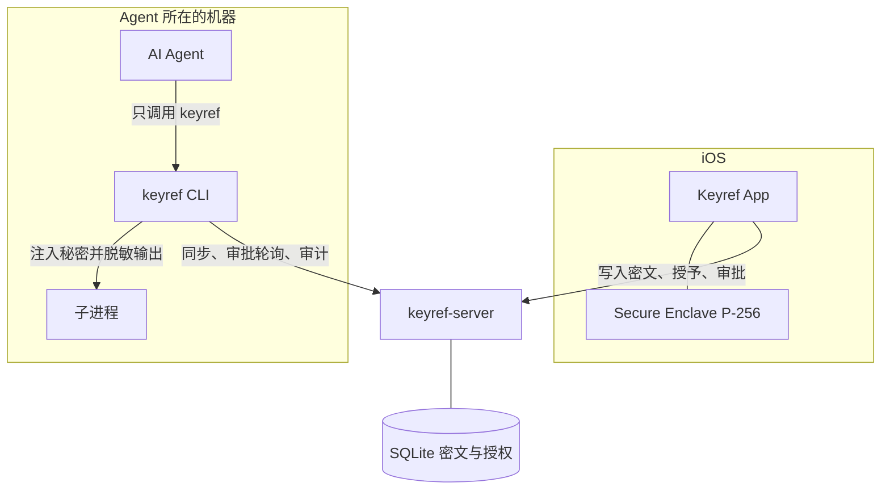
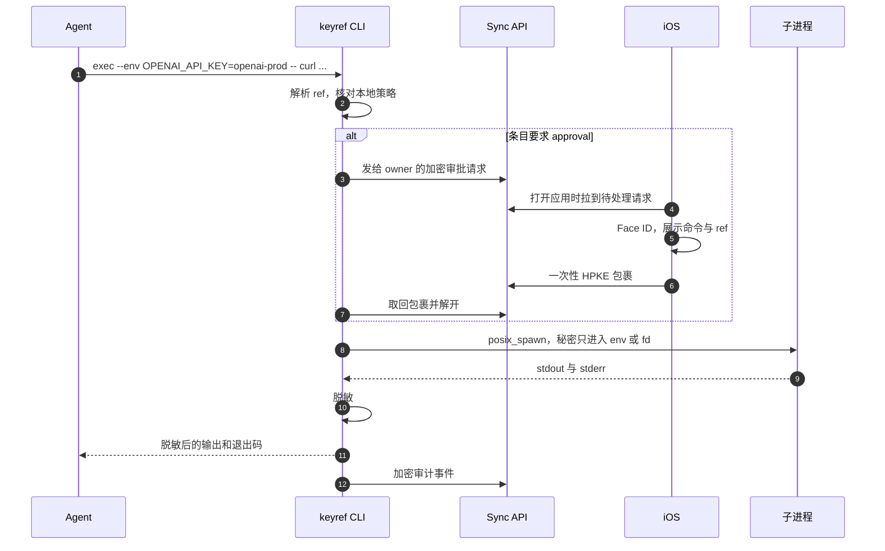
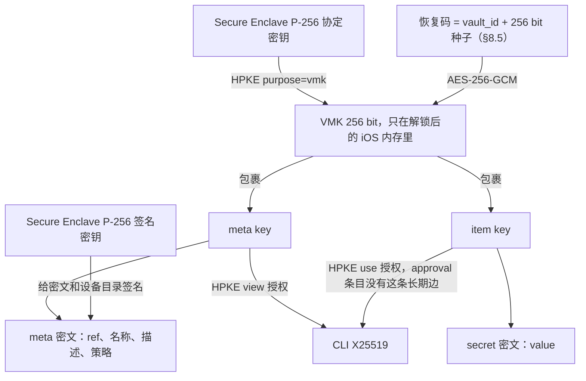

# keyref 设计文档

状态：草案 v0.10。本文是规格，不是实现记录。仓库里的 `ios/`、`cli/`、`server/` 已有 Phase 1/2 的非 iOS 实现与 iOS app。

日期：2026-11-13。

v0.10：按 2026-11-13 的 lib + CLI review 重写 §17，面向「作为库集成」与「agent 在本机直接用 CLI」两条路径。本地库的每一行多一份加密的 meta（ref、掩码、策略），因此 local source 也有 `list`，`get` 不再解密 secret，条目可以带自己的 `allowCommands`；`set` 默认去掉一个末尾换行（`--raw` 保留）；`get --reveal` 必须在控制终端上确认；密钥环条目绑定到库本身而不是 source 名；`keyref mcp` 跟随选中的 source。新增 §17.6（local source 挡什么）、§17.7（Go 库的边界）、§17.8（命令面细则）、§17.9（实现状态）。§7.4 的脱敏增加「去掉首尾空白后的值」这一组匹配。§16 改两条、加三条。**本版是规格先行**，尚未实现的部分列在 §17.9。

v0.9：新增 §17「统一命令面与 source」——CLI 只有一套命令，后端由 source 决定：`local`（本机离线库，默认）与 `sync`（已配对的 iOS 库，CLI 只读）；`keyref local` 子命令取消。选源顺序为 `--source` > `KEYREF_SOURCE` > 配置的默认 > `local`；本地主密钥放操作系统密钥环，`KEYREF_LOCAL_MASTER`（32 随机字节的 base64）为无头环境的覆盖项。`get --reveal` 是 §16「没有 reveal 路径」在 local source 上的唯一例外：只有 local 接受它，sync 拒绝。§16 相应补一条不变量。

v0.8：新增 §14「短信验证码采集」——多台 Android 以 `source` 设备上传端到端加密的验证码消息，owner 在 iOS 收件箱查看，agent 经审批一次性消费 `sms:<message_id>`；消息 24 小时过期即焚，通知复用 §8.3 的 APNs 管道。可选地，owner 可把消息消费的 decision 签署权委托给 `decider` 设备（例如本地部署的 JEV 决策服务），委托策略由 owner 签名、只能缩小不能扩大（§14.8）。原「开放问题」「实现时保持不变的约束」顺延为 §15、§16。

v0.7：新增存储类别（§6.6：同步 / 仅本机，创建时二选一，仅本机条目的 secret 密文不上服务器、每次审批投递秘密值本身）；仅本机条目的 iCloud 整文件加密副本（§6.7，恢复码 + iCloud = 全部找回）；可选的定期密钥轮换仪式（§8.4，原子完成、无失效窗口）。

v0.6：新增 §7.8「注入的三种形态」（exec / embed / proxy）与 `keyref mcp` 的语义同构说明；§6.1 写明弱端点（移动端等）以 approval-only 模式配对的立场。

v0.5：iOS 部署目标从 17 提到 26，界面全面采用 iOS 26 的 Liquid Glass（流体玻璃）设计语言（§12.1、docs/ios-ui.md §3.8）。

v0.4：CLI 从 Rust 改为 Go，与服务器共用语言、协议代码与测试向量；内存卫生从语言级清零降级为守护分配加显式清零，残余按 B1/B2 记录（§12.2、§10.2、§6.5）。

v0.3：按五视角设计评审补协议闭环。恢复码自带 `vault_id` 与恢复签名权威，丢机自助接管有了完整协议（§8.5）；审批请求加 CLI 签名、一次性包裹绑定请求内容（§8.3）；撤销与授权收回定义了送达语义（§8.4、§10.6）；条目密文的 AAD 不再绑定 revision（§9.1）；执行策略覆盖 shebang（§7.3）；配额计入审计与待审批字节，超额与档位回落定义了允许操作集合（§10.5）；自托管备份改为 `keyref-server backup` 在线备份（§10.4）。

v0.2：自托管是一等部署，和官方托管共用一份服务器。费用模型按「免费档有硬顶、付费档净收入高于边际成本」来写，避免托管亏钱。

本文用中文写。命令、字段、算法、路径和代码标识保持英文，例如 `keyref exec`、`VMK`、`{{keyref:openai-prod}}`。

## 决策摘要

这些决定是后面几节的结论，放在前面方便对照。标成「待确认」的条目在文末「开放问题」里，不阻塞把文档当成默认规格来读。

| 主题 | 决定 |
| --- | --- |
| 产品边界 | 人用 iOS 管理秘密。Agent 只用 keyref——CLI / `keyref mcp` / 嵌入库 / 本地代理四种形态（§7.8）。工具回传给模型的内容里没有明文 |
| 编辑权 | MVP 里只有 iOS owner 能创建、修改、删除、轮换。CLI 只读 |
| 引用 | 每个条目有稳定的 `ref`（例如 `openai-prod`）。占位符是 `{{keyref:REF}}`（v0.6 起不再有 URI 等价写法） |
| 注入 | 优先 `--env`、stdin、额外 fd / 打开后即删除的临时文件。进程参数注入必须显式 `--allow-argv`，且条目策略 `allowArgv = true` |
| 执行 | CLI 直接 `posix_spawn` / `execve`，不经过 shell。已配对条目必须显式列出允许的命令（`allowCommands`，v2 H）；`echo`、`env`、`sh` 等的内置拒绝名单只用于本地源。shebang 间接换入的解释器同样检查（§7.3） |
| 敏感条目 | `sensitivity = approval` 的条目不给 CLI 长期条目密钥。每次 `exec` 由手机批准后下发一次性包裹 |
| 元数据 | 名称、描述、`ref`、策略、秘密值全部加密。服务器只看见 id、版本、密文、设备授权图。托管部署另外看见配额档位 |
| 密码学 | AES-256-GCM 做数据加密；HPKE（RFC 9180）做密钥包裹；Secure Enclave 用 P-256；CLI 用 X25519 + Ed25519；恢复口令用 Argon2id |
| 存储与部署 | 一份 Go 服务器 + 嵌入式 SQLite。官方托管和自托管是同一二进制、同一协议。客户端默认连官方托管，也可以改服务器 URL |
| 技术栈 | iOS：Swift / SwiftUI，最低 iOS 26，界面用 Liquid Glass。CLI 与服务器：Go |
| 身份 | MVP 没有邮箱账号。保险库由第一台 iPhone 创建，恢复靠高熵恢复码（内含 `vault_id`，兼作恢复签名权威，见 §8.5） |
| 费用 | 托管按一台小机器的固定月租规划。免费档有硬配额（存储口径含审计与待审批字节，超额只读加删除、不自动删数据）。Plus 的推荐标价是 $6/月或 $48/年，按苹果抽成 30% 的压力情形仍然高于边际成本。自托管免费、不校验收据 |
| 短信验证码 | 多台 Android 以 `source` 设备上传端到端加密消息（只上传、永不读取）；人看 iOS 收件箱，agent 经审批一次性消费 `sms:<message_id>`；消息 24 小时过期即焚；审批默认由人签署，可委托 `decider` 设备按 owner 签名的策略自动签署（§14） |
| 待确认 | 默认要不要每次审批、MVP 要不要沙箱、Windows、团队共享、标价与付款渠道。MCP 已定（Phase 2，§7.8）；官方域名已给推荐并标记为 Phase 1 发布前必须敲定（§15.12） |

## 1. 背景

把 API key 交给 AI agent 时，常见做法是写进环境变量、项目配置或对话。模型随后能在上下文里看见明文，也可能把明文写进日志、工单、另一个文件，或在下一步命令里打印出来。

keyref 把两件事分开：

1. **使用**：被授权的命令可以拿到秘密（否则密钥没有意义）。
2. **看见**：规划命令的 agent 只接触 `ref`、名称、描述和掩码。工具返回给模型的字节流里，秘密已经被替换掉。

人的管理界面在 iOS 上。手机持有主密钥，并用 Face ID 控制主密钥的解包。CLI 是跑在 agent 那台机器上的经纪人：它能解自己被授权的条目，但协议上没有「把明文打出来」这条命令。

这不是另一套 1Password `op run`。`op run` 信任即将执行的命令。keyref 信任的是人在手机上设过的策略，以及「agent 的工具面只有 keyref」这条集成约束。命令本身是模型写的，默认不可信。

## 2. 目标与非目标

### 2.1 目标

- 人可以创建、查看、修改、删除、轮换 API key、token、密码和笔记。
- 每个条目有人类可读的名称、描述，以及保险库内唯一的稳定 `ref`。
- iOS 用 Face ID 解锁，主密钥材料的包裹密钥在 Secure Enclave 里。
- 人可以在手机上批准或撤销一台 CLI 设备，并选择这台设备能使用哪些条目。
- Agent 可以 `list` / `get` 看到掩码，不能看到明文。
- Agent 可以用 `exec` 跑自己本来要跑的命令，把 `ref` 放在秘密原来的位置。
- `exec` 会脱敏子进程的 stdout 和 stderr，包括常见编码。
- 交互式程序可以走 pty，密码可以从 keyref 写进子进程的输入，而不是写进 agent 的上下文。
- 同步服务器在端到端加密之外只保存密文。官方托管和自托管用同一套协议，服务器在两种部署里都不可信。
- iOS 和 CLI 可以指向任意服务器 URL。什么都不改时，连官方托管。
- 丢失手机后，人凭恢复码在新手机上自助恢复：解开 VMK、重新锚定设备目录、把丢失设备标撤销（§8.5）。
- 人可以删除整个保险库。删除是显式动作，服务器不因闲置自动删除数据（§10.5、§11）。
- 每一次 `exec` 都有审计记录，且审计正文对服务器是密文。

### 2.2 非目标

- 不把「主机已被同一用户完全控制」做成可防的场景。调试器、内存转储、恶意动态链接器不在保护范围内。见第 4 节。
- MVP 不做团队保险库、多主人同时编辑、浏览器扩展、Windows，也不做 Android 的完整客户端——Android 只有 §14 的 `source` 采集端（只上传、永不读取）。
- MVP 不托管 SSH 私钥文件、大附件或 OTP 种子。条目值是有长度上限的字符串（64 KiB 以内）。
- 不做服务端全文搜索。名称是加密的，搜索在已解锁的客户端本地进行。
- 不替换公司现有的 KMS。keyref 管的是「人自己的、要交给 agent 用的」那一类秘密。
- 不保证恶意但已被人批准的命令不会把秘密发到网络上。命令若真的需要秘密，它就有能力把秘密传走。策略和审批用来把这个决定留给手机前的人。
- 自托管不做集群、控制面或许可服务器。一台机器上的一个进程就是完整的服务器。
- 托管不做按量超售：超额就拒绝，不另开一张随用量长大的账单。

## 3. 角色

| 角色 | 是谁 | 持有什么 |
| --- | --- | --- |
| Owner | 使用 iOS 应用的人 | Secure Enclave 密钥、解锁后的 VMK、全部条目 |
| Agent | 写命令的模型，以及调用工具的 harness | `ref`、掩码、已脱敏的命令输出 |
| CLI 设备 | 装在 agent 机器上的 `keyref` 进程 | 自己的 X25519 / Ed25519 私钥；被授权条目的密钥 |
| 同步服务 | 官方托管或用户自己运行的 `keyref-server` | 密文、设备公钥、授权关系、会话令牌哈希、配额计数 |
| 采集设备（§14） | 装了采集 App 的 Android 手机 | 自己的 Ed25519/X25519 私钥；只上传，什么都不读 |
| 决策器（§14.8，可选） | owner 委托的自动审批服务，例如本地部署的 decision API | 消息密钥（TTL 内）；owner 签名的委托策略 |
| 子进程 | `exec` 真正启动的程序，例如 `curl` | 这一次被注入的秘密 |

Owner 设备是 `kind = ios`。Agent 设备是 `kind = cli`。只有 owner 设备会拿到 VMK 的包裹。

## 4. 威胁模型

### 4.1 要挡住的对手

| ID | 对手 | 我们要的结果 |
| --- | --- | --- |
| A1 | 网络窃听者 | TLS 之外仍然只能看到密文。窃听同步流量得不到秘密 |
| A2 | 被入侵的同步服务运营方，或被迫交出数据库的人 | 有全部密文、授权图、时间戳，没有密钥就解不开。不能伪造 owner 的签名来通过诚实客户端的校验 |
| A3 | 会写命令的 agent，工具结果会回到模型上下文 | `list` / `get` / `exec` 的回传里没有明文，也没有明文的常见编码 |
| A4 | 试图用 `exec` 做外泄的 agent：`echo`、`env`、`base64`、启动 shell、把值写进文件再读、用 `#!` 脚本换入解释器 | 默认策略拒绝这些命令，含经 shebang 间接启动的解释器（§7.3）。秘密不进 shell 历史。默认不进进程参数 |
| A5 | 偷到上锁 iPhone 的人 | 没有 Face ID / 密码就解不开 Secure Enclave 里的包裹 |
| A6 | 偷到服务器备份、但没有手机也没有恢复码的人 | 与 A2 相同 |
| A7 | 把用户骗去扫别人的配对二维码 | 配对码要在手机和终端两边对得上；授予范围默认是空的，要人逐条勾选 |
| A8 | 被攻破的短信采集设备（§14），或偷到它签名私钥的人 | 只能向收件箱上传垃圾或伪造消息（待处理上限按设备计、上传另有独立每日上限），读不到任何条目密文，也影响不了 items 与授权；伪造内容要到达 agent 必须经审批——人工，或命中 owner 签署委托策略并通过 decision API 复核的自动决策（§14.8） |

### 4.2 明确不承诺挡住的情况

这些不是「以后再修的 bug」，而是这个架构接受的边界。产品文案和集成文档都要写清楚。

| ID | 情况 | 原因 |
| --- | --- | --- |
| B1 | 跑 CLI 的主机被完全控制：root、调试器、`ptrace`、内存转储、`DYLD_INSERT_LIBRARIES` / `LD_PRELOAD` 打进 `keyref` 自己 | 注入秘密的进程自己能读到秘密。没有任何用户态经纪人能在这个前提下保密 |
| B2 | Agent 的 harness 除了 `keyref` 之外还有一个通用 shell，并且可以和 `exec` 同时观察这台机器 | 同一用户可以读 `/proc/<pid>/environ`、`ps e`、子进程写出来的文件。脱敏只覆盖 keyref 自己转发的那条输出 |
| B3 | 人在手机上批准了一个会把秘密发走的命令，或条目策略允许了这个命令和主机 | 被授权的程序本来就要使用秘密 |
| B4 | 攻击者拿着已解锁的手机，或能通过当时的 Face ID | 这就是主人 |
| B5 | 恢复码已经泄露 | 恢复码等价于 VMK 的副本。补救是生成新恢复码、轮换 VMK，并轮换条目密钥（§8.4、§8.5） |
| B6 | 已经解开过条目密钥的 CLI 副本，在撤销之后继续使用本地缓存，并且二进制被改掉、不再遵守过期时间 | 撤销要配合轮换条目密钥。只删服务器上的授权，挡不住已经拷走的密钥 |
| B7 | 操作系统或 Secure Enclave 自身被攻破 | 超出应用层设计 |
| B8 | 秘密很短，或被拆成几段分别打印，脱敏无法靠整串匹配发现 | 靠拒绝 shell 和解释器来缩小这个口子，不靠脱敏器万能 |
| B9 | 被攻破的采集设备把伪造的「验证码」灌进收件箱，误导人或模型 | 锁屏通知不带内容；列表与审批界面显示来源设备 label 与 sender（sender 本身可伪装，只作参考不作凭据）；消费必经审批（人工，或命中 owner 签署策略的决策器，§14.8）。人批准了一条伪造验证码，归入 B3 的同类残余 |
| B10 | 决策器（§14.8）被攻破，或其外部决策 API 被操纵 | 它本来就持有 TTL 内的消息明文，损失止于此：拿不到 VMK 与条目密钥，碰不了 items 与授权；委托策略 owner 签名、只能缩小。伪造内容被自动放行的前提是命中该策略并通过 decision API 复核；正文进入决策 API 时按不可信数据段隔离（§14.8） |

### 4.3 集成要求

这条要求和密码学同样重要：

> Agent 的工具白名单里只放 `keyref`（以后可以是 `keyref mcp`）。不要再给同一个 agent 一个原始 shell，也不要把 `ps`、环境变量转储或 core dump 喂回模型。

做不到这一点时，keyref 仍然能避免秘密进入「keyref 这个工具的返回值」，但不能阻止模型用另一个工具去读进程环境。第 7 节的沙箱是 Phase 3 的补强，不是 Phase 1 的前提。

### 4.4 失败时的方向

解不开、策略不通过、审批超时、脱敏器出错：命令不启动，或者已经启动的子进程被杀掉，并且 **不把原始输出交给调用方**。错误信息里可以有 `ref`，不能有秘密的任何片段。

## 5. 架构



人在手机上编辑条目。应用用 VMK 包裹每条的密钥，用条目密钥加密内容，用 Secure Enclave 签名。密文上传到同步服务。

CLI 配对之后，只同步自己被授予的条目。它在本地解开这些密钥，执行命令，把审计事件加密给 owner 的公钥再上传。

审批路径不走持久授权。CLI 把「将要执行的命令」（仍然是 `ref`，不是秘密）加密给 iPhone。人在手机上同意之后，iOS 用 CLI 的公钥做一次一次性 HPKE 包裹。CLI 取回、使用、从内存清掉。服务器看不到包裹里的密钥。



MVP 的在线方式是短请求。CLI 在等待审批时每 2 秒轮询一次，不占住长连接。手机在 Phase 2 用 APNs 获知新请求；Phase 1 可以在应用打开时轮询。服务器是单个 SQLite 进程，短请求好限流，也不需要为了审批做 WebSocket。审批轮询**不计入**每日请求配额（§8.3：超时等待不该烧掉当天的同步额度），但间隔短于 2 秒的请求直接拒绝。

## 6. 数据模型

### 6.1 条目在加密之前的样子

一条逻辑条目拆成两份明文，用两把不同的密钥加密。这样「可以看见名称」和「可以使用秘密」能分开授予。

Meta（由 meta key 加密）：

```json
{
  "v": 1,
  "ref": "openai-prod",
  "name": "OpenAI 生产密钥",
  "description": "文档代理用来调用模型",
  "type": "api_key",
  "masked": "sk-****abcd",
  "injectable": true,
  "policy": {
    "sensitivity": "standard",
    "commandPolicy": "deny-shells",
    "allowCommands": ["curl"],
    "allowedHosts": ["api.openai.com"],
    "allowArgv": false
  }
}
```

Secret（由 item key 加密）：

```json
{
  "v": 1,
  "value": "sk-example",
  "username": "",
  "notes": "",
  "fields": {}
}
```

`type` 取 `api_key`、`token`、`password`、`note`、`generic`。

`policy.allowArgv` 决定进程参数注入是否可用：CLI 的 `--allow-argv` 只有在该条目 `allowArgv = true` 时才被接受，否则退出码 `10`。两个条件同时满足才算显式同意——手机上的策略是权威，命令行旗标是当场确认，缺一不可。iOS 打开这个开关时提示「进程参数对本机所有用户可见」。`--reply` 受同样的双重限制（§7.1）。

- `note` 的 `injectable` 默认是 `false`。CLI 拒绝把笔记注入命令，直到人在手机上打开。
- `password` 和 `note` 的 `masked` 永远是 `***`。口令通常更短，末几位本身就能用。
- `api_key` 和 `token` 按最长前缀匹配：`github_pat_`、`sk-proj-`、`sk-ant-`、`glpat-`、`xoxb-`、`xoxp-`、`xoxa-`、`ghp_`、`gho_`、`sk-`、`AKIA`。总长度至少比前缀多 8 个字符时，`masked` 保留前缀和末四位，例如 `sk-****abcd`。否则是 `***`。
- `masked` 由 iOS 在保存时算好，放进 meta。`list` 和 `get` 只解 meta，不碰 secret。这样 `approval` 条目（CLI 只有 view 授权）也能显示 `sk-****abcd`，同时 `list` 这条更容易写错的路径上根本没有明文。
- 代价是：任何拿到 view 授权的 agent 都能看见 API key 的前缀和末四位。这是有意接受的小泄露。若要关掉，把 `masked` 固定成 `***` 即可，协议不用改。

`ref` 的语法：`^[a-z][a-z0-9-]{0,62}[a-z0-9]$`，或者单字符 `[a-z]`。在一个保险库里唯一。MVP 里创建之后不可改。改名会悄悄打断已经写进脚本和对话里的引用，所以留到以后单独立项，并要求人显式确认。

`sensitivity`：

| 值 | CLI 平时拿到的密钥 | `exec` 时 |
| --- | --- | --- |
| `standard` | meta key 和 item key 的长期包裹 | 有有效 `use` 授予且策略通过即可运行，不必每次按手机；没有授予时落到审批（v2 I） |
| `approval` | 只有 meta key | 每次执行向手机要一次性投递，不管本机有没有授予 |

无人值守的 agent 用 `standard`。生产密钥、邮箱密码、云账号根密钥建议用 `approval`。默认值见开放问题；设计里的推荐默认是 `standard` 加上显式 `allowCommands` 白名单（v2 H），避免产品第一天就无法无人使用，同时不把内置拒绝名单当成保护。

短信采集设备（§14）是这条立场更进一步的形态：它连审批都不参与——只上传，永不读取。

`approval` 档位有第二个用途：**弱端点**。移动端、共享设备、或任何无法像工作机一样安全持有长期密钥的平台，配对成 cli 设备时把长期授予保持空集——这样无论条目的 `sensitivity` 写什么，每次使用都要向手机要 60 秒一次性包裹（§8.3；v2 I：没有 `use` 授予就走审批）。设备本身在任何时刻都不持有可用的长期密钥。设备丢了，攻击者得到的是「每次用都要手机点头」的通道，而不是一把钥匙。这是协议内建的能力，不需要为弱端点新造机制。

### 6.2 标识

- `vault_id`、`device_id`、`item_id`、`approval_id`：16 字节随机数，编码为小写 hex。不用自增整数，避免把创建顺序以外的业务含义编码进去（创建顺序本来就会被时间戳暴露）。
- `ref` 是给人看的稳定名字，不是主键。它在密文里。
- 服务器上的 `revision` 是该条目的单调整数，从 1 开始，由 owner 签名覆盖。客户端拒绝比本地已见版本更小的 revision。

### 6.3 服务器上看见的表

数据库是一个 SQLite 文件。官方托管和自托管用同一份 schema、同一份迁移。时间用 Unix 毫秒。二进制列存原始字节。

```sql
CREATE TABLE vaults (
  vault_id            TEXT PRIMARY KEY,
  created_at          INTEGER NOT NULL,
  recovery_wrap       BLOB,
  recovery_kdf_json   TEXT,
  recovery_sign_pub   BLOB NOT NULL, -- 恢复码派生的 Ed25519 公钥，只用于验证接管誊本（§8.5）
  directory_revision  INTEGER NOT NULL,
  directory_signed    BLOB NOT NULL,
  delegation_signed   BLOB, -- owner 签名的自动审批委托策略（§14.8）；NULL = 未委托
  delegation_revision INTEGER NOT NULL DEFAULT 0,
  plan                TEXT NOT NULL DEFAULT 'unlimited', -- free | plus | unlimited
  plan_expires_at     INTEGER,
  frozen_at           INTEGER -- 托管部署的闲置冻结时间；自托管恒为 NULL
);

CREATE TABLE devices (
  device_id       TEXT PRIMARY KEY,
  vault_id        TEXT NOT NULL,
  kind            TEXT NOT NULL, -- ios | cli | source | decider
  status          TEXT NOT NULL, -- pending | active | revoked
  hpke_kem        TEXT NOT NULL, -- P-256 | X25519
  hpke_public_key BLOB NOT NULL,
  sign_alg        TEXT NOT NULL, -- ecdsa-p256 | ed25519
  sign_public_key BLOB NOT NULL,
  label           TEXT NOT NULL,
  created_at      INTEGER NOT NULL,
  revoked_at      INTEGER
);

CREATE TABLE items (
  vault_id                 TEXT NOT NULL,
  item_id                  TEXT NOT NULL,
  revision                 INTEGER NOT NULL,
  tombstone                INTEGER NOT NULL,
  meta_ciphertext          BLOB,
  secret_ciphertext        BLOB,
  vault_wrapped_meta_key   BLOB,
  vault_wrapped_item_key   BLOB,
  writer_device_id         TEXT NOT NULL,
  signature                BLOB NOT NULL,
  updated_at               INTEGER NOT NULL,
  PRIMARY KEY (vault_id, item_id)
);

CREATE TABLE grants (
  vault_id    TEXT NOT NULL,
  device_id   TEXT NOT NULL,
  item_id     TEXT NOT NULL,
  kind        TEXT NOT NULL, -- view | use
  hpke_enc    BLOB NOT NULL,
  wrapped_key BLOB NOT NULL,
  expires_at  INTEGER,
  revision    INTEGER NOT NULL, -- owner 客户端单调递增，进签名誊本（§9.1）
  signature   BLOB NOT NULL,
  PRIMARY KEY (vault_id, device_id, item_id, kind)
);

CREATE TABLE approvals (
  approval_id          TEXT PRIMARY KEY,
  vault_id             TEXT NOT NULL,
  cli_device_id        TEXT NOT NULL,
  subject              TEXT NOT NULL, -- item:<item_id> / message:<message_id>（§14.5）
  cli_ephemeral_public_key BLOB NOT NULL, -- 请求的临时公钥，公开材料，随审批明文下发（§14.8）
  request_ciphertext   BLOB NOT NULL,
  request_signature    BLOB NOT NULL, -- CLI Ed25519，覆盖请求誊本（§8.3）
  status               TEXT NOT NULL, -- pending | approved | denied | expired | consumed
  one_time_wrap        BLOB,
  expires_at           INTEGER NOT NULL,
  created_at           INTEGER NOT NULL
);

CREATE TABLE messages (
  vault_id          TEXT NOT NULL,
  message_id        TEXT NOT NULL,
  source_device_id  TEXT NOT NULL,
  status            TEXT NOT NULL, -- active | consumed
  envelope          BLOB NOT NULL, -- 消息密文 + 逐 active owner 的 HPKE 密钥包裹（§14.3）
  request_signature BLOB NOT NULL, -- source 设备 Ed25519，覆盖上传誊本（§14.3）
  received_at       INTEGER NOT NULL, -- 短信到达采集设备的时间（设备自报）
  created_at        INTEGER NOT NULL,
  expires_at        INTEGER NOT NULL, -- 服务器按固定 TTL 写入，客户端声明无效
  PRIMARY KEY (vault_id, message_id)
);

CREATE TABLE audit_events (
  vault_id    TEXT NOT NULL,
  seq         INTEGER NOT NULL,
  device_id   TEXT NOT NULL,
  created_at  INTEGER NOT NULL,
  ciphertext  BLOB NOT NULL,
  PRIMARY KEY (vault_id, seq)
);

CREATE TABLE changes (
  seq        INTEGER PRIMARY KEY AUTOINCREMENT,
  vault_id   TEXT NOT NULL,
  entity     TEXT NOT NULL,
  entity_id  TEXT NOT NULL,
  created_at INTEGER NOT NULL
);

CREATE TABLE sessions (
  token_hash TEXT PRIMARY KEY,
  device_id  TEXT NOT NULL,
  expires_at INTEGER NOT NULL
);

CREATE TABLE usage_daily (
  vault_id TEXT NOT NULL,
  day      TEXT NOT NULL, -- UTC YYYY-MM-DD
  requests INTEGER NOT NULL,
  PRIMARY KEY (vault_id, day)
);

CREATE TABLE pair_sessions (
  nonce_hash  TEXT PRIMARY KEY,
  hpke_public_key BLOB NOT NULL,
  sign_public_key BLOB NOT NULL,
  proposed_name   TEXT NOT NULL,
  expires_at      INTEGER NOT NULL,
  consumed_at     INTEGER
);
```

`vault_wrapped_*` 是用 VMK 包起来的 meta key / item key，给 owner 的其他设备用。它们是密文，服务器解不开。新 iPhone 只要拿到 VMK（恢复码接管 §8.5，或旧手机配对），就能解开全部条目。

`grants.kind = view` 包裹的是 meta key。`kind = use` 包裹的是 item key。`approval` 条目只有 `view`，没有长期的 `use`——因此服务器随 view 授权一并下发该条目的 secret 密文（CLI 的一次性解密需要它；机密性由 item key 承担，CLI 永不获得长期 use 授权）。

`directory_signed` 是 owner 签过名的当前有效设备名单和 `directory_revision`，誊本格式见 §9.1——含每台设备的 HPKE/签名公钥和它的 `grants_digest`。客户端用它判断撤销是否生效。诚实的服务器只负责递送这份签名。

索引至少要有：`changes(vault_id, seq)`、`grants(vault_id, device_id)`、`devices(vault_id, status)`、`approvals(vault_id, status)`、`approvals(cli_device_id, status)`。这台机器只有一个 SQLite 写连接，慢查询会挡住别人，所以上面的查询都要打在索引上。

`changes.entity_id` 是带类型前缀的编码字符串，规则固定：`item:<item_id>`、`grant:<device_id>:<item_id>:<kind>`、`device:<device_id>`、`directory:<vault_id>`。字段都是 hex，`:` 不会出现在值里。

两条服务端的连带规则，保证「后补的授权」和「被收回的授权」都送达：

- 写入或更新一条 grant 时，服务器为它指向的 item 追加一条合成的 `item:<item_id>` 变更。刚被授予的设备在下一次 `sync` 就拿到该条目**当前 revision** 的完整行，不依赖日志里更早的历史（§10.6 的可见性）。
- 删除一条 grant 时追加对应的 `grant:...` 变更（对该设备可见）；条目删除（tombstone）时服务器同时删除该条目的全部 grants，并逐设备追加变更。诚实 CLI 收到 grant 删除或条目 tombstone 后，删除本地对应的缓存行与包裹（§6.5）。

`plan` 和 `usage_daily` 是部署策略，不是密码学状态。自托管默认 `plan = unlimited`，不读取付费字段。官方托管在创建保险库时写成 `free`，付费成功后再写成 `plus`。客户端不能靠改这个字段给自己升级：托管进程忽略客户端传来的 `plan`。

### 6.4 明文元数据与密文的边界

服务器可以看见，因为没有这些就无法路由：

- `vault_id`、`device_id`、`item_id`、`revision`、tombstone 标记
- 设备种类、状态、公钥、算法标识
- 哪台设备被授予了哪个 `item_id`（授权图）
- 审批单的状态和过期时间，以及 CLI 对请求的签名（签名只用于验证来源，不泄露请求内容）；`subject` 前缀说明它指向条目还是消息（§14.5）
- 短信消息的路由元数据：`message_id`、来源设备、`status`、服务器收包与过期时间；正文在密文里（§14.3）
- 密文长度、服务器收到的时间
- 设备的 `label`（来自配对时 CLI 自报的名字，最多 32 字节，owner 可以改）。它是明文，方便在另一台设备的列表里显示「哪一台」。想隐藏机器名字时再把它挪进加密目录，MVP 不这么做
- 托管部署上的 `plan`、到期时间、闲置冻结时间和每日请求计数。这是配额，不是秘密。自托管不使用这些字段做访问控制

服务器看不见：

- `ref`、名称、描述、`type`、策略细节
- 秘密值、用户名、笔记
- 审批请求里的命令行（整段加密给 iPhone）
- 审计事件正文
- VMK、meta key、item key 的明文

授权图会泄露「这台 CLI 能碰 12 个条目」。这是为了让服务器可以只下发该设备的行，而不是把整个保险库的密文都给每一台 CLI。这个泄露是接受的。条目内容仍然是密文。

### 6.5 客户端本地状态

CLI 目录权限 `0700`：

| 位置 | 内容 |
| --- | --- |
| 操作系统密钥环 | CLI 的 X25519 私钥、Ed25519 私钥 |
| `cache.sqlite` 模式 `0600` | 服务器来的密文、revision、已验证的签名。不是明文 |
| 进程内存 | 解开的 meta key / item key。敏感缓冲区走守护分配（`mlock`、GC 不可见、退出和 `lock` 时清零，§12.2）；残余归 B1/B2 |
| 不落盘 | 解开后的秘密值、子进程环境块、fd 模板渲染结果 |

缓存里的对象本来就是端到端密文，所以不再做第二层加密。同机其他 Unix 用户靠目录权限挡住。同一用户的恶意程序能读到密文，这落在 B1/B2。收到条目 tombstone 或指向自己的 grant 删除变更后，CLI 删除对应的缓存行与本地包裹，相关的 item key 从内存清掉。

会话：密钥环里的设备私钥在机器登录态里可用。解开的 item key 在内存里默认保留 8 小时，超时后用密钥环里的私钥对本地缓存的包裹重新解开，不必再扫一次二维码。`keyref lock` 立刻清内存。`standard` 条目因此可以无人值守。`approval` 条目没有可重解的本地 item key。解开 item key 不等于把 secret 明文放进内存：明文只在单次 `exec` 的注入和脱敏期间存在，这次执行结束就清掉。

离线：缓存里已有的 `use` 授权可以离线 `exec`。过期时间由诚实的 CLI 执行。需要新的一次性密钥时必须在线。

### 6.6 存储类别：同步 / 仅本机（v0.7；v2 I 修订两轴关系）

创建条目时人做一个选择。它替代旧 `sensitivity` 的对外表述——「要不要审批」对用户是安全术语，「存在哪」不是：

| | 同步到服务器 | 仅本机 |
| --- | --- | --- |
| secret 密文 | 上传服务器 | 只在手机（本地加密存储），服务器行 `secret_ciphertext = NULL` |
| CLI 密钥 | 长期 `use` 授予，无人值守可用 | 永远没有 `use` 授予；每次 exec 审批（§8.3） |
| 审批投递 | 一次性 item key 包裹（约 32 字节） | 审批 decision 直接投递 secret 的**明文值本身**——owner 解开本地包裹后的 UTF-8 `value` 字符串（HPKE 包给 CLI 临时公钥，≤64 KiB；不是 secret JSON 包装，也不是密文；服务器仍是瞎中继，decision 体积上限相应放宽） |
| 恢复 | 恢复码 + 服务器（§8.5） | 恢复码 + iCloud 副本（§6.7）；二者皆无则条目随手机丢失 |
| 双 owner | 正常同步 | 转移即分叉：第二台 iPhone 接管时随目录转移一份，此后两台各自编辑、不合并（单设备工件） |
| 典型用途 | agent 日常用的 API key | TOTP seed、恢复口令、不希望上任何同步层的密钥 |

「存在哪」和「是否每次审批」是两个正交的轴（protocol v2 §I）。仅本机必然审批；同步条目可以是 `standard`，也可以是 `approval`。四种组合里三种合法——「仅本机 + standard」不存在。服务器只按行状态判定，不按 meta 判定：仅本机条目不得拥有 `use` 授权；`secret_ciphertext` 与 `use` 授权互斥（schema 里该列本就可空）。

CLI 需要走审批，当且仅当条目 meta 写着 `sensitivity = approval`，**或者**本设备对它没有有效的 `use` 授予。meta 里的字符串只会收紧，永远不会放松：写了 `approval` 就必审批，即使本机还留着授予。审批投递什么由行决定：`secret_ciphertext` 为空则决定里带的是秘密值本身，否则是一次性 item key（protocol §6.21）。CLI 对 `secret_ciphertext = NULL` 的行为：`list` / `get` 只见 meta；审批通过后拿到明文值，解开即用、即清。

### 6.7 iCloud 整文件副本（仅本机条目，可选）

- 一个 CloudKit 容器、一条固定记录、一个 CKAsset 装**整个加密快照文件**，只含仅本机条目（同步条目在服务器已有副本，不做第二份）。不建逐条 schema；Apple 只见一个不透明文件的名字、体积和时间。
- 文件内部是 VMK 锚定的既有密文加 owner 签名的 manifest（revision、条目清单）；下载后先验签再入库。端到端是构造出来的——快照里的字节本来就是 VMK 锚定的密文，不依赖 iCloud 的传输安全。
- 上传在编辑后退后台时去抖触发。冲突（两台 iPhone 各写了一版）解密两份、按「revision 大者胜」合并、再传合并版——与服务器同步同一套冲突规则。
- 恢复路径：新手机 + 恢复码解 VMK + 从 iCloud 拉快照 = 全部找回。iCloud 关闭或不可用时，仅本机条目回到「手机没了即丢失」，创建界面明示这句话。
- 全局开关 + 每条目覆盖，默认开。元数据权衡如实写：Apple 看不到内容，但看得到「有一个副本、多大、何时更新」。

## 7. 引用语法与 exec

### 7.1 人写在命令里的形式

canonical 占位符：

```text
{{keyref:openai-prod}}
```

这是唯一写法。v0.6 去掉了曾经的 URI 等价形式（`keyref://REF`）：一个语法养两份解析与两份文档不值当；配对二维码的 `keyref://pair?…` scheme 是另一回事，不受影响（§8.1）。

不支持在占位符里做编码变换（没有 `{{keyref:openai-prod | base64}}`）。变换是外泄通道，也让脱敏更难。

三种调用方式，按推荐顺序：

```bash
# 1. 环境变量。参数里没有秘密。适合自己读 env 的程序。
keyref exec --env OPENAI_API_KEY=openai-prod -- \
  openai api models.list

# 2. 额外的文件描述符。适合 curl 这种不会自己读 env 的程序。
keyref exec \
  --fd 3=openai-prod \
  --fd-template 'header "Authorization: Bearer {{keyref}}"' -- \
  curl --config /dev/fd/3 https://api.openai.com/v1/models

# 3. 标准输入就是秘密，然后关闭 stdin。
keyref exec --stdin github-pat -- \
  gh auth login --with-token
```

`--` 后面是 argv，原样交给子进程。keyref 不启动 `sh -c`。因此 argv 里的 `$OPENAI_API_KEY` **不会**被 shell 展开。需要秘密出现在参数里时，必须写成占位符并加上 `--allow-argv`：

```bash
keyref exec --allow-argv -- \
  mytool --token '{{keyref:openai-prod}}'
```

`--allow-argv` 需要两个条件同时成立：命令行上给了旗标，且该条目 `policy.allowArgv = true`（§6.1）。只满足一个就以退出码 `10` 拒绝。这个模式会在审计里标成 argv 注入。`ps` 和 macOS 的 Activity Monitor 能看到参数。文档和 CLI 的 stderr 提示都要说明这件事。stderr 提示本身不能打出秘密。

`--fd-template` 只允许一个记号 `{{keyref}}`，表示该 fd 绑定的那一条秘密。模板由 keyref 在内存里渲染，写入 fd。子进程的 argv 里只有 `/dev/fd/3` 这样的路径。

渲染之后、启动子进程之前，keyref 按模板声明的格式校验结果字节：`header` 模板要求值落在 RFC 7230 的 header-value 字符集（可见 ASCII 加空格/制表符，无 CR/LF/NUL）里；不满足就以退出码 `15` 拒绝，错误说明是哪条格式约束，不回显秘密或渲染结果。秘密里含引号、换行这类字符时，用 `--fd-raw`（不套模板，原样写字节）或改用 `--stdin`。不给任意格式做转义——转义过的秘密往往已经不是那个秘密。

fd 的落地方式：

1. 优先 `memfd` 或 `O_TMPFILE`。
2. 否则在 `0700` 目录里 `open(O_CREAT|O_EXCL, 0600)`，写入后立刻 `unlink`，再把仍然打开的 fd 传给子进程。路径消失，`/tmp` 里不会留下一个给后续命令读的文件名。
3. macOS 用 `/dev/fd/N`。实现时要在目标系统上确认 `posix_spawn` 的 file action 能把这个 fd 交给子进程。

stdin 的默认行为是：写入秘密，需要的话补一个换行，然后关闭写端。不把 agent 的 stdin 拼在秘密后面。需要先写秘密再转发调用方 stdin 时，用单独的 `--stdin-then-proxy`，并且审计里记录这个选择。

pty：

```bash
keyref exec --pty \
  --reply 'Password:=wifi-home' -- \
  some-login-tool
```

keyref 掌握 pty 主端。子进程的输出先过脱敏器，再交给 agent。`--reply` 的正则若匹配到**已脱敏前**的输出，keyref 把对应秘密写进 pty 输入，就像有人在键盘上输入。正则由 agent 提供，恶意程序可以打印 `Password:` 来触发写入。因此 `--reply` 有两道硬性闸门，缺一以退出码 `10` 拒绝：该条目的 `allowCommands` 明确包含这个 argv0，且 `sensitivity = approval`——审批界面上显示的命令行包含完整的 `--reply` 模式，由人把关。Phase 1 可以先不做 `--pty` / `--reply`，把接口定在这里。

### 7.2 启动子进程时的环境

子进程不继承 CLI 的全部环境。keyref 构造一份新环境：

- 保留一份短名单：`PATH`、`HOME`、`USER`、`LOGNAME`、`LANG`、`LC_ALL`、`TERM`、`TMPDIR`
- 丢掉 `LD_PRELOAD`、`LD_LIBRARY_PATH`、`DYLD_INSERT_LIBRARIES`、`DYLD_LIBRARY_PATH` 以及其他 `DYLD_*` / `LD_*`
- 加上本次 `--env NAME=REF` 指定的变量（值是该 ref 解出的秘密），以及 `--pass NAME` 从 keyref 自己的环境里按名转发的变量

`--env` 与 `--pass` 的变量名必须匹配 `[A-Za-z_][A-Za-z0-9_]*`，且不得以 `LD_` 或 `DYLD_` 开头，也不得是能把代码带进子进程的 shell/解释器启动与钩子变量（`BASH_ENV`、`ENV`、`NODE_OPTIONS`、`PERL5OPT`、`PYTHONPATH`、`RUBYOPT`、`JAVA_TOOL_OPTIONS`、`GIT_SSH_COMMAND`、`PAGER`、`LESSOPEN` 等，完整名单见 `cli/internal/exec/inject.go`）——否则退出码 `10`，清洗过的环境不允许从后门加回来。这份名单是防误用的滑倒保护，不是安全边界。`--pass` 转发的是调用方环境里本来就有的值（例如 `HTTPS_PROXY`、`SSH_AUTH_SOCK`），不是注入的秘密，但仍然要显式写名，不做「全部继承」。

同时设置 `RLIMIT_CORE = 0`。在 Linux 上于子进程里尝试 `PR_SET_DUMPABLE = 0`，并在实现时验证 `execve` 之后标志是否还在。不要在文档里把它写成已经封死 `/proc/<pid>/environ`。同一用户的 `procfs` 可读性是 B2，靠集成约束和以后的沙箱处理。

### 7.3 命令策略：已配对库要求显式白名单，本地源保留内置拒绝名单

**已配对（sync）source 要求显式白名单**（protocol v2 §H）。argv0 的 basename（大小写不敏感）必须命中条目 `allowCommands` 里的一项，否则退出码 `10`，并提示去 iOS 里设置该条目允许的命令。`allowCommands` 为空时条目**什么都跑不了**——已配对的库不退回下面的内置拒绝名单。唯一的例外是人在 iOS 上明确关闭了「拒绝 shell 与解释器」（`commandPolicy = allow-all`）：那是 owner 的显式放行，等价于「任何命令都能拿到它」。`allowCommands` 非空时仍按白名单收紧，列表只会越写越严；空白或未知的 `commandPolicy` 按默认处理（继续严格）。

**本地 source 保留内置拒绝名单。** 本地库没有逐条目的策略记录，`allowCommands` 无从谈起，所以 `deny-shells` 的内置名单继续生效：argv0 的 basename（大小写不敏感）落在下面的集合里就拒绝执行。

**拒绝名单不是安全边界。** 它挡的是手滑，不是对抗性的 agent：`timeout 5 sh -c …`、`awk`、`find -exec`、`git -c alias.x='!…'` 都能把 env 里的秘密变形输出，脱敏器只认整段秘密值。任何文档都不要把它写成保护；要抗对抗性 agent，靠显式白名单加审批（以及 Phase 3 的沙箱）。

```text
sh bash zsh dash fish ksh csh tcsh busybox
env printenv
echo printf
cat tee dd od xxd hexdump base64 base32
openssl
python python2 python3 node nodejs deno bun perl ruby php lua
osascript socat
```

两个 source 的判定都不能只看字面：`execve` 遇到以 `#!` 开头的可执行文件时，内核会把解释器换进来，字面 argv0 是脚本名，真正跑起来的是解释器。所以策略检查在 spawn 之前先做一遍解析：

1. 按子进程将使用的 `PATH` 把 argv0 解析到一个具体文件（这就是 `execvp` 将要执行的语义）。解析不到就以退出码 `18` 拒绝——fail closed。
2. 读文件前两个字节。是 `#!` 就解析解释器行，对解释器路径重复第 1、2 步（`/usr/bin/env python3` 会同时检查 `env` 和 `python3`），最多跟 4 层。拒绝与白名单的判定都以**实际会执行的程序**为准。
3. 文件不可读、不是普通文件、是 setuid/setgid 的，一律拒绝。符号链接先解到真实路径再判 basename，busybox 这类多-call 二进制按真实路径命中。

残余面：`binfmt_misc` 这类内核注册的解释器不在静态检查可见范围内，与 B2 归为同一类残余，不假装已封死。

拒绝时退出码 `10`，说明是策略拒绝；错误文本里不回显秘密，并指出该改哪里（已配对库：在 iOS 上设置该条目的 `allowCommands`；本地源：内置名单没有旋钮）。

`allowCommands` 是精确的名字匹配，不展开通配或前缀；检查覆盖解析链上的每一层，shebang 解释器也算。白名单是 owner 的判断：解释器一旦被允许，模型就可以用它把秘密切片打印，脱敏器会失明。所以对 `python`、`node`、`sh` 的显式放行应该和 `sensitivity = approval` 一起用；iOS 保存这类名字时会先给出红色警示。

`allowedHosts` 为空表示 MVP **不做**主机检查。不要把空列表解释成「禁止所有网络」。非空时，CLI 扫描 argv 里的 `http://` 和 `https://`，主机名必须与列表完全一致（不接受后缀匹配，`api.openai.com.evil.example` 不能通过 `api.openai.com`）。这是尽力而为：

- IP 字面量、DNS 重绑定、HTTP 重定向、程序自己拼出来的 URL，静态扫描都看不见
- `curl` 默认跟随重定向，允许的主机可以把秘密 302 到别处

真正能约束出口的是 Phase 3 的沙箱加本地代理。在那之前，UI 上把主机列表叫「参数检查」，不要叫「网络隔离」。

### 7.4 脱敏

脱敏发生在 CLI 把子进程输出转交给调用方之前，覆盖 stdout、stderr 和 pty 输出。

对每一个本次注入过的秘密值（长度至少 8；更短的值仍然尝试匹配，但短值误伤和漏检都更严重，创建密码时 UI 可以警告过短）：

- 原始字节
- Base64 与 Base64 去掉填充
- Base64url 与去掉填充
- 小写 hex、大写 hex
- RFC 3986 percent-encoding
- 秘密值首尾带 ASCII 空白时（典型是 `echo $TOKEN | keyref set` 留下的末尾换行），**另外**对去掉首尾空白之后的值建立同一组匹配。消费秘密的程序几乎都会先 trim 再使用和回显（HTTP 客户端打印 `Authorization` 头就是这样），只按原始字节匹配会让 trim 过的明文原样通过
- 跨 read 缓冲区的切分：重叠窗口按编码后最长长度定基数——percent-encoding 对非 unreserved 字节最高 3 倍，hex 是 2 倍，base64 是 4/3，所以窗口取 `len(secret) * 3 + 16` 字节。窗口比这短会让恰好跨缓冲区边界的编码漏检；更长只是浪费

窗口是扣留量的上限，不是固定扣留量：实现只需要扣留「仍然可能是某个匹配的前缀」的那段尾部，其余字节立即转交。固定扣留整个窗口会让长时间运行的子进程的最后一段输出卡到进程退出。

替换文本是固定的 ASCII：

```text
<redacted:openai-prod>
```

不用会让终端或 JSON 解析更麻烦的符号。替换文本本身如果偶然出现在正常输出里，可能被再次看到，这可以接受。

脱敏器内部出错时，杀掉子进程，丢弃已经读到的缓冲区，向调用方返回退出码 `14` 和一条不含输出片段的错误。不要「尽量输出」。

不做的事情，避免给人错误的安全感：

- 不检测任意切片、反转、ROT13、插空格
- 不检测秘密被写进子进程打开的文件
- 不检测子进程发出的网络流量

这些缺口用拒绝解释器、审批和 Phase 3 沙箱来收，不靠输出过滤器。

### 7.5 泄漏路径

| 路径 | MVP 的处理 |
| --- | --- |
| 模型上下文 / 工具返回值 | `list` 与 `get` 没有 value 字段。`exec` 输出先脱敏 |
| Shell 历史 | 不经过 shell。人自己敲的 `keyref exec ...` 历史里只有 `ref` |
| `ps` 的 argv | 默认不把秘密放进 argv。`--allow-argv` 明确接受这个泄露 |
| `/proc/<pid>/environ`、macOS `ps e` | 与 argv 相比，环境变量不会被系统里所有用户在进程列表里看到，但同一用户可以读。这是 B2。文档把 env 排在 argv 前面，是因为暴露面更窄，不是因为 agent 读不到 |
| 临时文件 | 0600、目录 0700、写入后 unlink |
| 子进程把秘密写到磁盘，后续命令再读 | 已配对库只放行白名单里的命令，默认没有 `cat` / shell；本地源靠内置拒绝名单。若 harness 另有 shell，则属于 B2 |
| `exec -- echo {{keyref:x}}` 或 `exec -- env` | 已配对库：不在条目白名单里就拒绝；本地源：命中内置拒绝名单 |
| CLI 日志、崩溃转储 | 不记录解开的值。关闭 core dump。密钥缓冲区尽力清零（§12.2） |
| 交换分区 | 对密钥页 `mlock`，失败只记调试计数，不把秘密写进日志 |
| 审批界面被模型骗 | 手机上展示的是 argv 原文、`ref`、条目名称、注入方式。人看到的是 `curl https://evil.example`，不是一个已经被替换成密钥的字符串 |
| 服务器篡改密文或回滚 | owner 签名 + 客户端保存的最高 revision。服务器可以拒绝服务，不能让诚实客户端接受伪造条目 |
| 撤销后离线使用 | 见 B6。撤销 UI 的默认动作是轮换受影响条目的 item key |

### 7.6 退出码

| 码 | 含义 |
| --- | --- |
| 子进程自身的码 | 策略已通过并且脱敏完成 |
| 10 | 策略拒绝（命令或解释器、`--allow-argv`、`--reply`、`--env`/`--pass` 非法变量名），子进程没有启动 |
| 11 | 未知 `ref`，或此设备没有 view 授权；`sms:` 引用未知、已过期或已消费（§14.5） |
| 12 | 本地会话锁着，密钥环里没有可用的设备私钥 |
| 13 | 审批被拒绝或超时 |
| 14 | 脱敏失败，原始输出已丢弃 |
| 15 | 注入内容校验失败：条目不可注入（`injectable = false`）、模板渲染结果不符合格式约束 |
| 16 | 包裹解开失败：grant 陈旧（密钥已轮换）、密文损坏、item key 不可用。与 12 的「会话锁定」区分 |
| 17 | 本设备已被目录撤销，先执行本地清理（§8.2） |
| 18 | 子进程无法启动：argv0 解析不到、不可读、setuid、无执行权限 |

`keyref get` 在没有这条 `ref` 时也用 `11`。

### 7.7 审计

每一次尝试都记一条，包括被拒绝的尝试。正文加密给当前 owner 设备的 HPKE 公钥（多台 iPhone 时，随机一个事件密钥，分别 HPKE 给每台 owner）。CLI 自己不保留可解密的副本。

事件明文里有：时间、`device_id`、`ref` 列表、注入方式、argv（占位符形式，不是替换后的秘密）、是否 `--allow-argv`、策略结果、审批结果、子进程退出码、脱敏替换次数。没有秘密值。

服务器只看见 `vault_id`、`seq`、`device_id`、时间和密文。iOS 解密后按时间展示。单条审计正文上限 4 KiB，超出服务器返回 `body_too_large` 拒绝。过期的审计由服务器删除，不另做归档：免费档保留 7 天且最多 100 条，Plus 保留 30 天且最多 5,000 条。审计与待审批密文的字节数计入保险库的存储配额（§10.5）。自托管默认不删，除非运行的人自己设了保留期。费用上的理由见第 10 节。

### 7.8 注入的三种形态

不变量先立住：**keyref 在哪里 spawn 子进程、或在哪里终结协议，就在哪里注入；模型上下文里永远只有 `ref` 和脱敏后的输出。** 消费端按「那个工具处在什么位置」分为三种形态，对应三种处境：

| 形态 | 处境 | 做法 | 阶段 |
| --- | --- | --- | --- |
| **exec**（进程外经纪） | 工具本身是个进程 | harness 的这个工具就定义为 `keyref exec -- 工具 参数`，注入发生在 spawn 时（§7.1–§7.6） | Phase 1，已实现 |
| **embed**（进程内库） | 工具以参数形式吃凭据、无法被 keyref spawn（`send_email(token=…)` 这类） | 工具自身嵌入 proto 库成为一台 cli 设备：内部解析 `{{keyref:REF}}`、自己解密自己使用，明文不出该工具的内存边界 | 以后，按需 |
| **proxy**（协议代理） | harness 内建工具，keyref 碰不到其内部（web fetch、浏览器控制等） | 只给工具的 env 注入一个**地址**（`OPENAI_BASE_URL=http://127.0.0.1:<port>` 这类）；`keyref proxy` 本地终结请求、按 `allowedHosts` 现场注入凭据头、再以正常客户端身份转发。秘密只活在代理内存，不进模型也不进工具配置 | Phase 3（与出口代理是同一份代码） |

embed 的密钥卫生随宿主语言：Go 库现成（proto 模块），GC 残余按 §12.2 的既有立场记录；其他语言按 §9.2 的跨语言测试向量移植。proxy 的适用面是「base URL 可配置的工具」，代理只实现它认识的协议形状（HTTP 头注入这类）；env 注入的内容从秘密变成了「指向持有者的指针」，注入机制不变。

`keyref mcp` 与 CLI 语义同构：exec 工具的参数是 `ref`（argv 占位符、env 绑定表、stdin ref），MCP server 进程收到调用后走与 CLI 完全相同的策略检查、spawn、注入与脱敏，返回脱敏输出。MCP 不注入 harness 的环境，`mcpServers` 配置里没有任何秘密——server 本身就是一台已配对的 CLI 设备，密钥按需从缓存与密钥环解出。

**永远不做的**：harness 拿到明文再塞给别的工具的参数（秘密进上下文，A3 失守）；MCP 工具返回明文；把秘密写进 harness 的工具配置文件。秘密一旦进了 harness 的上下文或配置，就回到 B1/B2 的世界——keyref 的一切保证只覆盖它自己的注入点。

## 8. 配对、会话与审批

### 8.1 配对

CLI 没有摄像头，所以二维码由 CLI 显示，iPhone 来扫。

1. `keyref pair` 在本地生成 X25519（HPKE）和 Ed25519（签名）密钥，私钥写入密钥环。
2. 终端打印二维码，内容是 `keyref://pair?v=1&k=...&s=...&n=...&name=...&u=...`。`u` 是这台 CLI 正在使用的服务器 origin，例如 `https://sync.example` 或 `https://keys.example.com`。origin 用 HTTPS。终端同时用文字印出 origin 和指纹，扫不出来时人还能核对。指纹是 CLI 签名公钥 SHA-256 的前 8 字节，显示为 `A1B2-C3D4-E5F6-7890`。
3. CLI 用私钥签 nonce，向服务器登记一个 10 分钟有效的 `pair_sessions` 行，并开始轮询。
4. iOS 扫描后展示指纹、对方自报的名字、服务器 origin，以及**默认不勾选**的条目列表。origin 和手机当前的服务器不一致时，先请人确认「密文将同步到这个域名」，确认后手机才改自己的服务器 URL。人点名要授予的条目，再用 Face ID 确认。恶意二维码可以把 origin 指到别人的服务器；端到端加密让对方读不到秘密，但授权图和密文会送到那里，所以这一步不能静默跳过。
5. iOS 用 Secure Enclave 签名配对誊本：`nonce`、双方公钥、`vault_id`、新 `device_id`、授予列表。设备公钥从这一刻起只信目录里的值（§9.1 的目录誊本把它钉死）；iOS 本地保存自己签过的每一版目录。
6. 服务器核对 nonce 未使用、CLI 的登记公钥与签名一致，然后写入 `devices` 和 `grants`。
7. CLI 取回结果，验证 iOS 的签名，把 iOS 签名公钥钉死在本地配置里。之后所有授予和设备目录更新都必须由这把已钉死的 owner 密钥，或目录里后来增加并被它签名接纳的 owner 密钥签署。

恶意服务器没有 Secure Enclave 的签名，不能自己完成配对。用户仍须核对两边的指纹，避免自己扫到旁边屏幕上的二维码。授予默认是空集，扫码成功不会自动交出所有密钥。

配对不建立邮箱账号。`vault_id` 是随机的，保存在 iPhone 的 Keychain 里（`ThisDeviceOnly`）。

### 8.2 会话令牌

设备用签名私钥签服务器挑战，换一个随机 bearer token，有效期 12 小时，可重新签名续期。数据库里只存 `SHA-256(token)`。

这个令牌被偷走的后果是：攻击者能替这台设备拉取 **它已被授予的密文**、提交审计、发起审批。攻击者解不开密文，除非同时拿走到 CLI 的私钥。所以令牌和密钥环是两层。CLI 发现本地设备被目录撤销后，删除本地包裹和缓存。

### 8.3 审批

`approval` 条目的一次执行：

1. CLI 生成一次性 X25519 临时密钥，用完丢掉私钥——不用设备长期密钥，缩小手机误批之后的窗口。
2. 请求誊本（argv 原文、`ref`、注入模式、主机名、临时公钥、时间戳、`cli_device_id`）HPKE 给 owner。CLI 另外用自己的 Ed25519 设备私钥对誊本签名，签名随密文一起提交；服务器先验签（设备在目录里、`status = active`、签名覆盖整个密文），验不过返回 `403` 才落库。没有发送方认证的审批请求不受理。
3. iOS 解开后先验 CLI 签名，通过才展示命令与发起设备。Face ID 通过后，用临时公钥包裹这一条的 item key；包裹的 HPKE `info` 绑定 `approval_id`、`item_id` 和请求誊本的 SHA-256——这个包裹只能用于这一次请求的这一条目，换一个请求或条目都解不出可用的密钥。`expires_at` 为 60 秒，`status = approved`。
4. CLI 取走包裹。服务器把该行标成 `consumed` 并清掉包裹字节。
5. CLI 在这一次 `exec` 结束后 zeroize item key。

超时默认 2 分钟，可用 `--timeout` 调整；超时或被拒都以退出码 `13` 结束。待处理审批每个保险库最多 10 条，请求正文上限 8 KiB，超出即拒绝（§10.5）。审批轮询不计入每日请求配额（§5），只有 2 秒的速率下限。

审批条目与 APNs 同批落地（§13），不留「审批只能靠人开着 App 轮询」的空窗。APNs 的实现是两半：**代码**（服务端 provider：token 签名、HTTP/2 推送、新审批落库即推给有 token 的 owner 设备；客户端：远程通知注册、token 上报 `PUT /v1/devices/push-token`、收到推送立即刷新待审批）与**凭据**（.p8 签名密钥、Key ID、Team ID——运行时环境变量 `KEYREF_APN_*`，只存在于托管机器的环境，见 §12.3）。代码就绪、未配置凭据时推送关闭，前台轮询 `GET /v1/approvals?status=pending` 始终可用——推送只是「叫人来看」的信号，审批正文永远走专用端点拉取。把 App 分发给别人需要 Apple Developer Program（$99/年），算进第 10 节的固定成本；协议本身不依赖它。

### 8.4 授予的有效期、送达与撤销

`use` 授予默认 30 天到期，续期由 iOS 负责，两条路径：

- **前台续期**：应用进前台、Face ID 解出 VMK 时，把 7 天内到期的 `use` 授予重新包裹顺延。
- **后台续期**：创建保险库时另外生成一把「续期密钥对」（软件 Ed25519，私钥存 Keychain，`ThisDeviceOnly`、`AfterFirstUnlock`），公钥进目录誊本（§9.1）。后台任务用它签名续期，服务器只接受「已存在的授予、范围不缩小、每次至多把剩余时长翻倍」，不能新建、不能扩大。攻击者拿到这把钥匙，最多让本就授权的设备多跑一段，拿不到新授权。手机连续 30 天（含后台尝试）没有续上，诚实的 CLI 停用这些授予。

到期预警是产品的一部分：iOS 在到期前 7 天和 1 天发本地通知；`keyref status` 对 7 天内到期的授予在 stderr 给警告。诚实的 CLI 在 `expires_at` 之后停止使用本地 item key，即使它错过了撤销同步。被改过的 CLI 会忽略这个时间，所以过期不能代替轮换。

**送达语义**（与 §10.6 一致）：目录变更对保险库的**全部设备**可见，包括已被撤销的。撤销一台设备后，它的会话仍可调用 `GET /v1/sync`，但只返回目录、tombstone 和指向它的 grant 删除；其余端点一律 `403 device_revoked`。这样 §8.2 的「发现被撤销、本地清理」才有数据来源，撤销的送达也不依赖「它的 grants 还在」这个前提——删除 grants 的同时，服务器逐条追加对该设备可见的合成变更（§6.3）。

iOS 上撤销一台 CLI 的默认动作：

1. 签一份新的设备目录，该设备 `status = revoked`。
2. 删除它的 grants，并逐条追加合成变更。
3. **轮换**它曾经拥有 `use` 授权的每条 item key：新密钥、用新密钥重加密 secret、重新包裹给剩余设备。meta 若没有泄露可以不轮换。
4. 被撤设备下次同步拿到新目录和自己名下的 grant 删除。已经拷走旧 item key 的攻击者解不开新的 secret 密文。

「只撤销、不轮换」放在二级确认后面，用于确认设备只是停用、密钥并没有离开那台机器的时候。UI 要写明 B6。

**定期轮换（可选仪式，v0.7）**：App 可按周期（建议 90 天，可关）为同步条目生成新 item key、重新包裹、可选重加密，并在一次事务内原子完成——新版本落库的同时旧包裹被覆盖，不存在「先失效、后补传」的窗口。它防的是密钥长期不换的疲劳，不是过期机制：服务器密文永不因超时被自动失效或删除（§10.5 第 8 条不变），「过期即失效」类设计在评审中被否决（旧快照自含密文与包裹，过期不减少任何攻击者的能力，只制造静默丢失）。

VMK 轮换分两个等级，与泄露假设对齐：

- **只换包裹层**：生成新 VMK，重新包裹全部 meta key 和 item key，生成**新恢复码**并替换 `recovery_wrap` 与 `recovery_sign_pub`（`PUT /v1/vault/recovery`，owner 签名）。条目密文不动——AAD 不绑 revision（§9.1），item key 没变就不必重加密。适用于怀疑 VMK 暴露、但条目密钥没被解开的情形。
- **恢复码泄露（B5）**：旧恢复码等价于旧 VMK 的副本，持有者可能已经解开过 item key。必须在做上面全套的同时**轮换全部 item key 并重加密条目密文**。只换 VMK 对这个场景是空操作。

### 8.5 恢复：丢失手机后的自助接管

恢复码是唯一的自助恢复材料。它必须同时解决三件事：找到保险库、解开 VMK、重新锚定签名权威，所以恢复码不只是一把对称密钥：

- **格式**：`vault_id`（16 字节）+ 恢复种子（32 字节，CSPRNG），Crockford Base32 分组编码。`vault_id` 进恢复码，新手机才有寻址手段；服务器不需要、也不存种子或其哈希。
- **派生**（HKDF-SHA256，info 域分离）：`recovery-kek` 用于 `recovery_wrap = AES-256-GCM(recovery-kek, VMK)`；`recovery-sign` 是 Ed25519 种子，公钥即 `recovery_sign_pub`，创建时上传（§9.3）。恢复签名权威等价于 ownership：它能接纳新 owner 设备，仅此而已——它解不开密文（两条派生相互独立），但拿到整串恢复码的人能解开（B5 仍然成立）。

接管流程（新手机，或本机重建，§9.5）：

1. 输入恢复码，解析出 `vault_id` 与种子。
2. `GET /v1/vaults/:vault_id/recovery`（按 IP 与按 vault 限流）：取回 `recovery_wrap`、`recovery_kdf_json` 和当前 `directory_signed`。任何人都能拉到这几段密文，由端到端加密兜底，限流只为防批量拖库。
3. 本地解 VMK——AEAD tag 就是「恢复码对不对」的判据。此时手机有了解密能力，但还不在设备目录里。
4. 生成新的 Secure Enclave 密钥，用恢复签名私钥与新 owner 密钥共同签署一份**接管誊本**：新目录（旧设备全部标 `revoked`）、`directory_revision` 加一。提交 `POST /v1/recovery/directory`，服务器验恢复签名后落库。
5. 服务器为新 owner 发会话，手机从 `cursor=0` 引导全部密文（§10.6）；旧设备的会话随即按上面的送达语义被掐掉。设备配额按 active 设备计数（§10.5），丢失手机的行不占新配额。

接管之后重新配对 CLI（§8.1），并按 §8.4 的默认动作轮换曾被旧设备用过的 item key——丢机本身就是「设备可能丢了」的事件。接管不强制换恢复码；若怀疑恢复码也泄露，走 §8.4 的全套替换。

换服务器/主动迁移不需要恢复码：手机在手时，把服务器 URL 指到新 origin，应用用本地已有的全部密文在新库上重建（`POST /v1/vaults` 加全量上传），再重新配对 CLI，不重新生成主密钥。

本机包裹失效（重录生物特征，§9.5）走同一套流程：输入恢复码、重解 VMK、在当前隔区重新包裹；接管誊本里只需更新本机那一行，其余设备不动。

## 9. 密码学

### 9.1 原则

只组合公开算法，不发明新的原语。实现时用各自平台上维护中的库（iOS：Apple CryptoKit / swift-crypto；Go：标准库 AES-GCM 与签名，HPKE 用 cloudflare/circl，见 §12.2）。

| 用途 | 算法 |
| --- | --- |
| 条目 meta、secret、审计正文、审批正文 | AES-256-GCM，12 字节随机 nonce |
| 把密钥包给另一台设备 | RFC 9180 HPKE base mode |
| 包给 iOS Secure Enclave | `DHKEM(P-256, HKDF-SHA256)` + `HKDF-SHA256` + `AES-256-GCM` |
| 包给 CLI | `DHKEM(X25519, HKDF-SHA256)` + `HKDF-SHA256` + `AES-256-GCM` |
| iOS 签名 | P-256 ECDSA，密钥在 Secure Enclave |
| CLI 签名 | Ed25519 |
| 从恢复码派生（`recovery-kek` / `recovery-sign`，§8.5） | HKDF-SHA256 |
| 可选的人类口令 | Argon2id |

选用 AES-256-GCM 而不是 XChaCha20-Poly1305，是因为 CryptoKit、WebCrypto、Go 标准库都自带它，MVP 不必在 iOS 上再链一份 libsodium。nonce 风险在这个数据规模上不成立：一把 item key 加密一个版本的 secret，一把 VMK 为每个条目包裹两把密钥。随机 96 位 nonce 在远低于 2^32 次加密时碰撞可以忽略。约定：任何一把密钥的加密次数接近 2^32 之前就轮换。keyref 的条目尺寸到不了这个量级。若以后做大文件流式加密，那些对象再改用 XChaCha20-Poly1305，不回头改条目格式。

HPKE 的 `info` 做域分离，UTF-8 字符串，字段用 ASCII unit separator（`0x1f`）连接：

```text
keyref v1 <US> <purpose> <US> <vault_id> <US> <recipient_device_id>
```

`purpose` 取 `vmk`、`meta-key`、`item-key`、`one-time-item-key`、`audit-event-key`、`approval-request`、`source-message`、`one-time-message-key`。`one-time-item-key` 的 info 在这串后面再接 `approval_id` 与请求誊本的 SHA-256（§8.3）。

条目密文的 AAD 用同一套分隔，避免拼接歧义。AAD **不含 `revision`**：轮换要求「换包裹、不重加密」（§8.4）时密文原样保留，防回滚由签名誊本里的 `revision` 和服务器端的严格递增校验承担，不靠 AAD：

```text
keyref v1 <US> secret <US> <vault_id> <US> <item_id>
```

meta 密文把 `secret` 换成 `meta`。签名覆盖的誊本是字节串而不是 JSON，避开 JSON 规范化，**含 `revision`**：

```text
KEYREF1 <NUL> item <NUL> <vault_id> <NUL> <item_id> <NUL>
<revision uint64 be> <NUL> <meta ciphertext> <NUL> <secret ciphertext> <NUL>
<vault_wrapped_meta_key> <NUL> <vault_wrapped_item_key> <NUL> <writer_device_id>
```

设备目录与 grants 的签名誊本用同一套 NUL 分隔风格，把「签名覆盖什么」钉死：

```text
KEYREF1 <NUL> directory <NUL> <vault_id> <NUL> <directory_revision uint64 be> <NUL>
每台设备依次：<device_id> <NUL> <kind> <NUL> <status> <NUL> <hpke_kem> <NUL>
<hpke_public_key> <NUL> <sign_alg> <NUL> <sign_public_key> <NUL>
<renewal_sign_public_key> <NUL> <grants_digest>

KEYREF1 <NUL> grant <NUL> <vault_id> <NUL> <device_id> <NUL> <item_id> <NUL> <kind> <NUL>
<revision uint64 be> <NUL> <expires_at> <NUL> <hpke_enc> <NUL> <wrapped_key>
```

`grants_digest` 是该设备当前全部 grant 誊本的 SHA-256（按 `item_id`、`kind` 排序后顺序拼接再哈希）。CLI 用 `GET /v1/grants/self` 对账：自己算出的 digest 与目录不符，说明服务器在压制或篡改授权集合——停用授予并提示（§10.6）。`renewal_sign_public_key` 是 §8.4 的续期公钥，没有则为空字节串。iOS 在配对与每次签目录时记录每台设备的公钥；包裹只发给目录里公钥匹配的设备。

客户端在解密之前验签。服务器也可以验签，用来丢弃垃圾请求。客户端不能因为「服务器说验过了」就跳过自己的验证。

### 9.2 密钥层次



VMK 不到 CLI，也不到服务器。CLI 被妥协时，损失限于已经授予它的 `use` 条目，不是整个保险库。

短信消息密钥（§14.3）是这条层次的同构延伸：消息密钥只包给 active 的 owner 与有效委托期内的决策器（§14.8），不进 CLI 的长期持有，也不进服务器；CLI 消费拿到的是 decision 直接投递的明文（§14.5），用完即清。

Secure Enclave 只能生成和使用 NIST P-256，不能生成 X25519，也不能把已有的私钥导入隔区。所以 owner 的包裹和签名走 P-256。CLI 没有隔区，用软件里的 X25519 和 Ed25519，私钥放在操作系统密钥环。

HPKE 与 Secure Enclave 的衔接是实现期风险最高的一处：RFC 9180 的 DHKEM 私钥运算要和 `SecureEnclave.P256.KeyAgreement` 的 ECDH 结果对齐，再按 RFC 做 LabeledExtract / LabeledExpand。Phase 1 的第一项密码学任务是提交跨语言测试向量：Go（circl）包给 P-256 公钥的 VMK，Swift 用隔区私钥解开，以及反方向的条目密钥包裹。CLI 与服务器同为 Go 之后，CLI 侧的包裹与解开直接复用同一实现与向量。

若隔区私钥无法严格走完 DHKEM，退路是：Keychain 里存一把软件 P-256 私钥，访问控制设为「需要设备密码，且生物识别，`ThisDeviceOnly`」。Face ID 仍然在每次解 VMK 时出现。退路比隔区弱的地方是：解锁之后，被攻破的操作系统内核有机会导出这把软件私钥。退路必须在文档和代码里显式标注，不能静默替换。

### 9.3 创建保险库

1. 生成 VMK（32 字节，系统 CSPRNG）。
2. 生成 Secure Enclave 协定密钥和签名密钥，访问控制 `.biometryCurrentSet`（或等价的「当前生物特征集合」），并要求设备密码。
3. 用协定公钥 HPKE 包裹 VMK，密文放在本机 Keychain，`ThisDeviceOnly`，不进 iCloud 备份。隔区私钥本身也不能离开这台设备。
4. 生成 256 bit 恢复种子，与 `vault_id` 一起编码成恢复码（格式与派生见 §8.5），显示一次。Crockford Base32，分组，避免 0/O、1/I。用户抄到纸上或放进另一个已经信任的保险库。
5. 上传 `recovery_wrap = AES-256-GCM(HKDF(seed, info=recovery-kek), VMK)` 和 `recovery_sign_pub`（`HKDF(seed, info=recovery-sign)` 派生的 Ed25519 公钥）。服务器没有种子。不在服务器存种子或其哈希，恢复码对不对由 AEAD tag 和签名验证判定。同时生成续期密钥对（§8.4），公钥进目录誊本。
6. 可选：再用一个 Argon2id 口令包一份 VMK。默认参数 `m = 64 MiB`、`t = 3`、`p = 1`、输出 32 字节、盐 16 字节。这是偶尔用于恢复的参数，不是每次解锁都跑的 KDF。实现时对照当时的 OWASP Password Storage Cheat Sheet，不得低于它的下限。解锁日常路径是生物识别，不是这个口令。

丢掉手机又丢掉恢复码，数据就没有了。UI 在创建结束前要求人确认已经记下恢复码。不做「客服帮你重置」，那会要求服务器能解密。

### 9.4 第二台 iPhone

两条路：

- 手机丢了或只有一台：走 §8.5 的恢复码自助接管，MVP 必须做——这是「手机没了、服务器还在」时唯一的路。
- 旧手机还在、想加第二台（Phase 2）：旧手机扫新手机的二维码，Face ID 之后把 VMK HPKE 给新手机的 P-256 公钥，新 owner 进入签名过的设备目录。

两台 owner 都进入签名过的设备目录。条目写入仍然由任一 owner 发起；MVP 不解决两台手机同时离线编辑。冲突策略：revision 更大的签名版本获胜；revision 相同但密文不同则 iOS 把两边都显示出来让人处理。服务器不合并明文。

### 9.5 本地解锁

iOS 每次从后台进入前台，应用内存里没有 VMK 时，要求 Face ID，让隔区完成 ECDH，解开 VMK。自动锁定间隔建议默认 1 分钟进后台即锁定，具体秒数可以做成设置。VMK 和解开的条目只活在内存里。

CLI 侧没有 Face ID。`standard` 条目的无人值守依赖本机密钥环。这是有意的产品选择：要求每条命令都按手机，agent 就没法在人离开时工作。风险被限制在「这台已经被配对、并且被授予了这些 standard 条目的机器」。

`.biometryCurrentSet` 的代价要写进产品文案：重录 Face ID、增删指纹、关闭再开启设备密码，都会让隔区私钥永久失效，本机的 VMK 包裹随之作废——这不是 bug，是「新的生物特征集合不再被信任」的定义。应用检测到包裹解不开（Keychain 返回 `errSecItemInvalidKey` 一类）时进入「本机包裹已失效」状态：提示用恢复码在本机走 §8.5 的重建流程（重新解 VMK、在新隔区重新包裹），不需要换手机。恢复码也丢了，就落到「手机和恢复码都没了」的结局（§10.4）。创建与恢复完成的确认页都要写明这句话。

## 10. 存储、部署与费用

### 10.1 服务要做什么

同步服务是一个哑存储加一点点鉴权：

- 认出设备（签名挑战，发会话令牌）
- 按 vault 存密文，按设备过滤 grants；写入/删除 grant 时追加合成变更（§6.3）
- 提供单调的变更游标；`cursor=0` 按现状引导（§10.6）
- 暂存审批请求（验过 CLI 签名后）和一次性包裹
- 暂存恢复材料并提供接管端点（§8.5）
- 拒绝明显非法的写入（CLI 改条目、已撤销设备、超大 body、revision 回退、无签名的审批）
- 在官方托管上执行配额和速率限制、闲置冻结与工作量证明

它不实现搜索，不实现分享链接，不实现「用邮箱找回」，也不持有任何解密密钥。官方托管和自托管在密码学上是同一类对手：能看见密文和授权图，解不开秘密。用户把 CLI 或 iOS 指向自己的 URL，不会降低加密强度，也不会提高。

### 10.2 一份服务器，两种部署

只有一份服务器代码，一个协议。发布物是一个静态二进制 `keyref-server`，以及装了这个二进制的一个 Docker 镜像。官方托管跑的就是用户 `docker run` 的那一个镜像。不维护「托管一套、自托管另一套」。

进程内嵌 SQLite，数据库是 volume 上的一个文件，WAL 模式。驱动用纯 Go 的 SQLite（写作时的选择是 `modernc.org/sqlite`），`CGO_ENABLED=0`，这样发布物不依赖本机的 C 工具链。驱动可以换，这两件事不换：单个静态二进制，以及单文件 SQLite。

CLI 与服务器同为 Go，协议代码、验签和跨平台测试向量直接共用。CLI 的内存里有明文，Go 的 GC 缺少语言级的清零保证：敏感缓冲区用守护分配补救（§12.2），残余风险按 B1/B2 记录。HTTP 用 Go 标准库，SQLite 用 `database/sql` 加纯 Go 驱动。

官方托管把这个二进制放在一台固定月租的小机器上，打开配额。自托管用同一份二进制，默认不限额、不校验收据、不向官方服务器报告任何东西。

### 10.3 为什么不是 Workers + D1

价格和额度按 2026-10-20 能查到的公开标价。标价会变，开工前再对一次。

| | Go + SQLite，一台固定月租的机器 | Cloudflare Workers + D1 | Supabase（托管 Postgres） | iCloud CloudKit |
| --- | --- | --- | --- | --- |
| 自托管是不是同一份代码 | 是。`docker run` 这个镜像即可 | 不是。Workers 运行时和 D1 绑定不能当成一个用户能带走的进程。再写一个可移植服务器就是两份实现 | 不是。托管 Postgres 和自托管要另做 | 不是。CLI 没有可用的 Linux 一等客户端 |
| 账单的形状 | 固定月租。诚实用户的边际成本接近零。超额就拒绝，不会自动加钱 | 按请求、CPU 和行读写计费。轮询或滥用会变成可变账单 | 按计算规格。Free 档闲置约 7 天会暂停。Pro 从 $25/月起 | 同步流量通常不单独计价，但分发和推送要 Apple Developer 年费 |
| 和「别亏钱」的关系 | 免费档用硬配额关在这台已经付过的机器里 | 免费用户把请求打满就会产生超出 $5 底价的费用 | 暂停对密码库不可接受；Pro 的底价高于一台小 VPS | 不能当 CLI 的同步层 |
| 一致性 | SQLite，写入之后读得到 | D1 是 SQLite，但是另一套访问层和限额 | Postgres | 最终一致，冲突模型是 CloudKit 的 |
| 运维 | 一台机器的补丁、磁盘和备份。TLS 和迁移做进二进制，见 10.4 | 没有机器要补丁，但要理解 Workers / D1 的配额 | 平台代管，外加暂停和规格 | Apple 代管 |

Workers 的公开额度仍然是：Free 为 10 万请求/天、每次调用 10 ms CPU；D1 每天 500 万行读、10 万行写、一共 5 GB。Paid 从 $5/月起，包含 1000 万请求，超出部分按量。这些数字适合「没有自托管、并且能接受按请求付钱」的服务。keyref 两头都不符合。自托管要一等，部署物就得是一个进程；托管要别亏钱，账单就得是固定的，而不是跟着免费用户的轮询涨。

「托管用 Workers、自托管另写一个 SQLite 服务器」看起来能两头兼顾，实际上协议和迁移会各写一遍。schema 都叫 SQLite 并不等于部署可移植。D1 的访问层、本地开发方式和生产限额都是 Cloudflare 的。

Supabase 的 Free 档含 500 MB 数据库，闲置约一周会暂停。密码同步不能接受「一周没人用就被暂停」。Pro 从 $25/月起，比下面这台小机器贵，而且仍然不是用户能 `docker run` 的那份代码。

CloudKit 只适合以后「仅 iOS 设备之间的可选副本」。CLI 要跑在 Linux 上，它不能当系统记录。

Workers KV 和 Durable Objects 不进入这条设计。授权和游标需要事务；审批用短轮询就够。

### 10.4 开箱和自托管

两条路都要能在几分钟内走完。差别是谁来运行那个进程。

**官方托管，零操作。** iOS 和 CLI 预填官方 origin（域名见开放问题，文中暂记为 `https://sync.example`）。安装应用、创建保险库、扫码配对。用户不装服务器，不申请域名。我们负责 TLS、机器、升级和备份。

**自托管，一条命令。** 前提是已经有一个域名解析到这台机器，并且 80 和 443 从公网可达：

```bash
docker run -d --name keyref \
  --restart unless-stopped \
  -p 80:80 -p 443:443 \
  -v keyref:/data \
  -e KEYREF_DOMAIN=keys.example.com \
  -e KEYREF_ACME_EMAIL=you@example.com \
  ghcr.io/lidessen/keyref-server
```

`KEYREF_DOMAIN` 打开进程内的 ACME（Let's Encrypt）。证书放在同一个 volume 里。进程在证书剩余寿命三分之一时（90 天证书即第 30 天起）自动续期，失败按指数退避重试，并把 `cert_renewal_failing` 暴露在 `GET /v1/healthz` 上；到期前仍未续上的继续用旧证书服务并标记 `cert_expiring`，到期后进程停 TLS 服务——healthz 的降级状态就是给外部拨测报警用的（§12.3）。不使用 Docker 时，同一个二进制读同样的环境变量：`KEYREF_DOMAIN`、`KEYREF_ACME_EMAIL`、`KEYREF_DATA`（默认 `/data`）。然后在 iOS 和 CLI 里把服务器设为 `https://keys.example.com`。配对二维码里的 `u` 会带上这个 origin，手机在改服务器之前要人确认。

没有域名、又不想开放端口时，可以用 Cloudflare Tunnel 或同类隧道把同一个容器暴露出去。证书仍然来自公开 CA。这是可选入口，不是第二套服务器，也不拿隧道当官方托管的底座。

本地调试可以听 `http://127.0.0.1`。这只给开发构建和 curl 用。iOS 的正式构建只接受系统信任的 HTTPS，不把自签证书当成可用路径。

自托管真正还要人做的事，就这几件：

| 事项 | 最低要求 | 怎样保持简单 |
| --- | --- | --- |
| 机器 | 进程要一直在。笔记本合盖，agent 就同步不了 | 一台小 VPS、家里的常开小主机，或上面的 Docker 命令。不需要 Kubernetes |
| 磁盘 | SQLite 文件要活在 volume 上。删容器时如果没有 volume，密文就没了 | 镜像只认 `KEYREF_DATA`（默认 `/data`）这一个目录 |
| TLS | iOS 信任的证书 | 有域名就用内置 ACME。没有入站端口就用隧道。不支持把自签证书装进手机作为正式步骤 |
| 备份 | 见下面的恢复关系 | 启动不强制备份，避免试玩还要先申请对象存储。进程在日志里写明：没有备份时，副本只在手机上。要备份就用 `keyref-server backup --out <file>`（§12.3），它在 WAL 模式下做一致性在线备份；**不要直接复制正在写入的 `.db` 文件**，热副本缺 WAL 尾部，看起来备份成功了其实不可用 |
| 升级 | 拉新镜像，重启 | 迁移在启动时向前执行。升级前先跑一次 `backup`。单副本，没有集群切换 |

恢复码和备份不是一回事。恢复码解开的是 VMK，解不开「服务器上已经不存在的密文」。

- 手机还在、服务器没了：手机用原来的 `vault_id` 和 VMK，在新 origin 上创建保险库并上传本地密文（§8.5 迁移），然后重新配对 CLI。恢复码用不上，也不重新生成主密钥。
- 手机没了、服务器还在：在新手机输入恢复码，走 §8.5 的自助接管。这是托管服务必须做备份的原因。
- 服务器没了、有备份：把 backup 产物放回 `KEYREF_DATA` 再启动（§12.3）。官方托管对 R2 备份每季度做一次恢复演练，演练不通过视为没有备份。
- 手机和服务器都没了，又没有备份：数据没有了。和丢掉恢复码是同一类结局。

官方托管始终用 Litestream 把 SQLite 复制到 S3 兼容的对象存储。写作时的选择是 Cloudflare R2：标准存储 $0.015 / GB-月，免费额度 10 GB-月，出站不收费（R2 文档，2026-10-01）。早期数据是几十到几百 MB，落在免费额度里，按 $0 规划。自托管的人如果也怕手机和磁盘一起丢，就加一个 Litestream 边车，或每天 cron 跑一次 `keyref-server backup --out`。镜像不把这个边车打进去，避免一个试玩容器还要配置桶。

### 10.5 托管的费用：别亏钱

官方托管要能在没有意外账单的前提下运行。自托管免费，源码和二进制都不校验收据。

#### 价格锚（2026-10-20）

这些是公开标价，用来做规划，不是发票。开工前再对一次。

- 机器：Hetzner CAX11，2026-06-15 调价之后的标价是不含 IPv4 **$6.99/月**（€5.99），2 个共享 vCPU、4 GB 内存、40 GB NVMe、20 TB 流量。IPv4 另计，2026-08 的公开比价把它记为约 €0.50/月。2026-10-20 这个机型在欧盟机房有货。更便宜的 CX23（不含 IPv4 $6.49）同一天在欧盟售罄，不拿它当可下单的底价。规划把机器取整为 **$8/月**。厂商可以换，规格用这一档当锚：固定月租，包含足够大的流量包，不按请求自动扩容。
- 域名：按 $15/年估算，约 **$1.25/月**。
- Apple Developer Program：**$99/年**，合 **$8.25/月**。给别人安装或使用 TestFlight 都要这份会员。只在自己手机上调试可以先不付。托管产品一旦公开分发，这笔就是固定成本。抽成另算，见下文。
- 备份：R2 免费额度 10 GB-月。早期按 **$0**。超出后是 $0.015 / GB-月，在这个数据量上仍然是零头。
- 不接入按月收费的错误监控或计费平台。内购收据由 `keyref-server` 自己向 App Store Server API 校验。

公开托管的固定成本大约是 **$18/月，约 $216/年**（$8 + $1.25 + $8.25，备份按 $0）。其中机器和域名大约 $9，苹果年费大约 $9。机器标价不含增值税；要交且不能抵扣时，固定成本和标价下限按当地税率上浮。

#### 每个用户的边际成本

用量是设计假设，不是预测。一条密文加包裹大约 2 KB。CLI 在执行、同步或等待审批时才访问网络，空闲时不轮询。

一个诚实的付费用户，按偏高的一侧估算：

- 100 条 × 2 KB ≈ 200 KB
- 审计 1 KB/次、每天 20 次、保留 30 天 ≈ 600 KB
- 索引、90 天滚动的 changes 日志（§10.6）和 WAL 余量之后，稳态按 **每个付费用户 2 MB** 规划。重用户按 20 MB
- 流量：增量同步平均 50 KB、每天 30 次 ≈ 45 MB/月。一次审批轮询只持续到人点完手机或超时（默认 2 分钟），不放进这个平均数

把它放到上面那台机器上：

- 磁盘：2 MB / 40 GB × $8 ≈ $0.0004/月
- 流量在 20 TB 包含额度里。45 MB 相对 20 TB 可以忽略
- 备份在 R2 免费额度里是 $0。超出后 0.002 GB × $0.015 仍然远小于一美分
- 容量：磁盘和流量都不是先碰到的墙。先碰到的是单个 SQLite 写连接的延迟。舒适水位按 **5,000 个诚实用户** 估，机器分摊是 $8 / 5000 = $0.0016/月

规划用的边际成本取 **$0.01/用户/月**。这比上面的加总高一个数量级，用来吸收全量同步、索引和偶发的重用户。即便按 20 MB 的重用户、十倍请求来算，也到不了 $0.10/月。

会把机器打满的不是这种用户，而是没有配额的轮询。一个客户端若全天每 2 秒请求一次，就是大约 43,000 次/天。一百个这样的客户端就接近这台机器愿意承受的请求量。所以免费档的危险在请求数，不在秘密有多大。配额要卡请求，不能只卡存储。

#### 怎样保证不亏

1. 托管的账单是这台机器的月租，加上域名、备份和苹果年费。不使用会按请求自动加价的平台来跑官方服务。
2. 免费档有硬配额。所有免费保险库还共享一个全局预算：合计存储 2 GB，合计每天 100 万次请求。存储口径包含条目密文、审计密文、待审批密文与短信消息密文（§7.7、§8.3、§14）。触顶之后拒绝新的免费保险库，并拒绝已有免费保险库**增长用量的写入**。付费用户不受影响。没有「免费用户把机器写满就自动买第二台」这回事。100 万次/天大约是每秒 12 次，留在这台机器的舒适区间里。
3. 超额的处理是拒绝（`429`，错误码 `quota_exceeded` 或 `rate_limited`），不是按量加钱。用户不会收到意外账单，我们也不会。
4. 标价下限：月付标价 × (1 − 0.30) 不低于 $4。30% 是未加入 Small Business Program 时美国店的标准抽成，拿来做压力测试。预期抽成是 15%：Small Business Program 覆盖上年收益不超过 100 万美元的开发者，新账号也可以加入。2026 年部分店面更低（中国大陆自 2026-03-15 起标准 25%、小企业 12%；欧盟自 2026-10-01 起店内购标准 26%、小企业 15%）。按 30% 规划，这些店面不会更差。
5. 升级机器是人的决定，不是自动策略。只有过去 30 天的付费净收入大于新配置月租的两倍时，才换更大的固定规格。在那之前，用免费档熔断来保付费用户。
6. 内购上线之前，托管只有免费档。不提供无限档，也不为了内测把配额关掉。没有收入的日子，成本停在已经付费的那台机器上。
7. 超额（全局预算触顶、免费档超个人配额、Plus 过期回落）时的允许操作集合固定：**读**（`sync`、`account`、`messages`）、**删除**（条目 tombstone、grants、设备目录、整个保险库）和审批决定永远可用；其余写入按 `quota_exceeded` 拒绝。这样「删条目降回限额内」和「撤销被入侵的 CLI」（§8.4，全部由删除和重签组成）在超额状态下仍然走得通。Plus 过期回落 free 后，超出免费档限额的保险库进入同一状态：只读加删除，iOS 显示原因，删到限额以下即恢复。
8. 闲置只冻结、不删除：免费档连续 180 天没有任何已登录设备成功访问，保险库转为 `frozen`（只读，含下载与删除，`frozen_at` 记在表上），任何一次成功登录即解冻。服务器永远不自动删除用户数据——删除只有主人显式一个入口（`DELETE /v1/vaults`，§11）。frozen 库仍占存储，这是「绝不悄悄删密文」的代价，记在这里。
9. 注册门槛：按 IP（IPv4 每 /32、IPv6 每 /64）限制之外，创建保险库要求客户端完成一个小工作量证明（约 2^21 次 SHA-256，服务器验证成本可忽略），托管默认开启、自托管默认关闭。它挡不住有 GPU 的对手，但把「脚本一天开两千个库占满免费预算」变成要花钱的事。设备签名密钥加这两道，就是没有邮箱时的全部准入。

#### 档位

自托管不在这张表里。自己运行的服务器默认 `unlimited`，运行的人可以用环境变量自行收紧，那是他们的机器。

| | 托管免费档 | 托管 Plus |
| --- | --- | --- |
| 价格 | $0 | **$6/月**，或 **$48/年** |
| 抽成后的净收入 | $0 | 按 15%：$5.10/月，或 $40.80/年。按 30%：$4.20/月，或 $33.60/年 |
| 相对边际成本 | 被硬配额卡住 | $4.20 是 $0.01 的 400 倍以上。年付净额 $2.80/月，仍是几百倍 |
| 保险库 | 1 | 1 |
| iOS 设备 | 1 | 3 |
| CLI 设备 | 1 | 5 |
| 条目 | 20 | 500 |
| 存储 | 1 MB | 50 MB |
| 审计 | 7 天，最多 100 条 | 30 天，最多 5,000 条 |
| 短信消息 | 待处理 20 条 | 待处理 200 条 |
| 采集设备（§14） | 1 台 | 3 台 |
| 决策器（§14.8） | 1 台 | 3 台 |
| 请求 | 每天 500 次，每分钟 30 次 | 每天 5,000 次，每分钟 60 次 |
| 审批轮询 | 间隔至少 2 秒；不计入每日次数（§8.3） | 同样 |

20 条和 1 台 CLI 够一个人把 agent 接上几把密钥试跑。它不够把一套长期在跑的生产密钥免费放在这里。Plus 的 500 条高于第 10.5 节里「一个人 100 条」的估算，付费不是为了买一个马上会撞上的墙。存储一栏的口径与全局预算一致：条目密文、审计密文、待审批密文都算。设备数按 active 设备计（§8.5 的接管不占旧设备的名额）。

覆盖固定成本的人数：按 30% 抽成，月付净收入 $4.20，$216 / $50.40 ≈ 4.3，所以 **5 个按月付费的 Plus** 就能盖住全年的机器、域名和苹果年费。若用户都选年付，$48 × 0.7 = $33.60/年，$216 / $33.60 ≈ 6.5，**7 个年付用户** 盖住同一笔固定成本。这是不亏钱的人数，不是增长目标。预期抽成 15% 时，月付 4 个人就够。

付款走 App Store 内购。服务器保存交易号和 `plan_expires_at`，向 App Store Server API 核对，不把收据的校验外包给另一个按月收费的服务。网页支付以后可以加，用来少付抽成；「不亏钱」的计算不依赖它。iOS 里解锁 Plus 的路径按内购来设计。

未登录的创建接口按 IP 限制：IPv4 每个 /32、IPv6 每个 /64 每天最多新建 3 个保险库，外加工作量证明（上面第 9 条）；配对登记另有每分钟上限。没有邮箱，所以不能靠收件箱挡注册；身份是设备签名密钥加上这些限额。计数写在 SQLite 里，重启之后还在。磁盘使用超过 50%，或免费档全局预算超过 70% 时，进程把告警写进日志**并**在 `GET /v1/healthz` 以降级状态暴露——「不接入按月收费的错误监控」（§10.5 价格锚）不等于不需要能被拨测到的状态面；官方托管自己用免费拨测对 healthz 报警。

### 10.6 同步协议

`GET /v1/sync?cursor=<seq>` 返回该设备可见的变更，最多 100 条，加上新的 cursor。

可见性按设备状态分两档：

- **active 设备**：CLI 可见自己的 grants、这些 grant 指向的 items（含新授予时服务器追加的合成 item 变更，§6.3）、设备目录、与自己相关的审批；owner 可见该 vault 的全部 items 和 grants。
- **revoked 设备**：只可见设备目录、tombstone 和指向自己的 grant 删除。其余端点对它一律 `403 device_revoked`。撤销的送达不依赖「它的 grants 还在」（§8.4）。

每条 item 变更都带签名。客户端验证失败就停止应用这一批，并保留旧数据。cursor 只表示「服务器的日志位置」，不表示这些字节可信。可信来自签名和 revision。

`cursor=0` 的语义是**从零引导**：服务器把该设备当前可见的现状（当前 revision 的 items、当前 grants、当前目录）作为一批合成变更返回，新 cursor 直接跳到日志末尾，不重放历史。changes 日志保留 90 天（滚动清理，计入 §10.5 的容量估算）；cursor 落在已清理区间时返回 `cursor_stale`，客户端重置为 0 重新引导。CLI 用 `GET /v1/grants/self` 与目录里的 `grants_digest` 对账（§9.1），发现服务器压制授权集合时停用并提示。

写入条目时，服务器要求 `revision` 比已存储的大 1，并且签名在这台 active 的 ios 设备公钥下验证通过。不满足则 `409`。grants 同样要求每行 `revision` 严格递增、签名覆盖 §9.1 的誊本。这不能阻止恶意服务器自己违反规则，但能阻止一个被盗的 CLI 令牌去破坏数据。

## 11. 服务端 API

基址由客户端配置。官方托管预填 `https://sync.example/v1`，自托管则是用户自己的 origin。全部请求走 HTTPS（开发构建访问本机除外）。正文是 JSON，二进制字段用标准 Base64。请求正文上限：单条 item 256 KiB（远大于 64 KiB 的秘密上限加上密文开销）、审计 4 KiB（§7.7）、审批 8 KiB（§8.3）、消息 16 KiB（§14，4 KiB 明文加逐 owner 包裹之后）。

除了配对登记、创建保险库和拉取恢复材料（按 IP 与按 vault 限流，§8.5），请求都带 `Authorization: Bearer <token>`。

| 方法与路径 | 谁可以调用 | 作用 |
| --- | --- | --- |
| `POST /v1/vaults` | 新的 iOS 设备，用其签名公钥自签 | 创建保险库，提交 recovery_wrap、recovery_sign_pub 和第一份设备目录。托管部署另需工作量证明 |
| `GET /v1/vaults/:vault_id/recovery` | 未登录，限流 | 取回 recovery_wrap、recovery_kdf_json 与当前 directory_signed（§8.5） |
| `POST /v1/recovery/directory` | 恢复码持有者 | 提交恢复签名 + 新 owner 签名的接管誊本，重新锚定设备目录（§8.5） |
| `PUT /v1/vault/recovery` | iOS owner | 替换 recovery_wrap 与 recovery_sign_pub（VMK 轮换 / 换恢复码，§8.4） |
| `DELETE /v1/vaults/:vault_id` | iOS owner | 删除整个保险库，级联清空全部行。两步：先领挑战，再签名确认 |
| `GET /v1/healthz` | 未登录 | 存活、版本、SQLite 可写、证书续期与预算水位的降级状态 |
| `GET /v1/items/:item_id` | 已登录设备 | 按需取单条当前 revision（修复与对账用） |
| `GET /v1/grants/self` | 已登录 CLI 设备 | 取自己的全部 grants，与目录 grants_digest 对账（§9.1） |
| `POST /v1/pair/register` | 尚未加入 vault 的 CLI | 登记公钥和 nonce |
| `POST /v1/pair/complete` | iOS owner | 提交签过名的配对誊本和初始 grants |
| `GET /v1/pair/status?nonce=` | 正在配对的 CLI | 取回签过名的结果 |
| `POST /v1/session` | 已登记设备 | 用签名换 bearer token |
| `GET /v1/sync?cursor=` | 已登录设备 | 增量同步 |
| `PUT /v1/items/:item_id` | iOS owner | 上传新 revision 的密文 |
| `DELETE /v1/items/:item_id` | iOS owner | tombstone |
| `PUT /v1/grants` | iOS owner | 写入或更新包裹 |
| `DELETE /v1/grants` | iOS owner | 删除授予 |
| `PUT /v1/directory` | iOS owner | 更新签名过的设备目录 |
| `PUT /v1/delegation` | iOS owner | 更新自动审批委托策略（owner 签名，§14.8） |
| `GET /v1/delegation` | 已登录设备 | 取当前委托策略；未委托返回空 |
| `POST /v1/approvals` | CLI | 提交加密的审批请求 |
| `GET /v1/approvals?status=pending` | iOS owner；决策器仅见 message subject（§14.8） | 拉取待审批 |
| `POST /v1/approvals/:id/decision` | iOS owner 或决策器（§14.8） | 同意（附一次性包裹）或拒绝 |
| `GET /v1/approvals/:id` | 发起的那台 CLI | 轮询；取走后服务器清掉包裹 |
| `POST /v1/messages` | source 设备 | 上传一条加密验证码（§14） |
| `GET /v1/messages?since=` | iOS owner 或决策器（§14.8） | 拉取未过期、未消费的消息；不进 changes 日志（§14.4） |
| `DELETE /v1/messages/:message_id` | iOS owner | 删除单条消息（§14.4） |
| `POST /v1/audit` | 已登录设备 | 追加一条加密审计 |
| `GET /v1/audit?cursor=` | iOS owner | 拉取审计密文 |
| `GET /v1/account` | iOS owner | 返回 `plan`、到期时间、已用配额。自托管在不强制配额时返回 `unlimited` |
| `PUT /v1/devices/push-token` | 已登录 iOS 设备 | 注册自己的 APNs token（仅 `kind = ios` 可为自己注册，重复覆盖）。自托管未配置 APNs 时端点仍接受，推送关闭 |
| `POST /v1/billing/apple` | iOS owner | 提交内购交易号。仅官方托管实现；自托管返回 `404` |

服务器做的校验：

- 设备属于这个 vault。写操作和目录/审批之外的读要求 `status = active`；revoked 设备只放行 §10.6 列出的目录与删除类读取
- `kind = cli` 的令牌调用 `PUT /v1/items`、`DELETE /v1/items`、`PUT /v1/directory`、`PUT /v1/vault/recovery`、`DELETE /v1/vaults` 时返回 `403`
- `kind = source` 的令牌只能调用 `POST /v1/messages`、会话续期和 `GET /v1/sync`（仅设备目录）；其余一律 `403`。消息的 `expires_at` 由服务器按固定 TTL 写入，待处理条数不超过档位（§14）
- `kind = decider` 的令牌只能调用 `GET /v1/messages`、`GET /v1/delegation`、`GET /v1/approvals?status=pending`（仅 message subject）和 `POST /v1/approvals/:id/decision`（服务器强制校验 subject 为 `message:` 前缀）；其余一律 `403`（§14.8）
- 同一条消息同时最多一个未终结的审批；decision 落库与该消息 `consumed` 置位在同一事务（§14.3、§14.5）
- 签名字段存在，且在该设备当前公钥下验证通过；审批请求额外要求 CLI 签名覆盖请求誊本（§8.3）；恢复接管要求 recovery_sign_pub 验证（§8.5）
- item 与 grant 的 revision 严格递增，签名各自覆盖 §9.1 的誊本
- body 大小：item ≤ 256 KiB、审计 ≤ 4 KiB、审批 ≤ 8 KiB、消息 ≤ 16 KiB；`ref` 不在服务器上出现（服务器也不去解密检查）
- 请求速率和每日次数不超过该保险库的档位（第 10.5 节）。审批轮询不得快于每 2 秒，但不计入每日次数（§8.3）
- 官方托管上，条目数、active 设备数、存储字节（含审计、待审批与短信消息）和审计条数不超过档位。超出时按 §10.5 第 7 条的允许操作集合放行或拒绝，错误码 `quota_exceeded`，不自动升级、不按量计费
- 创建保险库要求工作量证明，且按 IP（IPv4 /32、IPv6 /64）限额；配对登记另有每分钟上限

服务器不做的事情：解密、根据名称去重、给 CLI 一份「所有条目的列表」。去重 `ref` 是 owner 在本地加密前做的。两台 owner 离线时可能造出相同 `ref`，同步之后由 iOS 显示冲突。

错误正文是固定的错误码，例如 `revision_conflict`、`device_revoked`、`body_too_large`、`quota_exceeded`、`rate_limited`、`cursor_stale`（§10.6）。不要把请求里的字段回显进错误，以免以后有人把明文误传到服务器时又被错误日志放大。

`POST /v1/session` 的响应里带上 `origin`、`plan` 和当前限额，客户端用它显示「官方托管」或「自托管」，不必单独猜。

## 12. 三个组件

### 12.1 iOS

Swift 与 SwiftUI，最低 iOS 26。系统栏、Tab 栏与工具栏由系统给出 Liquid Glass 材质，自绘浮层用 glassEffect 系 API（采用的界面决定见 docs/ios-ui.md §3.8）。CryptoKit 提供 P-256、AES-GCM、HKDF 与 RFC 9180 HPKE，且隔区私钥原生接入 HPKE。生物识别用 `LocalAuthentication`。密钥持久化用 Keychain。

界面用简体中文。至少这些状态要有真实文案，而不是占位句：

- 未创建保险库
- 已锁定，等待 Face ID
- Face ID 失败
- 本机包裹已失效（生物特征集合变化），等待恢复码重建（§9.5）
- 列表为空
- 同步失败（本地修改仍在）
- 等待 CLI 扫码配对
- 没有待审批的请求
- 恢复码只显示一次的警告
- 当前服务器是官方托管，或是一个自托管 origin
- 配对二维码指向了另一台服务器，等待确认
- 免费额度用尽（超额态：只读加删除，说明现在还能做什么、怎么降回限额）
- 保险库已冻结（闲置 180 天，登录即解冻）
- 授予即将到期（到期前 7 天 / 1 天本地通知）

服务器地址在设置里。默认是官方托管。改地址、以及扫到带有不同 `u` 的配对二维码时，都要先显示 origin 再请人确认。端到端加密不区分这两台服务器，界面却必须区分：人需要知道密文送到了哪里。

主要流程：

1. 创建保险库，展示恢复码（只显示一次），确认已抄写。默认把密文同步到官方托管。
2. 列表显示名称、`ref`、类型、掩码。
3. 详情里可以编辑名称、描述、`ref`（仅创建时）、值、策略（`allowArgv`、`commandPolicy`、`allowCommands`、`allowedHosts` 的基础编辑都在 MVP；Phase 2 再做命令搜索、覆盖默认拒绝时的风险提示这类精细界面）。查看明文需要再验证一次 Face ID。保存时校验名称和描述里没有粘贴秘密值或它的常见编码（与 §7.4 同一套匹配器）——meta 会直达 agent 的上下文，这道检查挡的是人自己的手滑。
4. 扫 CLI 的二维码，核对指纹，勾选条目，确认。
5. 设备列表里撤销（默认动作含轮换，见 §8.4），并管理每台设备的条目授权——追加或收回，对应 `PUT` / `DELETE /v1/grants`。
6. 审批单上能看清命令（含 `--allow-argv` / `--reply` 模式）、条目名称和发起设备。验证码消费请求（§14）额外显示短信全文、来源设备、sender 和剩余有效期。
7. 审计列表由本机解密。
8. 恢复入口：输入恢复码，走 §8.5 的接管或本机重建。
9. 设置里可以删除整个保险库（两步确认，服务器级联清空）。
10. 验证码收件箱（§14）：按来源设备分组，显示 sender、到达时间与剩余有效期，支持单条删除和清空；新消息依赖 APNs 通知，未配置时打开应用即拉取。
11. 设置里可以配对采集设备（§14）：展示二维码供 Android 采集端扫描，确认页面写明「这台设备只能上传短信，读不到任何内容」。
12. 决策器管理（§14.8）：配对决策器（Face ID + 明示「这台设备将看到全部短信明文」）、签署与编辑委托策略（sender 白名单、年龄与频次上限、允许的 CLI）、一键撤回委托；审批与审计里能看到每条自动决策的来源与命中条目。

分析 SDK、崩溃上报默认不加。若以后要加，上传前必须去掉用户内容和密钥材料，这是另一项设计，不在 MVP 里顺手开启。

### 12.2 CLI

Go，和服务器同一门语言。这是对早期「CLI 用 Rust」决定的显式推翻，理由：实现速度快、协议代码与测试向量两侧直接共用、工具链只剩一个。原选 Rust 的依据是秘密缓冲区的确定性清零；改用 Go 后这一保证降级为工程手段，代价写明如下：

- 敏感缓冲区（解开的 item key、秘密明文、渲染后的 fd 模板）放进守护分配：libc `malloc` 分配、`mlock` 锁页、Go 的 GC 看不见也不会移动它，`lock` 与退出时显式清零。秘密不进普通 Go 堆，不在堆上对秘密做字符串拼接。
- 残余风险：任何经过普通堆的中间产物（错误信息拼接、日志格式化）无法彻底清零。这归入 B1/B2 的既有边界——同一台主机上的用户态经纪人在被完全控制的前提下本来就没有保密能力，这里只是把「缩小内存残片」从语言保证降级为纪律。
- 进程模型用 `os/exec` 加 `SysProcAttr` 直启（fork+exec），环境块与 fd 精确可控，不经过 shell。发布物是单文件二进制。

机器可读输出用英文，避免模型还要处理本地化表头。

`keyref list` 的文本形式：

```text
REF          NAME                TYPE     MASKED
openai-prod  OpenAI production   api_key  sk-****abcd
wifi-home    Home Wi-Fi          password ***
```

`keyref list --format json` 的每个对象只有 `ref`、`name`、`description`、`type`、`masked`、`sensitivity`、`injectable`。`masked` 来自 meta，这条命令不解密 secret。没有 `value` 字段。测试夹具要断言 stdout 和 stderr 都不包含夹具明文及其 base64 / hex。

`keyref get openai-prod` 打印同一组字段。未知 `ref` 退出 `11`，输出里看不出这个保险库里还有哪些别的 `ref`（避免把「猜 ref」变成枚举；不过 `list` 本身会列出已授予的全部 `ref`，所以这只影响没有 view 授权的条目）。

命令一览（§17 的统一命令面）：`pair`（`--kind cli|decider`）、`session`、`sync`、`status`、`lock`、`unlock`、`server [set <origin>]`、`source`；数据命令 `list`（仅配对库，本地库的 ref 是单向存储的）、`get [--format json] [--reveal]`、`exec`、`mcp`；本地库的 `init`、`set`、`delete`（同为这一套命令面，`--source` 选库）。配对库对 CLI 只读：创建、修改、删除、轮换都在 iOS 上。`--reveal` 只对本地 source 存在（§17.4），配对库拒绝它。**没有 `sms` 子命令**：`sms:<message_id>` 是 `exec` 注入位置里的引用（§14.5），短信正文只在 iOS 收件箱和审批单上出现。`status` 额外报告每条 `use` 授予的剩余有效期，7 天内到期的在 stderr 警告（§8.4）。（`decider run` 是决策器部署的入口，见 §14.8。）

`keyref server` 打印当前 origin。`keyref server set https://keys.example.com` 修改它，配置写在 `0700` 目录里。环境变量 `KEYREF_SERVER` 可以覆盖配置，方便 agent 的安装脚本指向自托管。未设置时使用编译进去的官方托管地址。`pair` 打出来的二维码必须带上当时的 origin。

### 12.3 服务器

Go。一个模块，入口是 `keyref-server`。HTTP 用标准库，SQLite 用纯 Go 驱动，发布时 `CGO_ENABLED=0`。校验用明确的 schema，字段未知则拒绝，避免把客户端多传的明文日志下来。

仓库里还没有这些文件。建议的布局是 `go.mod`、`Dockerfile` 和 `cmd/keyref-server`。镜像里只有这个二进制和一份 CA 证书，供 ACME 使用。

二进制自带运维子命令：`keyref-server backup --out <file>` 用 SQLite 在线备份（等价 `VACUUM INTO`）产出一致性副本，WAL 模式下安全，恢复时把文件放回 `KEYREF_DATA` 再启动；`keyref-server version` 打印版本。存活与降级状态（数据库可写、证书续期、预算水位）通过 `GET /v1/healthz` 暴露，给拨测和容器 healthcheck 用，不需要额外组件。

配置里不放任何解密密钥。官方托管的部署密钥、对象存储密钥、App Store API 密钥和 APNs 凭据只存在于那台机器的环境里，和用户的 VMK 无关。APNs 的凭据是四个环境变量：`KEYREF_APN_KEY_PATH`（.p8 签名密钥）、`KEYREF_APN_KEY_ID`、`KEYREF_TEAM_ID`、`KEYREF_APN_TOPIC`（iOS bundle id），`KEYREF_APN_ENV` 选 sandbox/production；缺失时推送关闭，一切功能照旧。自托管不需要这些密钥。

官方托管启动时设置 `KEYREF_ENFORCE_QUOTAS=1`。自托管不设置，行为是 `unlimited`。这个开关不能被客户端请求改掉。

## 13. 路线图

### Phase 0 — 手机上的本地保险库

- 创建保险库、Face ID、隔区包裹 VMK、恢复码
- 条目的增删改、掩码、锁定
- 没有网络，也不能配对

这一阶段用来验证解锁体验和数据格式。格式要从 Phase 0 就按第 9 节来，避免以后迁移明文。

### Phase 1 — MVP

- `keyref-server`：同一二进制的官方托管和自托管。嵌入 SQLite、内置 ACME、Docker 镜像、一条命令能跑起来
- iOS 和 CLI 可配置服务器 URL，默认官方托管。配对二维码带上 origin，换服务器前要确认
- 同步 API：vault、device、item、grant、sync、session，含恢复端点（`GET /v1/vaults/:id/recovery`、`POST /v1/recovery/directory`、`PUT /v1/vault/recovery`）、`DELETE /v1/vaults`、`GET /v1/healthz`
- 官方托管从第一天就打开免费档硬配额、按 IP 的注册限制和全局熔断。内购还没做时，不存在无限档
- iOS 扫码配对，默认不选任何条目；设备列表支持撤销（默认动作含轮换）与按设备追加/收回授权
- CLI：`pair`、`list`、`get`、`exec` 的 `--env`、`--stdin`、`--fd`，脱敏，已配对库执行显式命令白名单（v2 H）
- 审计加密上传，iOS 能查看。过期审计按档位删除
- 跨语言 HPKE 测试向量
- `keyref-server backup` 子命令、`GET /v1/healthz`、ACME 自动续期；官方托管配置免费拨测对 healthz 报警
- 验收：夹具明文不出现在 CLI 输出里；`echo` / `env` / `sh` 被拒绝，`#!/bin/sh` 脚本同样被拒绝；服务器数据库转储里没有名称和秘密；把 CLI 指到本机 Docker 和指到官方托管，配对和 `exec` 走同一条协议；丢一台测试手机，凭恢复码在新设备完成接管并重新配对 CLI

### Phase 2 — 审批、内购与交互

- `approval` 条目和一次性包裹，与 APNs 同批上线——审批的可用性依赖推送，两者之间不留「审批只能靠人开着 App 轮询」的空窗（§8.3 的配额豁免为轮询兜底）- App Store 内购和 Plus 配额。服务器自己校验交易。上线之前托管保持免费档
- `--pty` 与 `--reply`
- `allowCommands` / `allowedHosts` 的精细编辑界面（命令搜索、覆盖默认拒绝时的风险提示）；基础编辑在 Phase 1 就有（§12.1）
- 第二台 iPhone（旧手机在线配对；丢机恢复走 §8.5，属 Phase 1）
- `keyref mcp`：工具只有 `list`、`get`、`exec`，exec 与 CLI 语义同构（§7.8），返回值与 CLI 相同，仍然没有明文
- 弱端点（移动端等）以 approval-only 模式配对的支持落地：配对界面可以按设备类型预置「长期授予空集 + 全部 approval」（§6.1）
- 短信验证码采集（§14）：`source` 设备配对、消息上传与收件箱、`sms:` 消费。可用性依赖 APNs 与弱端点配对，故与审批同批；APNs 未配置时按 §14.4 降级。决策器委托（§14.8）为可选项，同批或紧随上线

MCP 放在 Phase 2 而不是 Phase 1，是因为 CLI 已经能被现有 agent 当成 shell 工具调用。若目标 agent 只能接 MCP、不能执行二进制，就把这一项提前。见开放问题。

### Phase 3 — 把 B2 收紧

- 可选沙箱：macOS sandbox / Linux bubblewrap 或 landlock。子进程只能写销毁即弃的临时目录，看不到用户主目录
- 出口代理：只允许 `allowedHosts`，并处理重定向；同时就是 §7.8 的 proxy 注入形态——harness 内建工具只被注入一个本地 base URL，代理现场注入凭据头
- 若有人需要超过 Plus 的 30 天审计，再考虑按天打包进对象存储。在那之前，过期就删除。不把归档当成费用的前提

### Phase 4 — 以后再考虑

- 团队保险库和多个主人同时编辑
- 文件、SSH 密钥、TOTP 生成器（短信验证码的收件箱已提前至 Phase 2，§14）
- Windows
- `ref` 重命名
- 浏览器扩展

## 14. 短信验证码采集（v0.8）

### 14.1 背景与定位

验证码短信是一种**短效秘密**：它落在某台安卓手机的收件箱里，人需要在一台 iPhone 上看到它，agent 在登录流程里需要「使用」它。把这条链路放进 keyref，而不是接一个第三方推送服务，理由有三：

- 「服务器只存密文」的既有不变量直接适用：消息从采集设备到收件箱全程端到端加密，不需要 Bark 这类明文中转；
- 通知复用 §8.3 的 APNs 管道，不为这个功能新增任何凭据与推送依赖；
- 「agent 用验证码」天然是一次性消费，正好落在审批与一次性投递的既有机制上（§6.6、§8.3）——这是独立转发工具给不了的能力。

定位一句话：**多台 Android 以 `kind = source` 的设备上传端到端加密的消息；人在 iOS 收件箱里看；agent 经审批一次性消费。**

### 14.2 采集设备：`kind = source`

- 软件密钥：X25519 与 Ed25519。Android Keystore 不支持这两类算法，实现上用 Keystore 里的 AES 密钥加密私钥后落盘（有 StrongBox 则优先），保护弱于 CLI 的系统密钥环——可接受：这台设备本来就什么都不读，丢了只需撤销重配。它也没有任何条目密钥——不是「弱一点的 owner」，而是只上传的传感器。
- 配对复用 §8.1 的全部机制，方向不变：采集端展示二维码，iPhone 扫描确认。没有 grants 勾选——它什么都不读，配对确认页只需要说明「这台设备从此只能向收件箱上传短信」。
- 能力边界（服务器强制）：`POST /v1/messages`、会话续期、`GET /v1/sync`（仅设备目录，用来感知撤销和取 owner 的 HPKE 公钥）。其余端点一律 `403`。
- **采集过滤是设备本地的明文配置**：号码白名单加「包含验证码」的特征匹配，命中的短信才上传。规则不上传也不加密——source 解不开任何密文，规则也没有同步的去处。不过滤的「整机收件箱」不进保险库（§15 第 16 项）。
- 撤销语义与 §10.6 一致；被撤设备之后的上传直接被服务器拒绝。

### 14.3 消息实体与加密

一条消息的明文（≤ 4 KiB）：

```json
{
  "v": 1,
  "sender": "10086",
  "body": "【XX银行】您的验证码 482913，5 分钟内有效。",
  "sim": "备用卡1",
  "received_at": 1761980000000
}
```

加密与审计事件同构（§7.7）：随机 256 位消息密钥做 AES-256-GCM，密钥逐台 HPKE 包给当前每台 active 的 owner 设备**以及有效委托期内的决策器**（`purpose = source-message`，信封里每个包裹带目标 `device_id` 钉死对应关系）；上传请求由 source 的 Ed25519 覆盖誊本签名（同 §8.3 的请求签名），服务器验签后落库。表结构见 §6.3 的 `messages`，索引至少 `messages(vault_id, expires_at, status)`。决策器配对之前已落库的消息它解不开——与「后加入的 owner」同一个缺口，24 小时 TTL 自愈；要立即覆盖时，owner 经 `PUT /v1/messages/:id/wraps` 补包（protocol.md §6.30，差异登记 D17）。

- **TTL 24 小时，服务器强制**：过期与审计同路径清理（§10.5）。客户端自报的 `expires_at` 不被接受。决策器配对前已落库的旧消息由 owner 经补投端点（protocol.md §6.30，差异登记 D17）显式覆盖，否则 24 小时自愈。
- `consumed` 是单向标记：decision 落库与置位在同一事务，同一条消息不能被二次消费；同一条消息同时最多一个未终结的审批（§11）。密文本身等 TTL 删除，人也可以在收件箱里随时手动删。「待处理」配额只数 `status = active` 的行。
- 消息不进 §10.6 的 changes 日志：90 天的滚动日志不该被 24 小时的消息污染，送达走专属端点（§14.4）。
- 后加入的 owner 设备解不开加入之前的消息——与审计同样的缺口，24 小时 TTL 自愈，不额外处理。

### 14.4 送达与收件箱（iOS）

**接收端角色（v0.8 内新增）**：目录设备行新增 `receiver_role` 字节（目录誊本每个设备行末尾追加：`0x00` 无角色 / `0x01` 主接收端 / `0x02` 收件箱）。规则：每个保险库**至多一台主接收端**，本轮限定 `kind = ios`（安卓收件箱设备后面单独立项，协议位子已留好）；验证码与审批的推送目标 = 主接收端（无 token 时退回全部 owner 设备）。iOS 设备列表为每台 owner 设备提供「设为主接收端」，随目录 revision+1 重签。

- `GET /v1/messages?since=`（owner 或决策器）：返回未过期、未消费的消息，按服务器 `created_at` 倒序，`since` 是同一单调游标；iOS 打开时拉取。设备自报的 `received_at` 只作展示参考，不作为策略与排序依据。
- 新消息到达即经 APNs 通知**主接收端**（§8.3 同一管道）。**推送正文只有「收到新的验证码」**，不带 sender、也不带设备 label——锁屏是半公开表面（§14.6 的 B9）。
- 收件箱按来源设备 label 分组（§6.4 的明文 label 正好承担「哪一台手机」的显示），每条显示 sender、到达时间、剩余有效期；支持单条删除与清空。
- APNs 未配置（自托管默认）时，功能降级为「打开应用才看到」，与审批的降级方式相同（§8.3）。

### 14.5 agent 消费：`sms:<message_id>`

把这一条诚实地说在前面：**验证码的用途决定了模型最终要看见它**——agent 要把验证码填进登录表单。这个功能提供的边界不是「对模型保密」，而是「哪一条、什么时候、经谁批准、留下什么审计」；与 B3 同类，接受残余。

- 语法：`sms:<message_id>` 的引用只存在于 `exec` 的注入位置（`--env` / `--stdin` / `--fd`）的**值里**，`list` 和 `get` 不认识它；`{{keyref:sms:…}}` 这样的 argv 占位符写法不存在。注入的值是该消息的 `body` 全文（验证码嵌在正文里，agent 自行读取）；注入后进入本次 `exec` 的脱敏集合，子进程输出里再出现时替换为 `<redacted:sms-ab12…>`。
- **每次消费必经审批对象，没有 standard 档**；decision 默认由人签署，也可以按 §14.8 委托给决策器自动签署。`exec` 解析出消息引用后走 §8.3 的审批：请求誊本带 `message_id` 与注入方式；人工审批界面把命令原文与短信全文、来源设备、sender、剩余秒数并列——人独立确认的是「这次登录该用哪条短信」。sender 与设备 label 是参考信号，不是凭据（sender 可伪造，B9）。
- 批准后，decision 的载荷是把**这条消息的明文 JSON** HPKE 包给 CLI 的临时公钥直接投递——正是 §6.6 为仅本机条目定义的「decision 直接投递秘密值」路径。消息密钥本身不出 owner 与决策器域：CLI 不需要、也没有端点去取 `messages.envelope`。`approvals` 的 `item_id` 相应扩展为 `subject`（`item:<id>` / `message:<id>`）。
- 注入后，验证码值进入本次 `exec` 的脱敏集合，子进程输出里再出现时替换为 `<redacted:sms-ab12…>`（§7.4 的单冒号风格）。
- 未知、已过期、已消费的消息一律退出码 `11`；审批被拒或超时 `13`。消费结束的内存清零同 §6.5。消费审计的明文含 `message_id`、decision 来源设备与命中的策略条目（§7.7 的消息版）。
- `sms:` 引用与解出的验证码永不进入 CLI 的密钥环与 cache.sqlite（§16）。

### 14.6 威胁模型增补

A8、B9 两行已并入 §4。残余面在这里写明：被攻破的采集设备可以往收件箱灌伪造的「验证码」（A8）；伪造内容要到达 agent，必经审批——人工审批时人核对的是「这次登录意图与哪条短信匹配」，sender 与设备 label 只是参考信号（sender 可伪造）；委托开启后由决策器按 owner 签署的策略加 decision API 复核把关（§14.8）。收件箱出现垃圾消息时，人在 iOS 里删除并撤销那台采集设备即可，不影响任何条目。

### 14.7 配额与实现注记

- 消息密文字节计入存储配额（§10.5 口径）；「待处理」只数 `status = active` 的行，上限按档位、按 source 设备独立计算，消息上传另有独立的每日上限（免费档 100 条/设备/日）——一台被攻破的采集设备灌满自己的配额，不影响其他设备、同步与审批（§15 第 18 项）。
- Android 采集端是现有「短信转发」原型 App 的重写：`SMS_RECEIVED` 广播 → 本地过滤 → HPKE 加密 → 上传；离线时 WorkManager 队列补传（密文先落本地，天然安全）。跨语言 HPKE 复用 §9.2 的测试向量；Kotlin 侧实现或 gomobile 嵌 `proto` 模块二选一，倾向后者——协议代码与测试向量直接复用。
- iOS 侧零新凭据：推送复用 `PUT /v1/devices/push-token` 与 §12.3 的 `KEYREF_APN_*`。

### 14.8 自动审批委托（decision delegation，可选）

默认路径不变：没有决策器时，每条消息的消费都等人按 Face ID。委托是 owner 显式开启的可选项，用于「验证码消费不必每次解锁手机」的场景——例如把决策器跑在一台常开的本地机器上，对接已有的 decision API（如本地模型做的 JEV 复核）。

- **设备形态**：`kind = decider`，与 CLI 同流程配对、无 grants。它持有的东西要说透：**TTL 内全部消息的明文**（解密能力来自 §14.3 信封里逐台发给它的包裹）。密钥层次上它是消息域的受托人，不是弱一点的 owner——拿不到 VMK、条目密钥与目录签名权，碰不了 items、grants 与设备目录。妥协一个决策器的损失 = 当前 TTL 内的短信内容 + 按策略自动放行（B10）；妥协一个 owner 的损失是整个保险库，两者的差距就是这个设计的意义。
- **委托策略**：owner 在 iOS 里签署的独立对象（`delegation_signed`，存在 vaults 行上、带 `delegation_revision`，与设备目录同风格的誊本，服务器只递送；端点 `PUT` / `GET /v1/delegation`）：允许的 sender 列表、消息最大年龄（按服务器时间）、每个 CLI 每小时/每日的自动批准上限、允许的 CLI 设备、decision API 复核参数。**复核必经，不可关闭**——sender 可伪造，结构策略命中只是必要条件。决策器只能缩小、不能扩大（与 §8.4 续期密钥同一哲学）；服务器没有签名权，无法伪造或放大。
- **覆盖范围**：委托只覆盖 message subject 的审批。条目（item）消费的审批永远是人签——`approval` 条目不接入自动决策，这条边界不留给配置（服务器按 `kind = decider` 强制校验 decision 的 subject 前缀）。
- **决策路径**：决策器拉取 message subject 的 pending 审批（CLI 的临时公钥作为公开材料列在审批单上，`approvals.cli_ephemeral_public_key`——决策器不需要、也解不开加密的 request_ciphertext），按策略评估；自动放行 = 结构策略命中 **且** decision API 复核未否决。通过则以与 iOS 相同的格式 `POST decision`，载荷按 §14.5（明文 JSON 包给 CLI 临时公钥，`purpose = one-time-message-key`；§8.3、§9.1 中绑定 `item_id` 的位置在消息消费时对应绑定 `message_id`）。审批单与审计里记录 decision 的 `device_id`——「这条是自动批的、来自哪台决策器、命中了策略哪一条」进审计明文（§7.7）。
- **决策输入的卫生**：短信正文是攻击者可控输入——任何人都可以给你的手机发短信，sender 也可以伪装成合法服务（B9 只把它当参考）。决策器把正文交给外部 decision API 时，正文必须作为**不可信数据段**隔离：结构化元数据（命中的策略条目、sender、来源设备、年龄）为主，正文放显式标注的不可信块，提示词禁止把正文当指令解释。复核器的输出只能在一票否决与放行之间选择——它不产生新的授权，放行仍受全部结构上限约束。
- **失败语义**：决策器离线、策略不命中、decision API 未配置/不可用/给出否决——一律视同否决，审批保持 pending，人工路径照旧（§8.3），CLI 按超时 `13` 结束。不存在「自动决策失败就自动放行」的分支。
- **撤销**：撤回委托 = 签署新的空委托（`delegation_revision` 递增）；撤销决策器设备同 §8.4。两者立即生效于它尚未签署的审批；已投递的一次性包裹不受影响（本来就是 60 秒寿命）。决策器对撤销前已上传消息的明文残余，最长存续到各自 TTL（§14.3）——配对确认页与撤销 UI 都要写明这一点。配对确认页与 source 同规格：Face ID + 明示「这台设备将看到全部短信明文」。

### 14.9 未决

见 §15 第 16–20 项。

## 15. 开放问题

下面每一项都给了推荐，方便直接开工。推翻推荐会改变 Phase 1 的范围。

1. **无人值守的默认值。** 推荐：新的 `api_key` 是 `standard`，条目显式列出允许的命令（v2 H）；人可以改成 `approval`。另一端是全部默认 `approval`，更安全，agent 在人离开后就不能跑。你更想要哪一个？
2. **沙箱要不要进 MVP。** 推荐：不进。Phase 1 用集成要求（工具面只有 keyref）加上拒绝 shell。若你的 agent 必须同时拥有通用 shell，沙箱就应该提前，否则「看不见明文」只对 keyref 自己的输出成立。
3. **账号。** 推荐：没有邮箱，恢复码就是恢复手段（§8.5）。若你希望换手机时用 Apple 登录而不是抄写恢复码，需要单独立项，而且仍然不能让 Apple 或服务器解开 VMK。
4. **团队共享。** 推荐：MVP 只有一个 owner 保险库。若一年内要给同事授权某几条密钥，grant 模型可以延伸，但目录签名和「谁有权轮换」要重新设计。
5. **操作系统。** 推荐：CLI 先做 macOS 和 Linux。Windows 的 pty、密钥环和 `/dev/fd` 都不同，放在 Phase 4。
6. **MCP。** 已定：Phase 2 提供 `keyref mcp`（已实现），工具与语义见 §7.8；如果你的第一个使用者只能通过 MCP 接工具，它随时可以提前单独发布。
7. **标价。** 推荐：$6/月或 $48/年。架构不依赖这个数字。不要低于第 10.5 节的下限（月付标价抽成 30% 之后仍不低于 $4），否则几个付费用户盖不住固定成本。
8. **Apple Developer 年费什么时候付。** 协议和自托管不依赖它。推荐：给第一个非自己的人安装，或打开 TestFlight 时再付 $99，并从那天把 $8.25/月计入固定成本。APNs 仍在 Phase 2。年费不是开放的产品问题，分发时机才是。
9. **秘密类型。** 推荐：MVP 只有字符串。SSH 私钥、文件和 OTP 会带来新的注入和脱敏问题。
10. **掩码的末四位。** 推荐：iOS 把 `sk-****abcd` 这种掩码放进 meta，`list` 不解密 secret，因此 `approval` 条目也能显示末四位。view 授权的 agent 会看见 API key 的末四位。若你不接受，就把 `masked` 一律设为 `***`。
11. **审计保留。** 推荐：免费档 7 天且最多 100 条，Plus 30 天且最多 5,000 条，过期从 SQLite 删除。自托管默认不删，运行的人可以自己设上限。更长的托管保留会先变成磁盘问题，不在 MVP 里做。
12. **产品名和域名（Phase 1 发布前必须敲定）。** 推荐：对外名称与仓库同名 `keyref`，官方托管用 `https://sync.keyref.app`（最终以能注册到的域名为准），二维码 scheme 用 `keyref://`。它是 20 项里唯一阻塞 Phase 1 发布的：两个客户端都要把默认 origin 编译进去。不可逆性已经被设计缓解——服务器 URL 本来就可配置，迁移与恢复（§8.5）不绑死 origin，编译进去的只是默认值。文中的 `https://sync.example` 仍是占位。
13. **付款渠道。** 推荐：只做 App Store 内购，由 `keyref-server` 调用 App Store Server API。网页支付能少给苹果抽成，但有审核和政策成本。「不亏钱」按内购、最高按 30% 抽成来算，不把网页支付算进前提。
14. **公开注册还是邀请。** 推荐：免费档配额和全局熔断进入官方托管之前，不公开注册。公开之后也不要关掉免费档的硬顶。
15. **仅本机条目的恢复托管逃生舱。** 背景：仅本机条目（§6.6）的密文不上服务器，手机丢了只有 iCloud 副本能救（§6.7）。可选做法是每条加一个勾选：密文用恢复码派生密钥再包一层后上传（服务器仍解不开，恢复码 + 服务器可取回）。推荐默认关——「仅本机」的用户就是冲着不上同步层来的，托管与否应在创建时显式选择。待拍板。
16. **采集过滤规则放哪。** 已定：Android 端本地明文配置（号码白名单 + 「包含验证码」的特征匹配），不上传、不进保险库——source 解不开任何密文，规则也没有可加密同步的去处。不过滤会把手机的全部短信变成保险库内容，隐私面不可接受；采集在配对完成后由人显式开启。
17. **消息 TTL。** 已定：固定 24 小时，服务器强制、不可按条延长；自托管可以用环境变量调整。收件箱支持手动删除，消费后标记 `consumed` 防重放。更长的「短信归档」不是这个功能的目标。
18. **采集设备与决策器配额。** 已定：采集设备免费 1 台、Plus 3 台；决策器（§14.8）免费 1 台、Plus 3 台，与 CLI 名额分开计数；待处理消息免费档 20 条、Plus 200 条，字节计入存储配额（§10.5）。
19. **收件箱要不要二次 Face ID。** 已定：不用——应用进入前台本来就要解锁（§9.5）；锁屏通知不带任何短信内容，列表页的风险与条目列表同级。
20. **决策器的否决语义。** 已定：决策器只能缩小、不能扩大委托范围；策略不命中、本地 decision API 不可用或给出否决时，审批保持 pending 走人工路径，绝不自动放行。委托只覆盖 message subject，条目审批永远人工（§14.8）。

以下五项来自协议 v2 收尾时的遗留（原 protocol-v2.md「未纳入本规格」，随该文件并入本文）：

21. **`PUT /v1/vault/recovery` 的重放。** 誊本没有 revision / nonce：旧的签名请求可以被重放，把恢复材料回滚到旧恢复码。修法：誊本加 revision，vaults 表存一列。影响中（需要先拿到旧的有效签名请求），放开放问题而不是 v2 批次。
22. **审计事件的发送方认证。** 审计走 HPKE base（`audit-event-key`），没有发送方签名：服务器可以增删事件行。推荐：暂不处理——审计是给人看的行为记录，不是授权依据；增删审计不扩大任何能力。若要求可审计的审计，给事件加 CLI 签名并在 iOS 验。
23. **pair-register 与 session 誊本的覆盖面。** pair-register 誊本不覆盖 HPKE 公钥（注册与完成用同一密钥对即可冒充 HPKE key）；session 誊本不绑定 origin。影响低：配对确认 MAC（v2 D）与目录签名链已经把可接受设备圈住。推荐：保持现状，要做就与 §15.12 的发布前清理一批。
24. **授予过期的后台续期。** owner 每次解锁都会静默续期 CLI 的授予；§8.4 的后台续期密钥生成了，但没有端点、没有后台任务。推荐：二选一——要么实现续期端点与任务，要么把续期密钥从目录誊本里拿掉（目录行少一个字段），不要留一个永不触发的字段。
25. **审批请求的门槛。** 任何 CLI 都可以对任意 item id 发起审批请求（不要求有授予），可用于骚扰式弹窗。推荐：保留无门槛——审批单上写明发起设备与条目，人可以拒绝；门槛（要求 view 授予）会把「弱端点配对后第一条命令」也挡掉。

## 16. 实现时保持不变的约束

这些句子是给以后写代码的人的，避免实现阶段把威胁模型做丢：

- 总原则（协议 v2 批次确立）：客户端从服务器消费的**每一个**对象，都必须带一个消费方能在 owner 签名目录里找到其密钥的设备的签名（或一个服务器从未见过的密钥算出的 MAC），并由消费方验证。服务器始终只是不可信的中继——新功能不许再开没有发送方认证的通道。
- 服务器进程、日志、错误响应和分析里不出现解开的秘密，也不出现用户的名称和 `ref`。`ref` 出现在已解锁客户端的 `list` 输出里，这是 agent 能引用条目的前提；它不出现在服务器能读的列里。
- 自托管二进制不打电话回家，不校验付费许可。官方托管必须打开配额；不能以「先不限额」的方式公开注册。
- 客户端把任何服务器 URL 都当成不可信的存储。官方托管不因为是我们在运行就少做一层加密。
- `list` 和 `get` 不解密 secret。掩码用 meta 里已经算好的 `masked`。两种 source 都一样：本地库的掩码在 `set` 时算好，放进该行的加密 meta（§17.4）。
- 不增加 `keyref get --reveal`、环境变量开关或调试 flag 来打印明文。需要明文的是子进程，不是父进程的 stdout。
- 上一条的唯一例外是 local source 的 `keyref get <ref> --reveal`（§17.4）：它必须显式点名、只对 local 有效、只写原始字节、不带任何其他输出，并且必须先在控制终端（`/dev/tty`）上得到人的确认——没有控制终端就拒绝，不提供跳过确认的 flag 或环境变量；sync source 一律拒绝，MCP 没有 reveal。
- `keyref init` 不覆盖已有的密钥环条目；本地主密钥的条目绑定到库自身的 id，而不是 source 名（§17.4）。
- 本地条目的策略只能随一次 `set`（即一个新的秘密值）写入；没有「只改策略、不换值」的命令（§17.4）。
- 任何文档都不把 local source 写成能挡对抗性 agent 的边界：它挡的是意外（§17.6）。
- 不用 `system()` 或 `sh -c` 执行 agent 的命令。
- 不把 VMK 放进任何 `kind = cli` 的包裹。
- 不把 `approval` 条目的 item key 写进 CLI 的密钥环或 sqlite。
- 配对完成时授予集合为空，直到人勾选。
- 撤销一台可能已经泄密的 CLI 时，轮换它能用的 item key。
- 审批请求必须带 CLI 设备签名；一次性包裹绑定 approval_id、item_id 与请求誊本摘要。
- 已配对库的 `exec` 要求条目显式列出允许的命令（v2 H）：`allowCommands` 为空则拒绝，除非 owner 明确关闭了 shell 拒绝（`commandPolicy = allow-all`）。内置拒绝名单只在本地源生效，且任何文档都不把它写成安全边界。
- 审批是两个正交的轴（v2 I）：条目 meta 写了 `sensitivity = approval`，或本设备没有有效的 `use` 授予，`exec` 就必须走审批。meta 只会收紧规则，永远不会放松；审批投递明文值还是一次性 item key 由条目行决定，不由 meta 决定。
- 客户端消费的每一条 item 与 grant 行都先验签再入库：item 按四个字段摘要加 `writer_device_id` 的签名（v2 E），grant 按 owner 密钥链逐个试 key（v2 F）；多 owner 时新目录必须由已保存目录里的 active owner 设备签名。验不过的行跳过，验不过的目录中止同步。
- 恢复码只显示一次，内含 `vault_id`；恢复签名权威只用于重新锚定目录。
- 服务器不因闲置删除保险库数据；删除只有 owner 的显式两步确认。
- 撤销与授权收回的送达不依赖被撤设备「还有 grants」。
- 模板校验、策略检查（含 shebang 解析）都在 spawn 之前完成，失败一律不启动子进程。
- 跨工具的秘密传递只有 §7.8 的三种形态（exec / embed / proxy）；明文不进 harness 的上下文，也不作为参数传给非 keyref spawn 的工具。
- 短信消息只有 `kind = source` 能写、只有 owner 与其显式委托的决策器（§14.8）能读；消息密钥不进 CLI 的密钥环与 cache.sqlite，消费永远走审批（人工或委托自动，§14.5）。
- 自动审批委托只覆盖 message subject；委托策略必须由 owner 签名，决策器与服务器都不能扩大范围；decision API 复核是自动放行的必要步骤，不可关闭（§14.8）。
- 决策器的消息明文只在内存里，不落盘、不进日志；正文交给外部决策 API 时按不可信数据段隔离（§14.8）。
- 决策器的 decision 只接受 `message:` subject，服务器强制（§14.8）。
- `sms:<message_id>` 不被 `list` / `get` 识别，只在 `exec` 注入中出现，且每次都审批。
- 锁屏通知与推送正文不包含短信内容与 sender；内容只出现在已解锁的客户端里。

## 17. 统一命令面与 source

v0.10 按 2026-11-13 的 lib + CLI review 重写了本节。**本节是规格先行**：哪些已经实现、哪些还没有，见 §17.9。

### 17.1 问题

CLI 原本只有一套命令，全部对着已配对的 iOS 库（`pair` / `session` / `sync` / `list` / `get` / `exec` …），另有一个孤立的 `keyref local init|set|delete` 子命令管本机离线库。两套命令面意味着两套帮助、两套退出码、两套心智模型，而本机离线库这条路径其实更基础：它不需要手机、不需要服务器、不需要审批。

决定：**只有一套命令面**，后端由 **source** 决定。没有 `keyref local` 子命令。

v0.9 落地之后，这句话只在名义上成立：`list` 只有 sync 有，`mcp` 只对 sync，`get` 在两边的输出形状不同。v0.10 把差异收敛到「谁能写」和「有没有审批」这两件真正不同的事上，其余命令在两个 source 上行为一致。

用词：本节的 source 是**凭据来源**（CLI 读哪个库）。§14 的 `kind = source` 设备是**短信采集设备**，同词不同义；文档和代码注释里后者一律写「采集设备」或 `source device`，不单用 source。

### 17.2 内置 source

| source | 类型 | `list` / `get` / `exec` | `set` / `delete` | 说明 |
| --- | --- | --- | --- | --- |
| `local` | 本机离线库 | 是 | 是 | `<data dir>/local.db`，SQLite；没有授予、没有审批、没有远程审计 |
| `sync` | 已配对的 iOS 库 | 是 | 否 | CLI 不能创建、修改或删除条目（§2.1 编辑权） |

`local` 是**默认** source：一条新的安装，`keyref set` 直接就是本机库。

### 17.3 选源顺序

`--source NAME` > `KEYREF_SOURCE` > 配置的默认（`<data dir>/sources.json`）> `local`。

`keyref source list|default|add|remove` 管理这套配置：`add` 注册另一个本地库（`--path` 必须是绝对路径），`remove` 只删配置、不删文件，也不删密钥环条目。

升级兼容：已经配对过的数据目录在没有 `sources.json` 时，第一次运行把默认 source 记成 `sync`——升级不能让老用户原本能用的命令落到一个空库上。`keyref pair` 成功也把默认 source 设为 `sync`（配对意味着这台 CLI 由 iOS 库支撑）。`keyref source default local` 切回来。

`sources.json` 用「写临时文件再 rename」的方式替换，读—改—写的路径串行化；并发的 keyref 命令不能读到半个文件。

### 17.4 本地库

**主密钥。** 32 随机字节。`keyref init` 生成并写进操作系统密钥环（macOS Keychain、Linux Secret Service）；`KEYREF_LOCAL_MASTER` 覆盖它，值是同一把钥匙的**标准 base64**。环境变量给的钥匙只用不抄，绝不写进密钥环。钥匙丢了库就没了——CLI 不生成、不恢复、不备份它。

密钥环条目绑定到**库本身**，不是 source 名：账户名是 `local-master-<store id>`，`store id` 是库文件里那个随机的 16 字节 id。`init` 的顺序是：生成钥匙 → 创建库文件 → 以该库的 id 写密钥环；密钥环写失败就删掉刚创建的文件。`init` **绝不覆盖**已有的密钥环条目。打开时先从库文件读出 id（它不是秘密），再按 id 取钥匙。这样两个数据目录、或者 `source remove` 之后重新 `add` 的同名 source，都不可能互相冲掉对方的钥匙。

**目录。** 库文件所在目录必须是私有目录（0700），否则拒绝创建或打开。

**行的形状。** 每一行有三样东西：

| 列 | 内容 | 钥匙 |
| --- | --- | --- |
| `id` | ref 的 HMAC，文件里没有可读的 ref | 索引钥匙（HKDF `keyref-local-index-v1`） |
| `meta` | AES-256-GCM 密文，明文是下面的 JSON | meta 钥匙（HKDF `keyref-local-meta-v1`） |
| `blob` | AES-256-GCM 密文，明文是秘密值 | 加密钥匙（HKDF `keyref-local-encryption-v1`） |

```json
{
  "v": 1,
  "ref": "openai-prod",
  "description": "",
  "masked": "sk-****abcd",
  "bytes": 51,
  "updated_at": 1790000000000,
  "policy": { "allowCommands": [], "allowedHosts": [] }
}
```

meta 与 secret 用不同的钥匙、不同的 AAD 标签（都绑定 `store id` 与行 id），两份密文不能互换。文件仍然不泄漏 ref 和掩码——没有主密钥什么都读不出来；持钥者则可以枚举。v0.9 的「ref 单向存、所以没有 `list`」是把「文件不泄漏名字」和「持钥者也不能列」混在了一起，后者不是需求，而且让 agent 无从发现有哪些 ref 可用。

本地库的文件格式随 v0.9 当天引入，按没有存量处理，直接改格式；实现时如果发现已有存量库，补一次性迁移（解开旧行、补写 meta）。

**ref。** 语法与 §6.1 相同：`^[a-z][a-z0-9-]{0,62}[a-z0-9]$` 或单字符 `[a-z]`。`sms:` 前缀、空白、`=`、花括号都不是合法的本地 ref。

**`set`。** 秘密从 stdin 读，1 字节到 1 MiB，绝不出现在参数和任何输出里。

- 默认去掉**一个**末尾换行（`\n` 或 `\r\n`）：`echo "$TOKEN" | keyref set tok` 存下的是 token 本身。`--raw` 原样保存每一个字节。v0.9 的「含末尾换行原样存」会把换行带进 `Authorization` 头，并且让 §7.4 的整串匹配对 trim 过的回显失效。
- stdin 是终端时，不回显地读一行，而不是读到 EOF。
- 输出说明是新建还是替换：`created "tok"` / `replaced "tok"`。
- 值短于 8 字节时在 stderr 警告：§7.4 对短值的误伤和漏检都更严重（1 字节的值会把输出里所有同样的字节替换掉）。
- `--description TEXT`、`--allow-command NAME`（可重复）、`--allow-host HOST`（可重复）写进这一行的 meta。掩码按 §6.1 的规则在这时算好。
- **策略只能随一次 `set` 写入**，也就是随一个新的秘密值。没有「只改策略、不换值」的命令：不知道秘密值的调用方（比如 agent）没法在保留秘密的同时放宽它的策略。

**`list` / `get`。** 只解 meta，不碰 secret（§16）。输出字段与 sync 完全相同——`ref`、`name`、`description`、`type`、`masked`、`sensitivity`、`injectable`——本地条目的 `name` 等于 `ref`，`type` 是 `local`，`sensitivity` 是 `standard`，`injectable` 是 `true`。agent 只需要认一种形状。

**`get --reveal`。** 把原始字节写到 stdout，别的什么都不写。这是 §16「没有 reveal 路径」的唯一例外，只有 local source 接受，并且：

- keyref 打开控制终端（`/dev/tty`），在上面打印 ref 并要求输入 `y` 确认；确认与 stdin / stdout 无关，所以 `keyref get tok --reveal | pbcopy` 照常可用。
- 没有控制终端就拒绝，退出码 `10`。没有跳过确认的 flag，也没有环境变量开关。
- MCP 没有 reveal。

理由：v0.9 的 `--reveal` 对 agent 没有任何门槛，一条命令就把明文读进上下文。agent harness 的工具调用通常没有控制终端，这道确认挡住的正是「模型想帮忙看一眼值」这种非对抗性的泄漏。它不是边界：有 pty 的 shell 可以伪造终端，那是 B2。

**`exec`。** 与 `sync` 同一套代码路径——同样的注入形态、同样的脱敏器、同样的 spawn 前检查；没有授予、没有审批、没有远程审计。命令策略（§7.3）：

- 行的 `allowCommands` 非空：精确白名单，与 sync 条目同义，只会收紧。
- 为空：内置拒绝名单（滑倒保护，不是边界）。本地 source 的默认值保持拒绝名单不变。
- `allowedHosts` 非空时做与 sync 相同的参数检查。
- argv 注入在本地库上仍然不可用。

### 17.5 MCP

`keyref mcp [--source NAME]` 按 §17.3 在启动时选定一个 source，整个会话不变。三个工具（list / get / exec）在两个 source 上都存在、形状相同（§17.4），所以 v0.9 的「MCP 始终对着 sync」不再需要。选中 `sync` 时它仍然是「一台已配对的 CLI 设备」（§7.8）。

工具调用期间产生的每一条消息都进这次调用的结果，不写进程的 stderr：MCP 客户端看不到 server 的 stderr，只拿到一个退出码等于没有报错。

### 17.6 local source 挡什么，不挡什么

本地 source 的保证比已配对的库弱，文档、帮助文本和集成说明都要直说：

- **挡的是意外。** 秘密不出现在命令行、shell 历史、`list` / `get` 的输出和 keyref 转发的子进程输出里。一个配合的 agent 不会「不小心」把明文带进上下文。
- **不挡对抗性的 agent。** 主密钥在同一用户的密钥环里；无头环境下 `KEYREF_LOCAL_MASTER` 就在调用 keyref 的那个进程的环境里，也就是在 agent harness 的环境里。内置拒绝名单拦不住 `awk`、`sed`、`curl` 这类把秘密变形输出或直接发走的命令，脱敏器只认整串和几种固定编码。这些都是 B1 / B2，不是待修的 bug。
- **收紧的手段只有两个**：给条目写 `allowCommands`（§17.4），或者把秘密放进已配对的库并设 `sensitivity = approval`。需要「人点头才能用」的秘密不属于本地 source。

其余不变：明文只进子进程（除非人在终端上确认 `--reveal`），`exec` 先做策略检查再 spawn，不经过 shell，输出脱敏。

### 17.7 Go 库的边界

§7.8 的 embed 形态在本地库上的落点。v0.9 的库只导出了一个带 `Use` 回调的键值存储，而 keyref 真正的价值——注入与脱敏——在 `cli/internal/exec` 里，嵌入方拿不到，只能重写。

- **独立 module。** 库不放在 `cli` module 里：那会让嵌入方的依赖图带上密钥环、D-Bus、二维码这些只有 CLI 才用的东西，并且 `cli/go.mod` 对 `proto` 的版本钉在 workspace 之外从未被验证过。库 module 只依赖 `proto` 与 SQLite 驱动。CI 对每个 module 各做一次 `GOWORK=off` 的构建。
- **导出两样东西。**
  1. 本地库：`Create` / `Open` / `Put` / `Use` / `Delete` / `List` / `Stat` / `Close`。`Stat` 与 `List` 只解 meta。
  2. 执行引擎：`Run(Request)` 与 `Redactor`。嵌入方用自己的方式拿到秘密（本地库、或自己的后端），把注入、spawn 前检查和脱敏交给同一份代码。
- **引擎不认识 source。** 引擎的输入是它自己定义的策略类型（`AllowCommands`、`AllowedHosts`、`AllowArgv`、`RequireAllowList`），不是 sync 的 `itemcrypt.MetaPolicy`，也没有 `Paired` 这样的开关。「已配对的库空白名单即拒绝」由 sync 的适配层把 `RequireAllowList` 置真来表达；本地适配层不置。
- **错误可区分。** 现在几乎所有失败都是 `ErrInvalidStore`，CLI 自己不得不先 `os.Stat` 和检查目录权限才能给出人话。库至少区分：库不存在、库已存在、目录权限不安全、钥匙不对、ref 不合法、值的大小不合法、条目不存在、写次数用尽、库损坏；底层错误用 `%w` 包住；`context` 的取消与超时原样返回，不折叠成别的错误。
- **不做注册表。** 没有 provider 注册机制；需要抽象的调用方自己声明它要的小接口。

### 17.8 命令面细则

- **`status`** 按 source 报告。local：库文件是否存在、主密钥来自密钥环还是 `KEYREF_LOCAL_MASTER`、是否上锁。sync：服务器、配对、会话、授予有效期。只报告选中的 source；`--all` 报告全部。
- **只读命令不创建文件。** `status`、`list`、`get` 不创建 `cache.sqlite`；只用本地 source 的安装里不出现这个文件。`keyref lock` 的标志是数据目录里的独立状态，不放在 sync 的缓存库里——本地 source 不依赖 sync 的任何文件。
- **帮助与版本。** 显式的 `-h` / `--help` 把帮助写到 stdout、退出 `0`。`keyref --version` 打印版本；MCP 的 `serverInfo.version` 用同一个值。
- **退出码。** 用法错误（未知 flag、缺参数）是 `2`；§7.6 的码只用于它表里写的含义。代码里只用 `exitcode` 包的常量，不写数字。

### 17.9 实现状态

| 条目 | 状态 |
| --- | --- |
| 一套命令面、选源顺序、升级迁移（§17.1–§17.3） | 已实现 |
| 本地库的主密钥、私有目录、`init` / `set` / `get` / `delete` / `exec`（v0.9 的形状） | 已实现 |
| 本地 source 遵守 `keyref lock` | 已实现（标志目前放在 `cache.sqlite` 里，与 §17.8 不符） |
| 密钥环条目绑定 `store id`、`init` 不覆盖 | 未实现（现状会覆盖，issue #2） |
| `sources.json` 原子替换 | 未实现（issue #6） |
| 行的加密 meta；local 的 `list`；`get` 不解密 secret；本地 `allowCommands` / `allowedHosts` | 未实现 |
| `set` 默认去末尾换行、`--raw`、终端不回显、新建/替换、短值警告、ref 语法 | 未实现 |
| §7.4 对去掉首尾空白的值建立匹配；只扣留可能成为匹配前缀的尾部 | 未实现 |
| `get --reveal` 的控制终端确认 | 未实现（现状没有任何确认） |
| `keyref mcp --source`；工具消息进结果 | 未实现（现状固定 sync；消息问题见 issue #3） |
| 库独立 module、导出执行引擎、引擎自有策略类型、错误分类 | 未实现（注册表已删除；`GOWORK=off` 构建问题见 issue #5） |
| `status` 按 source 报告、只读命令不建文件、帮助退出 `0`、`--version` | 未实现（issue #7） |

建议顺序：先修 issue #2（会丢数据）和末尾换行（会漏脱敏），两者都是小改动；再做行的加密 meta，它同时解锁 `list`、不解密的 `get`、本地 `allowCommands` 和 MCP 的 local 模式；最后做库的 module 拆分与引擎导出。实现落地时同步更新 `cli/README.md`、`cli/local/README.md` 与 `CLAUDE.md`——它们描述的是现状，本节描述的是目标。
