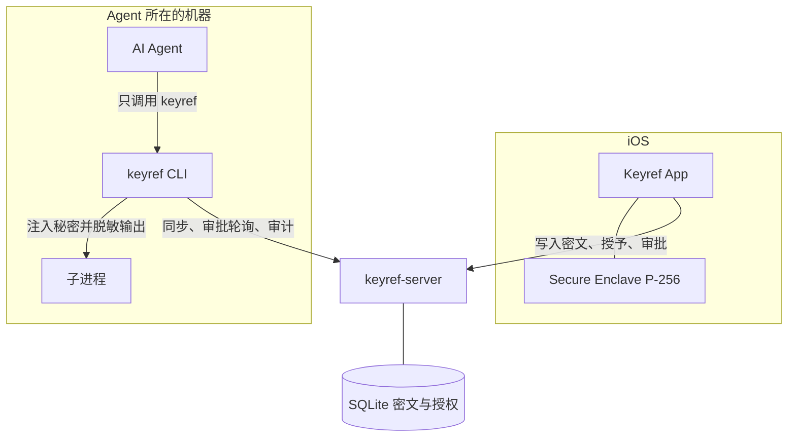
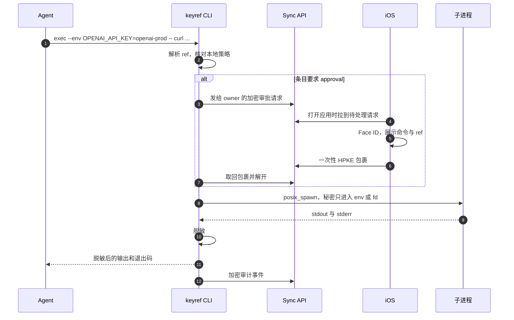
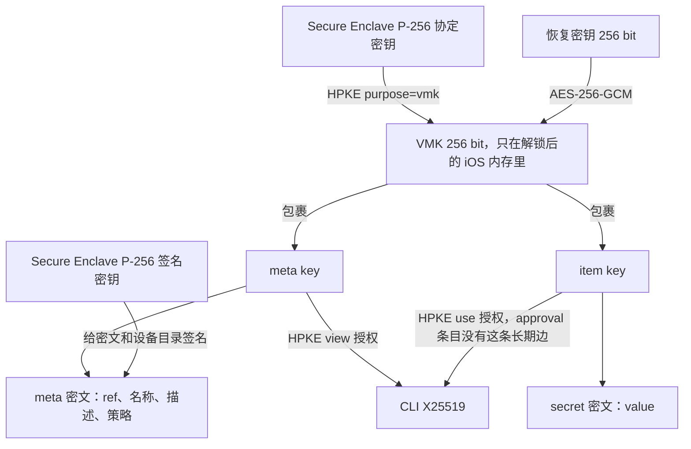

# keyref 设计文档

状态：草案 v0.2。本文是规格，不是实现记录。仓库里的 `ios/`、`cli/`、`server/` 还没有代码。

日期：2026-10-20。

v0.2：自托管是一等部署，和官方托管共用一份服务器。费用模型按「免费档有硬顶、付费档净收入高于边际成本」来写，避免托管亏钱。

本文用中文写。命令、字段、算法、路径和代码标识保持英文，例如 `keyref exec`、`VMK`、`{{keyref:openai-prod}}`。

## 决策摘要

这些决定是后面几节的结论，放在前面方便对照。标成「待确认」的条目在文末「开放问题」里，不阻塞把文档当成默认规格来读。

| 主题 | 决定 |
| --- | --- |
| 产品边界 | 人用 iOS 管理秘密。Agent 只用 CLI。CLI 的输出里没有明文 |
| 编辑权 | MVP 里只有 iOS owner 能创建、修改、删除、轮换。CLI 只读 |
| 引用 | 每个条目有稳定的 `ref`（例如 `openai-prod`）。占位符是 `{{keyref:REF}}`，URI 形式 `keyref://REF` 与之等价 |
| 注入 | 优先 `--env`、stdin、额外 fd / 打开后即删除的临时文件。进程参数注入必须显式 `--allow-argv` |
| 执行 | CLI 直接 `posix_spawn` / `execve`，不经过 shell。`echo`、`env`、`sh` 等默认拒绝 |
| 敏感条目 | `sensitivity = approval` 的条目不给 CLI 长期条目密钥。每次 `exec` 由手机批准后下发一次性包裹 |
| 元数据 | 名称、描述、`ref`、策略、秘密值全部加密。服务器只看见 id、版本、密文、设备授权图。托管部署另外看见配额档位 |
| 密码学 | AES-256-GCM 做数据加密；HPKE（RFC 9180）做密钥包裹；Secure Enclave 用 P-256；CLI 用 X25519 + Ed25519；恢复口令用 Argon2id |
| 存储与部署 | 一份 Go 服务器 + 嵌入式 SQLite。官方托管和自托管是同一二进制、同一协议。客户端默认连官方托管，也可以改服务器 URL |
| 技术栈 | iOS：Swift / SwiftUI。CLI：Rust。服务器：Go |
| 身份 | MVP 没有邮箱账号。保险库由第一台 iPhone 创建，恢复靠高熵恢复密钥 |
| 费用 | 托管按一台小机器的固定月租规划。免费档有硬配额。Plus 的推荐标价是 $6/月或 $48/年，按苹果抽成 30% 的压力情形仍然高于边际成本。自托管免费、不校验收据 |
| 待确认 | 默认要不要每次审批、MVP 要不要沙箱、要不要 MCP、Windows、团队共享、标价与付款渠道、官方域名 |

## 1. 背景

把 API key 交给 AI agent 时，常见做法是写进环境变量、项目配置或对话。模型随后能在上下文里看见明文，也可能把明文写进日志、工单、另一个文件，或在下一步命令里打印出来。

keyref 把两件事分开：

1. **使用**：被授权的命令可以拿到秘密（否则密钥没有意义）。
2. **看见**：规划命令的 agent 只接触 `ref`、名称、描述和掩码。工具返回给模型的字节流里，秘密已经被替换掉。

人的管理界面在 iOS 上。手机持有主密钥，并用 Face ID 控制主密钥的解包。CLI 是跑在 agent 那台机器上的经纪人：它能解自己被授权的条目，但协议上没有「把明文打出来」这条命令。

这不是另一套 1Password `op run`。`op run` 信任即将执行的命令。keyref 信任的是人在手机上设过的策略，以及「agent 的工具面只有 keyref」这条集成约束。命令本身是模型写的，默认不可信。

## 2. 目标与非目标

### 2.1 目标

- 人可以创建、查看、修改、删除、轮换 API key、token、密码和笔记。
- 每个条目有人类可读的名称、描述，以及保险库内唯一的稳定 `ref`。
- iOS 用 Face ID 解锁，主密钥材料的包裹密钥在 Secure Enclave 里。
- 人可以在手机上批准或撤销一台 CLI 设备，并选择这台设备能使用哪些条目。
- Agent 可以 `list` / `get` 看到掩码，不能看到明文。
- Agent 可以用 `exec` 跑自己本来要跑的命令，把 `ref` 放在秘密原来的位置。
- `exec` 会脱敏子进程的 stdout 和 stderr，包括常见编码。
- 交互式程序可以走 pty，密码可以从 keyref 写进子进程的输入，而不是写进 agent 的上下文。
- 同步服务器在端到端加密之外只保存密文。官方托管和自托管用同一套协议，服务器在两种部署里都不可信。
- iOS 和 CLI 可以指向任意服务器 URL。什么都不改时，连官方托管。
- 每一次 `exec` 都有审计记录，且审计正文对服务器是密文。

### 2.2 非目标

- 不把「主机已被同一用户完全控制」做成可防的场景。调试器、内存转储、恶意动态链接器不在保护范围内。见第 4 节。
- MVP 不做团队保险库、多主人同时编辑、浏览器扩展、Android、Windows。
- MVP 不托管 SSH 私钥文件、大附件或 OTP 种子。条目值是有长度上限的字符串（64 KiB 以内）。
- 不做服务端全文搜索。名称是加密的，搜索在已解锁的客户端本地进行。
- 不替换公司现有的 KMS。keyref 管的是「人自己的、要交给 agent 用的」那一类秘密。
- 不保证恶意但已被人批准的命令不会把秘密发到网络上。命令若真的需要秘密，它就有能力把秘密传走。策略和审批用来把这个决定留给手机前的人。
- 自托管不做集群、控制面或许可服务器。一台机器上的一个进程就是完整的服务器。
- 托管不做按量超售：超额就拒绝，不另开一张随用量长大的账单。

## 3. 角色

| 角色 | 是谁 | 持有什么 |
| --- | --- | --- |
| Owner | 使用 iOS 应用的人 | Secure Enclave 密钥、解锁后的 VMK、全部条目 |
| Agent | 写命令的模型，以及调用工具的 harness | `ref`、掩码、已脱敏的命令输出 |
| CLI 设备 | 装在 agent 机器上的 `keyref` 进程 | 自己的 X25519 / Ed25519 私钥；被授权条目的密钥 |
| 同步服务 | 官方托管或用户自己运行的 `keyref-server` | 密文、设备公钥、授权关系、会话令牌哈希、配额计数 |
| 子进程 | `exec` 真正启动的程序，例如 `curl` | 这一次被注入的秘密 |

Owner 设备是 `kind = ios`。Agent 设备是 `kind = cli`。只有 owner 设备会拿到 VMK 的包裹。

## 4. 威胁模型

### 4.1 要挡住的对手

| ID | 对手 | 我们要的结果 |
| --- | --- | --- |
| A1 | 网络窃听者 | TLS 之外仍然只能看到密文。窃听同步流量得不到秘密 |
| A2 | 被入侵的同步服务运营方，或被迫交出数据库的人 | 有全部密文、授权图、时间戳，没有密钥就解不开。不能伪造 owner 的签名来通过诚实客户端的校验 |
| A3 | 会写命令的 agent，工具结果会回到模型上下文 | `list` / `get` / `exec` 的回传里没有明文，也没有明文的常见编码 |
| A4 | 试图用 `exec` 做外泄的 agent：`echo`、`env`、`base64`、启动 shell、把值写进文件再读 | 默认策略拒绝这些命令。秘密不进 shell 历史。默认不进进程参数 |
| A5 | 偷到上锁 iPhone 的人 | 没有 Face ID / 密码就解不开 Secure Enclave 里的包裹 |
| A6 | 偷到服务器备份、但没有手机也没有恢复密钥的人 | 与 A2 相同 |
| A7 | 把用户骗去扫别人的配对二维码 | 配对码要在手机和终端两边对得上；授予范围默认是空的，要人逐条勾选 |

### 4.2 明确不承诺挡住的情况

这些不是「以后再修的 bug」，而是这个架构接受的边界。产品文案和集成文档都要写清楚。

| ID | 情况 | 原因 |
| --- | --- | --- |
| B1 | 跑 CLI 的主机被完全控制：root、调试器、`ptrace`、内存转储、`DYLD_INSERT_LIBRARIES` / `LD_PRELOAD` 打进 `keyref` 自己 | 注入秘密的进程自己能读到秘密。没有任何用户态经纪人能在这个前提下保密 |
| B2 | Agent 的 harness 除了 `keyref` 之外还有一个通用 shell，并且可以和 `exec` 同时观察这台机器 | 同一用户可以读 `/proc/<pid>/environ`、`ps e`、子进程写出来的文件。脱敏只覆盖 keyref 自己转发的那条输出 |
| B3 | 人在手机上批准了一个会把秘密发走的命令，或条目策略允许了这个命令和主机 | 被授权的程序本来就要使用秘密 |
| B4 | 攻击者拿着已解锁的手机，或能通过当时的 Face ID | 这就是主人 |
| B5 | 恢复密钥已经泄露 | 恢复密钥等价于 VMK 的副本 |
| B6 | 已经解开过条目密钥的 CLI 副本，在撤销之后继续使用本地缓存，并且二进制被改掉、不再遵守过期时间 | 撤销要配合轮换条目密钥。只删服务器上的授权，挡不住已经拷走的密钥 |
| B7 | 操作系统或 Secure Enclave 自身被攻破 | 超出应用层设计 |
| B8 | 秘密很短，或被拆成几段分别打印，脱敏无法靠整串匹配发现 | 靠拒绝 shell 和解释器来缩小这个口子，不靠脱敏器万能 |

### 4.3 集成要求

这条要求和密码学同样重要：

> Agent 的工具白名单里只放 `keyref`（以后可以是 `keyref mcp`）。不要再给同一个 agent 一个原始 shell，也不要把 `ps`、环境变量转储或 core dump 喂回模型。

做不到这一点时，keyref 仍然能避免秘密进入「keyref 这个工具的返回值」，但不能阻止模型用另一个工具去读进程环境。第 7 节的沙箱是 Phase 3 的补强，不是 Phase 1 的前提。

### 4.4 失败时的方向

解不开、策略不通过、审批超时、脱敏器出错：命令不启动，或者已经启动的子进程被杀掉，并且 **不把原始输出交给调用方**。错误信息里可以有 `ref`，不能有秘密的任何片段。

## 5. 架构



人在手机上编辑条目。应用用 VMK 包裹每条的密钥，用条目密钥加密内容，用 Secure Enclave 签名。密文上传到同步服务。

CLI 配对之后，只同步自己被授予的条目。它在本地解开这些密钥，执行命令，把审计事件加密给 owner 的公钥再上传。

审批路径不走持久授权。CLI 把「将要执行的命令」（仍然是 `ref`，不是秘密）加密给 iPhone。人在手机上同意之后，iOS 用 CLI 的公钥做一次一次性 HPKE 包裹。CLI 取回、使用、从内存清掉。服务器看不到包裹里的密钥。



MVP 的在线方式是短请求。CLI 在等待审批时每 2 秒轮询一次，不占住长连接。手机在 Phase 2 用 APNs 获知新请求；Phase 1 可以在应用打开时轮询。服务器是单个 SQLite 进程，短请求好限流，也不需要为了审批做 WebSocket。轮询计入该保险库的每日请求配额，间隔短于 2 秒的请求直接拒绝。

## 6. 数据模型

### 6.1 条目在加密之前的样子

一条逻辑条目拆成两份明文，用两把不同的密钥加密。这样「可以看见名称」和「可以使用秘密」能分开授予。

Meta（由 meta key 加密）：

```json
{
  "v": 1,
  "ref": "openai-prod",
  "name": "OpenAI 生产密钥",
  "description": "文档代理用来调用模型",
  "type": "api_key",
  "masked": "sk-****abcd",
  "injectable": true,
  "policy": {
    "sensitivity": "standard",
    "commandPolicy": "deny-shells",
    "allowCommands": [],
    "allowedHosts": ["api.openai.com"],
    "allowArgv": false
  }
}
```

Secret（由 item key 加密）：

```json
{
  "v": 1,
  "value": "sk-example",
  "username": "",
  "notes": "",
  "fields": {}
}
```

`type` 取 `api_key`、`token`、`password`、`note`、`generic`。

- `note` 的 `injectable` 默认是 `false`。CLI 拒绝把笔记注入命令，直到人在手机上打开。
- `password` 和 `note` 的 `masked` 永远是 `***`。口令通常更短，末几位本身就能用。
- `api_key` 和 `token` 按最长前缀匹配：`github_pat_`、`sk-proj-`、`sk-ant-`、`glpat-`、`xoxb-`、`xoxp-`、`xoxa-`、`ghp_`、`gho_`、`sk-`、`AKIA`。总长度至少比前缀多 8 个字符时，`masked` 保留前缀和末四位，例如 `sk-****abcd`。否则是 `***`。
- `masked` 由 iOS 在保存时算好，放进 meta。`list` 和 `get` 只解 meta，不碰 secret。这样 `approval` 条目（CLI 只有 view 授权）也能显示 `sk-****abcd`，同时 `list` 这条更容易写错的路径上根本没有明文。
- 代价是：任何拿到 view 授权的 agent 都能看见 API key 的前缀和末四位。这是有意接受的小泄露。若要关掉，把 `masked` 固定成 `***` 即可，协议不用改。

`ref` 的语法：`^[a-z][a-z0-9-]{0,62}[a-z0-9]$`，或者单字符 `[a-z]`。在一个保险库里唯一。MVP 里创建之后不可改。改名会悄悄打断已经写进脚本和对话里的引用，所以留到以后单独立项，并要求人显式确认。

`sensitivity`：

| 值 | CLI 平时拿到的密钥 | `exec` 时 |
| --- | --- | --- |
| `standard` | meta key 和 item key 的长期包裹 | 配对完成且策略通过即可运行，不必每次按手机 |
| `approval` | 只有 meta key | 每次执行向手机要一次性 item key |

无人值守的 agent 用 `standard`。生产密钥、邮箱密码、云账号根密钥建议用 `approval`。默认值见开放问题；设计里的推荐默认是 `standard` 加上 `deny-shells`，避免产品第一天就无法无人使用。

### 6.2 标识

- `vault_id`、`device_id`、`item_id`、`approval_id`：16 字节随机数，编码为小写 hex。不用自增整数，避免把创建顺序以外的业务含义编码进去（创建顺序本来就会被时间戳暴露）。
- `ref` 是给人看的稳定名字，不是主键。它在密文里。
- 服务器上的 `revision` 是该条目的单调整数，从 1 开始，由 owner 签名覆盖。客户端拒绝比本地已见版本更小的 revision。

### 6.3 服务器上看见的表

数据库是一个 SQLite 文件。官方托管和自托管用同一份 schema、同一份迁移。时间用 Unix 毫秒。二进制列存原始字节。

```sql
CREATE TABLE vaults (
  vault_id            TEXT PRIMARY KEY,
  created_at          INTEGER NOT NULL,
  recovery_wrap       BLOB,
  recovery_kdf_json   TEXT,
  directory_revision  INTEGER NOT NULL,
  directory_signed    BLOB NOT NULL,
  plan                TEXT NOT NULL DEFAULT 'unlimited', -- free | plus | unlimited
  plan_expires_at     INTEGER
);

CREATE TABLE devices (
  device_id       TEXT PRIMARY KEY,
  vault_id        TEXT NOT NULL,
  kind            TEXT NOT NULL, -- ios | cli
  status          TEXT NOT NULL, -- pending | active | revoked
  hpke_kem        TEXT NOT NULL, -- P-256 | X25519
  hpke_public_key BLOB NOT NULL,
  sign_alg        TEXT NOT NULL, -- ecdsa-p256 | ed25519
  sign_public_key BLOB NOT NULL,
  label           TEXT NOT NULL,
  created_at      INTEGER NOT NULL,
  revoked_at      INTEGER
);

CREATE TABLE items (
  vault_id                 TEXT NOT NULL,
  item_id                  TEXT NOT NULL,
  revision                 INTEGER NOT NULL,
  tombstone                INTEGER NOT NULL,
  meta_ciphertext          BLOB,
  secret_ciphertext        BLOB,
  vault_wrapped_meta_key   BLOB,
  vault_wrapped_item_key   BLOB,
  writer_device_id         TEXT NOT NULL,
  signature                BLOB NOT NULL,
  updated_at               INTEGER NOT NULL,
  PRIMARY KEY (vault_id, item_id)
);

CREATE TABLE grants (
  vault_id    TEXT NOT NULL,
  device_id   TEXT NOT NULL,
  item_id     TEXT NOT NULL,
  kind        TEXT NOT NULL, -- view | use
  hpke_enc    BLOB NOT NULL,
  wrapped_key BLOB NOT NULL,
  expires_at  INTEGER,
  signature   BLOB NOT NULL,
  PRIMARY KEY (vault_id, device_id, item_id, kind)
);

CREATE TABLE approvals (
  approval_id          TEXT PRIMARY KEY,
  vault_id             TEXT NOT NULL,
  cli_device_id        TEXT NOT NULL,
  item_id              TEXT NOT NULL,
  request_ciphertext   BLOB NOT NULL,
  status               TEXT NOT NULL, -- pending | approved | denied | expired | consumed
  one_time_wrap        BLOB,
  expires_at           INTEGER NOT NULL,
  created_at           INTEGER NOT NULL
);

CREATE TABLE audit_events (
  vault_id    TEXT NOT NULL,
  seq         INTEGER NOT NULL,
  device_id   TEXT NOT NULL,
  created_at  INTEGER NOT NULL,
  ciphertext  BLOB NOT NULL,
  PRIMARY KEY (vault_id, seq)
);

CREATE TABLE changes (
  seq        INTEGER PRIMARY KEY AUTOINCREMENT,
  vault_id   TEXT NOT NULL,
  entity     TEXT NOT NULL,
  entity_id  TEXT NOT NULL,
  created_at INTEGER NOT NULL
);

CREATE TABLE sessions (
  token_hash TEXT PRIMARY KEY,
  device_id  TEXT NOT NULL,
  expires_at INTEGER NOT NULL
);

CREATE TABLE usage_daily (
  vault_id TEXT NOT NULL,
  day      TEXT NOT NULL, -- UTC YYYY-MM-DD
  requests INTEGER NOT NULL,
  PRIMARY KEY (vault_id, day)
);

CREATE TABLE pair_sessions (
  nonce_hash  TEXT PRIMARY KEY,
  hpke_public_key BLOB NOT NULL,
  sign_public_key BLOB NOT NULL,
  proposed_name   TEXT NOT NULL,
  expires_at      INTEGER NOT NULL,
  consumed_at     INTEGER
);
```

`vault_wrapped_*` 是用 VMK 包起来的 meta key / item key，给 owner 的其他设备用。它们是密文，服务器解不开。新 iPhone 只要拿到 VMK（恢复密钥或旧手机配对），就能解开全部条目。

`grants.kind = view` 包裹的是 meta key。`kind = use` 包裹的是 item key。`approval` 条目只有 `view`，没有长期的 `use`。

`directory_signed` 是 owner 签过名的当前有效设备名单和 `directory_revision`。客户端用它判断撤销是否生效。诚实的服务器只负责递送这份签名。

索引至少要有：`changes(vault_id, seq)`、`grants(vault_id, device_id)`、`devices(vault_id, status)`。这台机器只有一个 SQLite 写连接，慢查询会挡住别人，所以上面的查询都要打在索引上。

`plan` 和 `usage_daily` 是部署策略，不是密码学状态。自托管默认 `plan = unlimited`，不读取付费字段。官方托管在创建保险库时写成 `free`，付费成功后再写成 `plus`。客户端不能靠改这个字段给自己升级：托管进程忽略客户端传来的 `plan`。

### 6.4 明文元数据与密文的边界

服务器可以看见，因为没有这些就无法路由：

- `vault_id`、`device_id`、`item_id`、`revision`、tombstone 标记
- 设备种类、状态、公钥、算法标识
- 哪台设备被授予了哪个 `item_id`（授权图）
- 审批单的状态和过期时间
- 密文长度、服务器收到的时间
- 设备的 `label`（来自配对时 CLI 自报的名字，最多 32 字节，owner 可以改）。它是明文，方便在另一台设备的列表里显示「哪一台」。想隐藏机器名字时再把它挪进加密目录，MVP 不这么做
- 托管部署上的 `plan`、到期时间和每日请求计数。这是配额，不是秘密。自托管不使用这些字段做访问控制

服务器看不见：

- `ref`、名称、描述、`type`、策略细节
- 秘密值、用户名、笔记
- 审批请求里的命令行（整段加密给 iPhone）
- 审计事件正文
- VMK、meta key、item key 的明文

授权图会泄露「这台 CLI 能碰 12 个条目」。这是为了让服务器可以只下发该设备的行，而不是把整个保险库的密文都给每一台 CLI。这个泄露是接受的。条目内容仍然是密文。

### 6.5 客户端本地状态

CLI 目录权限 `0700`：

| 位置 | 内容 |
| --- | --- |
| 操作系统密钥环 | CLI 的 X25519 私钥、Ed25519 私钥 |
| `cache.sqlite` 模式 `0600` | 服务器来的密文、revision、已验证的签名。不是明文 |
| 进程内存 | 解开的 meta key / item key。`mlock` 尽力锁页，退出和 `lock` 时 `zeroize` |
| 不落盘 | 解开后的秘密值、子进程环境块、fd 模板渲染结果 |

缓存里的对象本来就是端到端密文，所以不再做第二层加密。同机其他 Unix 用户靠目录权限挡住。同一用户的恶意程序能读到密文，这落在 B1/B2。

会话：密钥环里的设备私钥在机器登录态里可用。解开的 item key 在内存里默认保留 8 小时，超时后用密钥环里的私钥对本地缓存的包裹重新解开，不必再扫一次二维码。`keyref lock` 立刻清内存。`standard` 条目因此可以无人值守。`approval` 条目没有可重解的本地 item key。解开 item key 不等于把 secret 明文放进内存：明文只在单次 `exec` 的注入和脱敏期间存在，这次执行结束就清掉。

离线：缓存里已有的 `use` 授权可以离线 `exec`。过期时间由诚实的 CLI 执行。需要新的一次性密钥时必须在线。

## 7. 引用语法与 exec

### 7.1 人写在命令里的形式

canonical 占位符：

```text
{{keyref:openai-prod}}
```

等价的 URI，便于写进只接受 URL 的配置说明里：

```text
keyref://openai-prod
```

不支持在占位符里做编码变换（没有 `{{keyref:openai-prod | base64}}`）。变换是外泄通道，也让脱敏更难。

三种调用方式，按推荐顺序：

```bash
# 1. 环境变量。参数里没有秘密。适合自己读 env 的程序。
keyref exec --env OPENAI_API_KEY=openai-prod -- \
  openai api models.list

# 2. 额外的文件描述符。适合 curl 这种不会自己读 env 的程序。
keyref exec \
  --fd 3=openai-prod \
  --fd-template 'header "Authorization: Bearer {{keyref}}"' -- \
  curl --config /dev/fd/3 https://api.openai.com/v1/models

# 3. 标准输入就是秘密，然后关闭 stdin。
keyref exec --stdin github-pat -- \
  gh auth login --with-token
```

`--` 后面是 argv，原样交给子进程。keyref 不启动 `sh -c`。因此 argv 里的 `$OPENAI_API_KEY` **不会**被 shell 展开。需要秘密出现在参数里时，必须写成占位符并加上 `--allow-argv`：

```bash
keyref exec --allow-argv -- \
  mytool --token '{{keyref:openai-prod}}'
```

这个模式会在审计里标成 argv 注入。`ps` 和 macOS 的 Activity Monitor 能看到参数。文档和 CLI 的 stderr 提示都要说明这件事。stderr 提示本身不能打出秘密。

`--fd-template` 只允许一个记号 `{{keyref}}`，表示该 fd 绑定的那一条秘密。模板由 keyref 在内存里渲染，写入 fd。子进程的 argv 里只有 `/dev/fd/3` 这样的路径。

fd 的落地方式：

1. 优先 `memfd` 或 `O_TMPFILE`。
2. 否则在 `0700` 目录里 `open(O_CREAT|O_EXCL, 0600)`，写入后立刻 `unlink`，再把仍然打开的 fd 传给子进程。路径消失，`/tmp` 里不会留下一个给后续命令读的文件名。
3. macOS 用 `/dev/fd/N`。实现时要在目标系统上确认 `posix_spawn` 的 file action 能把这个 fd 交给子进程。

stdin 的默认行为是：写入秘密，需要的话补一个换行，然后关闭写端。不把 agent 的 stdin 拼在秘密后面。需要先写秘密再转发调用方 stdin 时，用单独的 `--stdin-then-proxy`，并且审计里记录这个选择。

pty：

```bash
keyref exec --pty \
  --reply 'Password:=wifi-home' -- \
  some-login-tool
```

keyref 掌握 pty 主端。子进程的输出先过脱敏器，再交给 agent。`--reply` 的正则若匹配到**已脱敏前**的输出，keyref 把对应秘密写进 pty 输入，就像有人在键盘上输入。正则由 agent 提供，恶意程序可以打印 `Password:` 来触发写入。因此 `--reply` 只允许用在该条目的 `allowCommands` 明确包含这个 argv0 的时候，并且条目建议设为 `approval`。Phase 1 可以先不做 `--pty` / `--reply`，把接口定在这里。

### 7.2 启动子进程时的环境

子进程不继承 CLI 的全部环境。keyref 构造一份新环境：

- 保留一份短名单：`PATH`、`HOME`、`USER`、`LOGNAME`、`LANG`、`LC_ALL`、`TERM`、`TMPDIR`
- 丢掉 `LD_PRELOAD`、`LD_LIBRARY_PATH`、`DYLD_INSERT_LIBRARIES`、`DYLD_LIBRARY_PATH` 以及其他 `DYLD_*` / `LD_*`
- 加上本次 `--env` 指定的变量

同时设置 `RLIMIT_CORE = 0`。在 Linux 上于子进程里尝试 `PR_SET_DUMPABLE = 0`，并在实现时验证 `execve` 之后标志是否还在。不要在文档里把它写成已经封死 `/proc/<pid>/environ`。同一用户的 `procfs` 可读性是 B2，靠集成约束和以后的沙箱处理。

### 7.3 默认拒绝的命令

`commandPolicy = deny-shells` 时，argv0 的 basename（大小写不敏感）落在下面的集合里就拒绝执行：

```text
sh bash zsh dash fish ksh csh tcsh busybox
env printenv
echo printf
cat tee dd od xxd hexdump base64 base32
openssl
python python2 python3 node nodejs deno bun perl ruby php lua
osascript socat
```

拒绝时退出码 `10`，说明是策略拒绝，并提示要在 iOS 里修改该条目的 `allowCommands`。错误文本里不回显秘密。

`allowCommands` 非空时，它变成白名单：argv0 必须命中其中一项。白名单里的名字可以覆盖上面的默认拒绝。覆盖默认拒绝时，iOS 保存前提示风险。解释器一旦被允许，模型就可以用它把秘密切片打印，脱敏器会失明。所以对 `python`、`node`、`sh` 的显式允许应该和 `sensitivity = approval` 一起用。

`allowedHosts` 为空表示 MVP **不做**主机检查。不要把空列表解释成「禁止所有网络」。非空时，CLI 扫描 argv 里的 `http://` 和 `https://`，主机名必须与列表完全一致（不接受后缀匹配，`api.openai.com.evil.example` 不能通过 `api.openai.com`）。这是尽力而为：

- IP 字面量、DNS 重绑定、HTTP 重定向、程序自己拼出来的 URL，静态扫描都看不见
- `curl` 默认跟随重定向，允许的主机可以把秘密 302 到别处

真正能约束出口的是 Phase 3 的沙箱加本地代理。在那之前，UI 上把主机列表叫「参数检查」，不要叫「网络隔离」。

### 7.4 脱敏

脱敏发生在 CLI 把子进程输出转交给调用方之前，覆盖 stdout、stderr 和 pty 输出。

对每一个本次注入过的秘密值（长度至少 8；更短的值仍然尝试匹配，但短值误伤和漏检都更严重，创建密码时 UI 可以警告过短）：

- 原始字节
- Base64 与 Base64 去掉填充
- Base64url 与去掉填充
- 小写 hex、大写 hex
- RFC 3986 percent-encoding
- 跨 read 缓冲区的切分：保留 `len(secret) * 2` 量级的重叠窗口，具体常数在实现里按最长编码（hex 是 2 倍）来定

替换文本是固定的 ASCII：

```text
<redacted:openai-prod>
```

不用会让终端或 JSON 解析更麻烦的符号。替换文本本身如果偶然出现在正常输出里，可能被再次看到，这可以接受。

脱敏器内部出错时，杀掉子进程，丢弃已经读到的缓冲区，向调用方返回退出码 `14` 和一条不含输出片段的错误。不要「尽量输出」。

不做的事情，避免给人错误的安全感：

- 不检测任意切片、反转、ROT13、插空格
- 不检测秘密被写进子进程打开的文件
- 不检测子进程发出的网络流量

这些缺口用拒绝解释器、审批和 Phase 3 沙箱来收，不靠输出过滤器。

### 7.5 泄漏路径

| 路径 | MVP 的处理 |
| --- | --- |
| 模型上下文 / 工具返回值 | `list` 与 `get` 没有 value 字段。`exec` 输出先脱敏 |
| Shell 历史 | 不经过 shell。人自己敲的 `keyref exec ...` 历史里只有 `ref` |
| `ps` 的 argv | 默认不把秘密放进 argv。`--allow-argv` 明确接受这个泄露 |
| `/proc/<pid>/environ`、macOS `ps e` | 与 argv 相比，环境变量不会被系统里所有用户在进程列表里看到，但同一用户可以读。这是 B2。文档把 env 排在 argv 前面，是因为暴露面更窄，不是因为 agent 读不到 |
| 临时文件 | 0600、目录 0700、写入后 unlink |
| 子进程把秘密写到磁盘，后续命令再读 | 默认拒绝 `cat` / shell。若 harness 另有 shell，则属于 B2 |
| `exec -- echo {{keyref:x}}` 或 `exec -- env` | 默认拒绝 |
| CLI 日志、崩溃转储 | 不记录解开的值。关闭 core dump。密钥缓冲区 zeroize |
| 交换分区 | 对密钥页 `mlock`，失败只记调试计数，不把秘密写进日志 |
| 审批界面被模型骗 | 手机上展示的是 argv 原文、`ref`、条目名称、注入方式。人看到的是 `curl https://evil.example`，不是一个已经被替换成密钥的字符串 |
| 服务器篡改密文或回滚 | owner 签名 + 客户端保存的最高 revision。服务器可以拒绝服务，不能让诚实客户端接受伪造条目 |
| 撤销后离线使用 | 见 B6。撤销 UI 的默认动作是轮换受影响条目的 item key |

### 7.6 退出码

| 码 | 含义 |
| --- | --- |
| 子进程自身的码 | 策略已通过并且脱敏完成 |
| 10 | 策略拒绝，子进程没有启动 |
| 11 | 未知 `ref`，或此设备没有 view 授权 |
| 12 | 本地会话锁着，密钥环里没有可用的设备私钥 |
| 13 | 审批被拒绝或超时 |
| 14 | 脱敏失败，原始输出已丢弃 |

`keyref get` 在没有这条 `ref` 时也用 `11`。

### 7.7 审计

每一次尝试都记一条，包括被拒绝的尝试。正文加密给当前 owner 设备的 HPKE 公钥（多台 iPhone 时，随机一个事件密钥，分别 HPKE 给每台 owner）。CLI 自己不保留可解密的副本。

事件明文里有：时间、`device_id`、`ref` 列表、注入方式、argv（占位符形式，不是替换后的秘密）、是否 `--allow-argv`、策略结果、审批结果、子进程退出码、脱敏替换次数。没有秘密值。

服务器只看见 `vault_id`、`seq`、`device_id`、时间和密文。iOS 解密后按时间展示。过期的审计由服务器删除，不另做归档：免费档保留 7 天且最多 100 条，Plus 保留 30 天且最多 5,000 条。自托管默认不删，除非运行的人自己设了保留期。费用上的理由见第 10 节。

## 8. 配对、会话与审批

### 8.1 配对

CLI 没有摄像头，所以二维码由 CLI 显示，iPhone 来扫。

1. `keyref pair` 在本地生成 X25519（HPKE）和 Ed25519（签名）密钥，私钥写入密钥环。
2. 终端打印二维码，内容是 `keyref://pair?v=1&k=...&s=...&n=...&name=...&u=...`。`u` 是这台 CLI 正在使用的服务器 origin，例如 `https://sync.example` 或 `https://keys.example.com`。origin 用 HTTPS。终端同时用文字印出 origin 和指纹，扫不出来时人还能核对。指纹是 CLI 签名公钥 SHA-256 的前 8 字节，显示为 `A1B2-C3D4-E5F6-7890`。
3. CLI 用私钥签 nonce，向服务器登记一个 10 分钟有效的 `pair_sessions` 行，并开始轮询。
4. iOS 扫描后展示指纹、对方自报的名字、服务器 origin，以及**默认不勾选**的条目列表。origin 和手机当前的服务器不一致时，先请人确认「密文将同步到这个域名」，确认后手机才改自己的服务器 URL。人点名要授予的条目，再用 Face ID 确认。恶意二维码可以把 origin 指到别人的服务器；端到端加密让对方读不到秘密，但授权图和密文会送到那里，所以这一步不能静默跳过。
5. iOS 用 Secure Enclave 签名配对誊本：`nonce`、双方公钥、`vault_id`、新 `device_id`、授予列表。
6. 服务器核对 nonce 未使用、CLI 的登记公钥与签名一致，然后写入 `devices` 和 `grants`。
7. CLI 取回结果，验证 iOS 的签名，把 iOS 签名公钥钉死在本地配置里。之后所有授予和设备目录更新都必须由这把已钉死的 owner 密钥，或目录里后来增加并被它签名接纳的 owner 密钥签署。

恶意服务器没有 Secure Enclave 的签名，不能自己完成配对。用户仍须核对两边的指纹，避免自己扫到旁边屏幕上的二维码。授予默认是空集，扫码成功不会自动交出所有密钥。

配对不建立邮箱账号。`vault_id` 是随机的，保存在 iPhone 的 Keychain 里（`ThisDeviceOnly`）。

### 8.2 会话令牌

设备用签名私钥签服务器挑战，换一个随机 bearer token，有效期 12 小时，可重新签名续期。数据库里只存 `SHA-256(token)`。

这个令牌被偷走的后果是：攻击者能替这台设备拉取 **它已被授予的密文**、提交审计、发起审批。攻击者解不开密文，除非同时拿走到 CLI 的私钥。所以令牌和密钥环是两层。CLI 发现本地设备被目录撤销后，删除本地包裹和缓存。

### 8.3 审批

`approval` 条目的一次执行：

1. CLI 生成一次性 X25519 密钥（可以复用设备长期密钥；更稳妥的是每条审批一把临时密钥，用完丢掉私钥）。推荐临时密钥，缩小手机误批之后的窗口。
2. 请求正文（argv、`ref`、注入模式、主机名、临时公钥）HPKE 给 owner。
3. iOS 展示解密后的命令。Face ID 通过后，用临时公钥包裹这一条的 item key，`expires_at` 为 60 秒，`status = approved`。
4. CLI 取走包裹。服务器把该行标成 `consumed` 并清掉包裹字节。
5. CLI 在这一次 `exec` 结束后 zeroize item key。

超时默认 2 分钟，然后 CLI 以退出码 `13` 结束。人拒绝同样是 `13`。

Phase 1 如果还没有推送，iOS 在前台轮询 `GET /v1/approvals?status=pending`。这够用来打通协议。Phase 2 再接 APNs。APNs 和把 App 分发给别人都需要 Apple Developer Program（$99/年）。这笔钱算进第 10 节的固定成本。协议本身不依赖它：Phase 1 在自己的手机上调试可以先不付。

### 8.4 授予的有效期与撤销

`use` 授予默认 30 天到期。iOS 在设备仍处于有效目录里、并且手机解锁联网时，于到期前重新包裹并顺延。手机连续 30 天没有回来续期的话，诚实的 CLI 会停用这些授予。诚实的 CLI 在 `expires_at` 之后停止使用本地 item key，即使它错过了撤销同步。被改过的 CLI 会忽略这个时间，所以过期不能代替轮换。

iOS 上撤销一台 CLI 的默认动作：

1. 签一份新的设备目录，该设备 `status = revoked`。
2. 删除它的 grants。
3. **轮换**它曾经拥有 `use` 授权的每条 item key：新密钥、用新密钥重加密 secret、重新包裹给剩余设备。meta 若没有泄露可以不轮换。
4. 被撤设备下次同步收到 tombstone 和新目录。已经拷走旧 item key 的攻击者解不开新的 secret 密文。

「只撤销、不轮换」放在二级确认后面，用于确认设备只是停用、密钥并没有离开那台机器的时候。UI 要写明 B6。

VMK 轮换是稀有操作：重新包裹全部 meta key 和 item key，条目密文可以不动。怀疑恢复密钥泄露时必须轮换 VMK，并作废旧的 `recovery_wrap`。

## 9. 密码学

### 9.1 原则

只组合公开算法，不发明新的原语。实现时用各自平台上维护中的库（Apple CryptoKit / swift-crypto、Rust 的 `hpke` 与 `aes-gcm`）。

| 用途 | 算法 |
| --- | --- |
| 条目 meta、secret、审计正文、审批正文 | AES-256-GCM，12 字节随机 nonce |
| 把密钥包给另一台设备 | RFC 9180 HPKE base mode |
| 包给 iOS Secure Enclave | `DHKEM(P-256, HKDF-SHA256)` + `HKDF-SHA256` + `AES-256-GCM` |
| 包给 CLI | `DHKEM(X25519, HKDF-SHA256)` + `HKDF-SHA256` + `AES-256-GCM` |
| iOS 签名 | P-256 ECDSA，密钥在 Secure Enclave |
| CLI 签名 | Ed25519 |
| 从高熵恢复密钥派生 | HKDF-SHA256 |
| 可选的人类口令 | Argon2id |

选用 AES-256-GCM 而不是 XChaCha20-Poly1305，是因为 CryptoKit、WebCrypto、Go、Rust 都自带它，MVP 不必在 iOS 上再链一份 libsodium。nonce 风险在这个数据规模上不成立：一把 item key 加密一个版本的 secret，一把 VMK 为每个条目包裹两把密钥。随机 96 位 nonce 在远低于 2^32 次加密时碰撞可以忽略。约定：任何一把密钥的加密次数接近 2^32 之前就轮换。keyref 的条目尺寸到不了这个量级。若以后做大文件流式加密，那些对象再改用 XChaCha20-Poly1305，不回头改条目格式。

HPKE 的 `info` 做域分离，UTF-8 字符串，字段用 ASCII unit separator（`0x1f`）连接：

```text
keyref v1 <US> <purpose> <US> <vault_id> <US> <recipient_device_id>
```

`purpose` 取 `vmk`、`meta-key`、`item-key`、`one-time-item-key`、`audit-event-key`、`approval-request`。

条目密文的 AAD 用同一套分隔，避免拼接歧义：

```text
keyref v1 <US> secret <US> <vault_id> <US> <item_id> <US> <revision>
```

meta 密文把 `secret` 换成 `meta`。签名覆盖的誊本是字节串而不是 JSON，避开 JSON 规范化：

```text
KEYREF1 <NUL> item <NUL> <vault_id> <NUL> <item_id> <NUL>
<revision uint64 be> <NUL> <meta ciphertext> <NUL> <secret ciphertext> <NUL>
<vault_wrapped_meta_key> <NUL> <vault_wrapped_item_key> <NUL> <writer_device_id>
```

客户端在解密之前验签。服务器也可以验签，用来丢弃垃圾请求。客户端不能因为「服务器说验过了」就跳过自己的验证。

### 9.2 密钥层次



VMK 不到 CLI，也不到服务器。CLI 被妥协时，损失限于已经授予它的 `use` 条目，不是整个保险库。

Secure Enclave 只能生成和使用 NIST P-256，不能生成 X25519，也不能把已有的私钥导入隔区。所以 owner 的包裹和签名走 P-256。CLI 没有隔区，用软件里的 X25519 和 Ed25519，私钥放在操作系统密钥环。

HPKE 与 Secure Enclave 的衔接是实现期风险最高的一处：RFC 9180 的 DHKEM 私钥运算要和 `SecureEnclave.P256.KeyAgreement` 的 ECDH 结果对齐，再按 RFC 做 LabeledExtract / LabeledExpand。Phase 1 的第一项密码学任务是提交跨语言测试向量：Rust 包给 P-256 公钥的 VMK，Swift 用隔区私钥解开，以及反方向的条目密钥包裹。

若隔区私钥无法严格走完 DHKEM，退路是：Keychain 里存一把软件 P-256 私钥，访问控制设为「需要设备密码，且生物识别，`ThisDeviceOnly`」。Face ID 仍然在每次解 VMK 时出现。退路比隔区弱的地方是：解锁之后，被攻破的操作系统内核有机会导出这把软件私钥。退路必须在文档和代码里显式标注，不能静默替换。

### 9.3 创建保险库

1. 生成 VMK（32 字节，系统 CSPRNG）。
2. 生成 Secure Enclave 协定密钥和签名密钥，访问控制 `.biometryCurrentSet`（或等价的「当前生物特征集合」），并要求设备密码。
3. 用协定公钥 HPKE 包裹 VMK，密文放在本机 Keychain，`ThisDeviceOnly`，不进 iCloud 备份。隔区私钥本身也不能离开这台设备。
4. 生成 256 bit 恢复密钥，显示一次。编码用 Crockford Base32，分组，避免 0/O、1/I。用户抄到纸上或放进另一个已经信任的保险库。
5. `recovery_wrap = AES-256-GCM(HKDF(recovery_key), VMK)`，这份密文可以上传。服务器没有恢复密钥。不在服务器存恢复密钥的哈希，验证靠 AEAD tag。
6. 可选：再用一个 Argon2id 口令包一份 VMK。默认参数 `m = 64 MiB`、`t = 3`、`p = 1`、输出 32 字节、盐 16 字节。这是偶尔用于恢复的参数，不是每次解锁都跑的 KDF。实现时对照当时的 OWASP Password Storage Cheat Sheet，不得低于它的下限。解锁日常路径是生物识别，不是这个口令。

丢掉手机又丢掉恢复密钥，数据就没有了。UI 在创建结束前要求人确认已经记下恢复密钥。不做「客服帮你重置」，那会要求服务器能解密。

### 9.4 第二台 iPhone

两条路，MVP 可以只做恢复密钥这一条，旧手机配对放到 Phase 2：

- 在新手机输入恢复密钥，下载 `recovery_wrap` 和全部条目密文，解开 VMK，然后在新隔区里重新包裹一份 VMK。
- 或者旧手机扫新手机的二维码，Face ID 之后把 VMK HPKE 给新手机的 P-256 公钥。

两台 owner 都进入签名过的设备目录。条目写入仍然由任一 owner 发起；MVP 不解决两台手机同时离线编辑。冲突策略：revision 更大的签名版本获胜；revision 相同但密文不同则 iOS 把两边都显示出来让人处理。服务器不合并明文。

### 9.5 本地解锁

iOS 每次从后台进入前台，应用内存里没有 VMK 时，要求 Face ID，让隔区完成 ECDH，解开 VMK。自动锁定间隔建议默认 1 分钟进后台即锁定，具体秒数可以做成设置。VMK 和解开的条目只活在内存里。

CLI 侧没有 Face ID。`standard` 条目的无人值守依赖本机密钥环。这是有意的产品选择：要求每条命令都按手机，agent 就没法在人离开时工作。风险被限制在「这台已经被配对、并且被授予了这些 standard 条目的机器」。

## 10. 存储、部署与费用

### 10.1 服务要做什么

同步服务是一个哑存储加一点点鉴权：

- 认出设备（签名挑战，发会话令牌）
- 按 vault 存密文，按设备过滤 grants
- 提供单调的变更游标
- 暂存审批请求和一次性包裹
- 拒绝明显非法的写入（CLI 改条目、已撤销设备、超大 body、revision 回退）
- 在官方托管上执行配额和速率限制

它不实现搜索，不实现分享链接，不实现「用邮箱找回」，也不持有任何解密密钥。官方托管和自托管在密码学上是同一类对手：能看见密文和授权图，解不开秘密。用户把 CLI 或 iOS 指向自己的 URL，不会降低加密强度，也不会提高。

### 10.2 一份服务器，两种部署

只有一份服务器代码，一个协议。发布物是一个静态二进制 `keyref-server`，以及装了这个二进制的一个 Docker 镜像。官方托管跑的就是用户 `docker run` 的那一个镜像。不维护「托管一套、自托管另一套」。

进程内嵌 SQLite，数据库是 volume 上的一个文件，WAL 模式。驱动用纯 Go 的 SQLite（写作时的选择是 `modernc.org/sqlite`），`CGO_ENABLED=0`，这样发布物不依赖本机的 C 工具链。驱动可以换，这两件事不换：单个静态二进制，以及单文件 SQLite。

CLI 继续用 Rust，是因为 CLI 的内存里有明文，需要 `zeroize`。服务器按第 9 节碰不到明文，Go 的 GC 会不会复制秘密缓冲区，在这里不是威胁。HTTP 用 Go 标准库，SQLite 用 `database/sql` 加纯 Go 驱动，验签用维护中的库。测试向量和 CLI 共用，不必为了共用语言把服务器写成 Rust。

官方托管把这个二进制放在一台固定月租的小机器上，打开配额。自托管用同一份二进制，默认不限额、不校验收据、不向官方服务器报告任何东西。

### 10.3 为什么不是 Workers + D1

价格和额度按 2026-10-20 能查到的公开标价。标价会变，开工前再对一次。

| | Go + SQLite，一台固定月租的机器 | Cloudflare Workers + D1 | Supabase（托管 Postgres） | iCloud CloudKit |
| --- | --- | --- | --- | --- |
| 自托管是不是同一份代码 | 是。`docker run` 这个镜像即可 | 不是。Workers 运行时和 D1 绑定不能当成一个用户能带走的进程。再写一个可移植服务器就是两份实现 | 不是。托管 Postgres 和自托管要另做 | 不是。CLI 没有可用的 Linux 一等客户端 |
| 账单的形状 | 固定月租。诚实用户的边际成本接近零。超额就拒绝，不会自动加钱 | 按请求、CPU 和行读写计费。轮询或滥用会变成可变账单 | 按计算规格。Free 档闲置约 7 天会暂停。Pro 从 $25/月起 | 同步流量通常不单独计价，但分发和推送要 Apple Developer 年费 |
| 和「别亏钱」的关系 | 免费档用硬配额关在这台已经付过的机器里 | 免费用户把请求打满就会产生超出 $5 底价的费用 | 暂停对密码库不可接受；Pro 的底价高于一台小 VPS | 不能当 CLI 的同步层 |
| 一致性 | SQLite，写入之后读得到 | D1 是 SQLite，但是另一套访问层和限额 | Postgres | 最终一致，冲突模型是 CloudKit 的 |
| 运维 | 一台机器的补丁、磁盘和备份。TLS 和迁移做进二进制，见 10.4 | 没有机器要补丁，但要理解 Workers / D1 的配额 | 平台代管，外加暂停和规格 | Apple 代管 |

Workers 的公开额度仍然是：Free 为 10 万请求/天、每次调用 10 ms CPU；D1 每天 500 万行读、10 万行写、一共 5 GB。Paid 从 $5/月起，包含 1000 万请求，超出部分按量。这些数字适合「没有自托管、并且能接受按请求付钱」的服务。keyref 两头都不符合。自托管要一等，部署物就得是一个进程；托管要别亏钱，账单就得是固定的，而不是跟着免费用户的轮询涨。

「托管用 Workers、自托管另写一个 SQLite 服务器」看起来能两头兼顾，实际上协议和迁移会各写一遍。schema 都叫 SQLite 并不等于部署可移植。D1 的访问层、本地开发方式和生产限额都是 Cloudflare 的。

Supabase 的 Free 档含 500 MB 数据库，闲置约一周会暂停。密码同步不能接受「一周没人用就被暂停」。Pro 从 $25/月起，比下面这台小机器贵，而且仍然不是用户能 `docker run` 的那份代码。

CloudKit 只适合以后「仅 iOS 设备之间的可选副本」。CLI 要跑在 Linux 上，它不能当系统记录。

Workers KV 和 Durable Objects 不进入这条设计。授权和游标需要事务；审批用短轮询就够。

### 10.4 开箱和自托管

两条路都要能在几分钟内走完。差别是谁来运行那个进程。

**官方托管，零操作。** iOS 和 CLI 预填官方 origin（域名见开放问题，文中暂记为 `https://sync.example`）。安装应用、创建保险库、扫码配对。用户不装服务器，不申请域名。我们负责 TLS、机器、升级和备份。

**自托管，一条命令。** 前提是已经有一个域名解析到这台机器，并且 80 和 443 从公网可达：

```bash
docker run -d --name keyref \
  -p 80:80 -p 443:443 \
  -v keyref:/data \
  -e KEYREF_DOMAIN=keys.example.com \
  -e KEYREF_ACME_EMAIL=you@example.com \
  ghcr.io/lidessen/keyref-server
```

`KEYREF_DOMAIN` 打开进程内的 ACME（Let's Encrypt）。证书放在同一个 volume 里。不使用 Docker 时，同一个二进制读同样的环境变量：`KEYREF_DOMAIN`、`KEYREF_ACME_EMAIL`、`KEYREF_DATA`（默认 `/data`）。然后在 iOS 和 CLI 里把服务器设为 `https://keys.example.com`。配对二维码里的 `u` 会带上这个 origin，手机在改服务器之前要人确认。

没有域名、又不想开放端口时，可以用 Cloudflare Tunnel 或同类隧道把同一个容器暴露出去。证书仍然来自公开 CA。这是可选入口，不是第二套服务器，也不拿隧道当官方托管的底座。

本地调试可以听 `http://127.0.0.1`。这只给开发构建和 curl 用。iOS 的正式构建只接受系统信任的 HTTPS，不把自签证书当成可用路径。

自托管真正还要人做的事，就这几件：

| 事项 | 最低要求 | 怎样保持简单 |
| --- | --- | --- |
| 机器 | 进程要一直在。笔记本合盖，agent 就同步不了 | 一台小 VPS、家里的常开小主机，或上面的 Docker 命令。不需要 Kubernetes |
| 磁盘 | SQLite 文件要活在 volume 上。删容器时如果没有 volume，密文就没了 | 镜像只认 `KEYREF_DATA`（默认 `/data`）这一个目录 |
| TLS | iOS 信任的证书 | 有域名就用内置 ACME。没有入站端口就用隧道。不支持把自签证书装进手机作为正式步骤 |
| 备份 | 见下面的恢复关系 | 启动不强制备份，避免试玩还要先申请对象存储。进程在日志里写明：没有备份时，副本只在手机上 |
| 升级 | 拉新镜像，重启 | 迁移在启动时向前执行。升级前把 SQLite 文件复制一份。单副本，没有集群切换 |

恢复密钥和备份不是一回事。恢复密钥解开的是 VMK，解不开「服务器上已经不存在的密文」。

- 手机还在、服务器没了：手机用原来的 `vault_id` 和 VMK，在新 origin 上创建保险库并上传本地密文，然后重新配对 CLI。恢复密钥用不上，也不重新生成主密钥。
- 手机没了、服务器还在：在新手机输入恢复密钥，下载 `recovery_wrap` 和密文。这是托管服务必须做备份的原因。
- 手机和服务器都没了，又没有备份：数据没有了。和丢掉恢复密钥是同一类结局。

官方托管始终用 Litestream 把 SQLite 复制到 S3 兼容的对象存储。写作时的选择是 Cloudflare R2：标准存储 $0.015 / GB-月，免费额度 10 GB-月，出站不收费（R2 文档，2026-10-01）。早期数据是几十到几百 MB，落在免费额度里，按 $0 规划。自托管的人如果也怕手机和磁盘一起丢，就加一个 Litestream 边车，或每天复制一次 SQLite 文件。镜像不把这个边车打进去，避免一个试玩容器还要配置桶。

### 10.5 托管的费用：别亏钱

官方托管要能在没有意外账单的前提下运行。自托管免费，源码和二进制都不校验收据。

#### 价格锚（2026-10-20）

这些是公开标价，用来做规划，不是发票。开工前再对一次。

- 机器：Hetzner CAX11，2026-06-15 调价之后的标价是不含 IPv4 **$6.99/月**（€5.99），2 个共享 vCPU、4 GB 内存、40 GB NVMe、20 TB 流量。IPv4 另计，2026-08 的公开比价把它记为约 €0.50/月。2026-10-20 这个机型在欧盟机房有货。更便宜的 CX23（不含 IPv4 $6.49）同一天在欧盟售罄，不拿它当可下单的底价。规划把机器取整为 **$8/月**。厂商可以换，规格用这一档当锚：固定月租，包含足够大的流量包，不按请求自动扩容。
- 域名：按 $15/年估算，约 **$1.25/月**。
- Apple Developer Program：**$99/年**，合 **$8.25/月**。给别人安装或使用 TestFlight 都要这份会员。只在自己手机上调试可以先不付。托管产品一旦公开分发，这笔就是固定成本。抽成另算，见下文。
- 备份：R2 免费额度 10 GB-月。早期按 **$0**。超出后是 $0.015 / GB-月，在这个数据量上仍然是零头。
- 不接入按月收费的错误监控或计费平台。内购收据由 `keyref-server` 自己向 App Store Server API 校验。

公开托管的固定成本大约是 **$18/月，约 $216/年**（$8 + $1.25 + $8.25，备份按 $0）。其中机器和域名大约 $9，苹果年费大约 $9。机器标价不含增值税；要交且不能抵扣时，固定成本和标价下限按当地税率上浮。

#### 每个用户的边际成本

用量是设计假设，不是预测。一条密文加包裹大约 2 KB。CLI 在执行、同步或等待审批时才访问网络，空闲时不轮询。

一个诚实的付费用户，按偏高的一侧估算：

- 100 条 × 2 KB ≈ 200 KB
- 审计 1 KB/次、每天 20 次、保留 30 天 ≈ 600 KB
- 索引和 WAL 余量之后，稳态按 **每个付费用户 2 MB** 规划。重用户按 20 MB
- 流量：增量同步平均 50 KB、每天 30 次 ≈ 45 MB/月。一次审批轮询只持续到人点完手机或超时（默认 2 分钟），不放进这个平均数

把它放到上面那台机器上：

- 磁盘：2 MB / 40 GB × $8 ≈ $0.0004/月
- 流量在 20 TB 包含额度里。45 MB 相对 20 TB 可以忽略
- 备份在 R2 免费额度里是 $0。超出后 0.002 GB × $0.015 仍然远小于一美分
- 容量：磁盘和流量都不是先碰到的墙。先碰到的是单个 SQLite 写连接的延迟。舒适水位按 **5,000 个诚实用户** 估，机器分摊是 $8 / 5000 = $0.0016/月

规划用的边际成本取 **$0.01/用户/月**。这比上面的加总高一个数量级，用来吸收全量同步、索引和偶发的重用户。即便按 20 MB 的重用户、十倍请求来算，也到不了 $0.10/月。

会把机器打满的不是这种用户，而是没有配额的轮询。一个客户端若全天每 2 秒请求一次，就是大约 43,000 次/天。一百个这样的客户端就接近这台机器愿意承受的请求量。所以免费档的危险在请求数，不在秘密有多大。配额要卡请求，不能只卡存储。

#### 怎样保证不亏

1. 托管的账单是这台机器的月租，加上域名、备份和苹果年费。不使用会按请求自动加价的平台来跑官方服务。
2. 免费档有硬配额。所有免费保险库还共享一个全局预算：合计存储 2 GB，合计每天 100 万次请求。触顶之后拒绝新的免费保险库，并拒绝已有免费保险库的写入。付费用户不受影响。没有「免费用户把机器写满就自动买第二台」这回事。100 万次/天大约是每秒 12 次，留在这台机器的舒适区间里。
3. 超额的处理是拒绝（`429`，错误码 `quota_exceeded` 或 `rate_limited`），不是按量加钱。用户不会收到意外账单，我们也不会。
4. 标价下限：月付标价 × (1 − 0.30) 不低于 $4。30% 是未加入 Small Business Program 时美国店的标准抽成，拿来做压力测试。预期抽成是 15%：Small Business Program 覆盖上年收益不超过 100 万美元的开发者，新账号也可以加入。2026 年部分店面更低（中国大陆自 2026-03-15 起标准 25%、小企业 12%；欧盟自 2026-10-01 起店内购标准 26%、小企业 15%）。按 30% 规划，这些店面不会更差。
5. 升级机器是人的决定，不是自动策略。只有过去 30 天的付费净收入大于新配置月租的两倍时，才换更大的固定规格。在那之前，用免费档熔断来保付费用户。
6. 内购上线之前，托管只有免费档。不提供无限档，也不为了内测把配额关掉。没有收入的日子，成本停在已经付费的那台机器上。

#### 档位

自托管不在这张表里。自己运行的服务器默认 `unlimited`，运行的人可以用环境变量自行收紧，那是他们的机器。

| | 托管免费档 | 托管 Plus |
| --- | --- | --- |
| 价格 | $0 | **$6/月**，或 **$48/年** |
| 抽成后的净收入 | $0 | 按 15%：$5.10/月，或 $40.80/年。按 30%：$4.20/月，或 $33.60/年 |
| 相对边际成本 | 被硬配额卡住 | $4.20 是 $0.01 的 400 倍以上。年付净额 $2.80/月，仍是几百倍 |
| 保险库 | 1 | 1 |
| iOS 设备 | 1 | 3 |
| CLI 设备 | 1 | 5 |
| 条目 | 20 | 500 |
| 存储 | 1 MB | 50 MB |
| 审计 | 7 天，最多 100 条 | 30 天，最多 5,000 条 |
| 请求 | 每天 500 次，每分钟 30 次 | 每天 5,000 次，每分钟 60 次 |
| 审批轮询 | 间隔至少 2 秒，计入每日次数 | 同样的 2 秒下限，每日上限更高 |

20 条和 1 台 CLI 够一个人把 agent 接上几把密钥试跑。它不够把一套长期在跑的生产密钥免费放在这里。Plus 的 500 条高于第 10.5 节里「一个人 100 条」的估算，付费不是为了买一个马上会撞上的墙。

覆盖固定成本的人数：按 30% 抽成，月付净收入 $4.20，$216 / $50.40 ≈ 4.3，所以 **5 个按月付费的 Plus** 就能盖住全年的机器、域名和苹果年费。若用户都选年付，$48 × 0.7 = $33.60/年，$216 / $33.60 ≈ 6.5，**7 个年付用户** 盖住同一笔固定成本。这是不亏钱的人数，不是增长目标。预期抽成 15% 时，月付 4 个人就够。

付款走 App Store 内购。服务器保存交易号和 `plan_expires_at`，向 App Store Server API 核对，不把收据的校验外包给另一个按月收费的服务。网页支付以后可以加，用来少付抽成；「不亏钱」的计算不依赖它。iOS 里解锁 Plus 的路径按内购来设计。

未登录的创建接口按 IP 限制：每个 IP 每天最多新建 3 个保险库，配对登记另有每分钟上限。没有邮箱，所以不能靠收件箱挡注册；身份是设备签名密钥加上这些限额。计数写在 SQLite 里，重启之后还在。磁盘使用超过 50%，或免费档全局预算超过 70% 时，进程要有一条能被人看见的告警。

### 10.6 同步协议

`GET /v1/sync?cursor=<seq>` 返回该设备可见的变更，最多 100 条，加上新的 cursor。

CLI 可见的变更只有：自己的 grants、这些 grant 指向的 items、设备目录、与自己相关的审批。Owner 可见该 vault 的全部 items 和 grants。

每条 item 变更都带签名。客户端验证失败就停止应用这一批，并保留旧数据。cursor 只表示「服务器的日志位置」，不表示这些字节可信。可信来自签名和 revision。

写入条目时，服务器要求 `revision` 比已存储的大 1，并且签名在这台 active 的 ios 设备公钥下验证通过。不满足则 `409`。这不能阻止恶意服务器自己违反规则，但能阻止一个被盗的 CLI 令牌去破坏数据。

## 11. 服务端 API

基址由客户端配置。官方托管预填 `https://sync.example/v1`，自托管则是用户自己的 origin。全部请求走 HTTPS（开发构建访问本机除外）。正文是 JSON，二进制字段用标准 Base64。单条 item 的请求正文上限 256 KiB，远大于 64 KiB 的秘密上限加上密文开销。

除了配对登记和创建保险库，请求都带 `Authorization: Bearer <token>`。

| 方法与路径 | 谁可以调用 | 作用 |
| --- | --- | --- |
| `POST /v1/vaults` | 新的 iOS 设备，用其签名公钥自签 | 创建保险库，提交 recovery_wrap 和第一份设备目录 |
| `POST /v1/pair/register` | 尚未加入 vault 的 CLI | 登记公钥和 nonce |
| `POST /v1/pair/complete` | iOS owner | 提交签过名的配对誊本和初始 grants |
| `GET /v1/pair/status?nonce=` | 正在配对的 CLI | 取回签过名的结果 |
| `POST /v1/session` | 已登记设备 | 用签名换 bearer token |
| `GET /v1/sync?cursor=` | 已登录设备 | 增量同步 |
| `PUT /v1/items/:item_id` | iOS owner | 上传新 revision 的密文 |
| `DELETE /v1/items/:item_id` | iOS owner | tombstone |
| `PUT /v1/grants` | iOS owner | 写入或更新包裹 |
| `DELETE /v1/grants` | iOS owner | 删除授予 |
| `PUT /v1/directory` | iOS owner | 更新签名过的设备目录 |
| `POST /v1/approvals` | CLI | 提交加密的审批请求 |
| `GET /v1/approvals?status=pending` | iOS owner | 拉取待审批 |
| `POST /v1/approvals/:id/decision` | iOS owner | 同意（附一次性包裹）或拒绝 |
| `GET /v1/approvals/:id` | 发起的那台 CLI | 轮询；取走后服务器清掉包裹 |
| `POST /v1/audit` | 已登录设备 | 追加一条加密审计 |
| `GET /v1/audit?cursor=` | iOS owner | 拉取审计密文 |
| `GET /v1/account` | iOS owner | 返回 `plan`、到期时间、已用配额。自托管在不强制配额时返回 `unlimited` |
| `POST /v1/billing/apple` | iOS owner | 提交内购交易号。仅官方托管实现；自托管返回 `404` |

服务器做的校验：

- 设备属于这个 vault，且 `status = active`
- `kind = cli` 的令牌调用 `PUT /v1/items` 或 `DELETE /v1/items` 时返回 `403`
- 签名字段存在，且在该设备当前公钥下验证通过
- item revision 严格递增
- body 大小、`ref` 不在服务器上出现（服务器也不去解密检查）
- 请求速率和每日次数不超过该保险库的档位（第 10.5 节）。审批轮询不得快于每 2 秒，并且计入每日次数
- 官方托管上，条目数、设备数、存储字节和审计条数不超过档位。超出返回 `quota_exceeded`，不自动升级、不按量计费
- 创建保险库和配对登记另有按 IP 的限额

服务器不做的事情：解密、根据名称去重、给 CLI 一份「所有条目的列表」。去重 `ref` 是 owner 在本地加密前做的。两台 owner 离线时可能造出相同 `ref`，同步之后由 iOS 显示冲突。

错误正文是固定的错误码，例如 `revision_conflict`、`device_revoked`、`body_too_large`、`quota_exceeded`、`rate_limited`。不要把请求里的字段回显进错误，以免以后有人把明文误传到服务器时又被错误日志放大。

`POST /v1/session` 的响应里带上 `origin`、`plan` 和当前限额，客户端用它显示「官方托管」或「自托管」，不必单独猜。

## 12. 三个组件

### 12.1 iOS

Swift 与 SwiftUI，最低 iOS 17。CryptoKit 提供 P-256、AES-GCM、HKDF，以及和 swift-crypto 对齐的 HPKE。生物识别用 `LocalAuthentication`。密钥持久化用 Keychain。

界面用简体中文。至少这些状态要有真实文案，而不是占位句：

- 未创建保险库
- 已锁定，等待 Face ID
- Face ID 失败
- 列表为空
- 同步失败（本地修改仍在）
- 等待 CLI 扫码配对
- 没有待审批的请求
- 恢复密钥只显示一次的警告
- 当前服务器是官方托管，或是一个自托管 origin
- 配对二维码指向了另一台服务器，等待确认
- 免费额度用尽

服务器地址在设置里。默认是官方托管。改地址、以及扫到带有不同 `u` 的配对二维码时，都要先显示 origin 再请人确认。端到端加密不区分这两台服务器，界面却必须区分：人需要知道密文送到了哪里。

主要流程：

1. 创建保险库，展示恢复密钥，确认已抄写。默认把密文同步到官方托管。
2. 列表显示名称、`ref`、类型、掩码。
3. 详情里可以编辑名称、描述、`ref`（仅创建时）、值、策略。查看明文需要再验证一次 Face ID。
4. 扫 CLI 的二维码，核对指纹，勾选条目，确认。
5. 设备列表里撤销。
6. 审批单上能看清命令和条目名称。
7. 审计列表由本机解密。

分析 SDK、崩溃上报默认不加。若以后要加，上传前必须去掉用户内容和密钥材料，这是另一项设计，不在 MVP 里顺手开启。

### 12.2 CLI

Rust。选择它是因为秘密缓冲区需要确定性的清零（`zeroize`），进程模型要直接 `posix_spawn`，并且希望给 agent 一个静态二进制。Go 的标准库和交叉编译更省事，但 GC 会复制含有秘密的内存，清零没有语言级保证。实现速度如果压过这一点，可以改用 Go，但那是对这条决定的推翻，不是两套都做。

机器可读输出用英文，避免模型还要处理本地化表头。

`keyref list` 的文本形式：

```text
REF          NAME                TYPE     MASKED
openai-prod  OpenAI production   api_key  sk-****abcd
wifi-home    Home Wi-Fi          password ***
```

`keyref list --format json` 的每个对象只有 `ref`、`name`、`description`、`type`、`masked`、`sensitivity`、`injectable`。`masked` 来自 meta，这条命令不解密 secret。没有 `value` 字段。测试夹具要断言 stdout 和 stderr 都不包含夹具明文及其 base64 / hex。

`keyref get openai-prod` 打印同一组字段。未知 `ref` 退出 `11`，输出里看不出这个保险库里还有哪些别的 `ref`（避免把「猜 ref」变成枚举；不过 `list` 本身会列出已授予的全部 `ref`，所以这只影响没有 view 授权的条目）。

命令一览：`pair`、`status`、`lock`、`unlock`、`sync`、`list`、`get`、`exec`、`server`。没有创建、删除、轮换，也没有 reveal。

`keyref server` 打印当前 origin。`keyref server set https://keys.example.com` 修改它，配置写在 `0700` 目录里。环境变量 `KEYREF_SERVER` 可以覆盖配置，方便 agent 的安装脚本指向自托管。未设置时使用编译进去的官方托管地址。`pair` 打出来的二维码必须带上当时的 origin。

### 12.3 服务器

Go。一个模块，入口是 `keyref-server`。HTTP 用标准库，SQLite 用纯 Go 驱动，发布时 `CGO_ENABLED=0`。校验用明确的 schema，字段未知则拒绝，避免把客户端多传的明文日志下来。

仓库里还没有这些文件。建议的布局是 `go.mod`、`Dockerfile` 和 `cmd/keyref-server`。镜像里只有这个二进制和一份 CA 证书，供 ACME 使用。

配置里不放任何解密密钥。官方托管的部署密钥、对象存储密钥和 App Store API 密钥只存在于那台机器的环境里，和用户的 VMK 无关。自托管不需要这些密钥。

官方托管启动时设置 `KEYREF_ENFORCE_QUOTAS=1`。自托管不设置，行为是 `unlimited`。这个开关不能被客户端请求改掉。

## 13. 路线图

### Phase 0 — 手机上的本地保险库

- 创建保险库、Face ID、隔区包裹 VMK、恢复密钥
- 条目的增删改、掩码、锁定
- 没有网络，也不能配对

这一阶段用来验证解锁体验和数据格式。格式要从 Phase 0 就按第 9 节来，避免以后迁移明文。

### Phase 1 — MVP

- `keyref-server`：同一二进制的官方托管和自托管。嵌入 SQLite、内置 ACME、Docker 镜像、一条命令能跑起来
- iOS 和 CLI 可配置服务器 URL，默认官方托管。配对二维码带上 origin，换服务器前要确认
- 同步 API：vault、device、item、grant、sync、session
- 官方托管从第一天就打开免费档硬配额、按 IP 的注册限制和全局熔断。内购还没做时，不存在无限档
- iOS 扫码配对，默认不选任何条目
- CLI：`pair`、`list`、`get`、`exec` 的 `--env`、`--stdin`、`--fd`，脱敏，默认拒绝 shell
- 审计加密上传，iOS 能查看。过期审计按档位删除
- 跨语言 HPKE 测试向量
- 验收：夹具明文不出现在 CLI 输出里；`echo` / `env` / `sh` 被拒绝；服务器数据库转储里没有名称和秘密；把 CLI 指到本机 Docker 和指到官方托管，配对和 `exec` 走同一条协议

### Phase 2 — 审批、内购与交互

- `approval` 条目和一次性包裹
- APNs
- App Store 内购和 Plus 配额。服务器自己校验交易。上线之前托管保持免费档
- `--pty` 与 `--reply`
- `allowCommands` / `allowedHosts` 的手机界面
- 第二台 iPhone、撤销并轮换
- `keyref mcp`：工具只有 `list`、`get`、`exec`，返回值与 CLI 相同，仍然没有明文

MCP 放在 Phase 2 而不是 Phase 1，是因为 CLI 已经能被现有 agent 当成 shell 工具调用。若目标 agent 只能接 MCP、不能执行二进制，就把这一项提前。见开放问题。

### Phase 3 — 把 B2 收紧

- 可选沙箱：macOS sandbox / Linux bubblewrap 或 landlock。子进程只能写销毁即弃的临时目录，看不到用户主目录
- 出口代理：只允许 `allowedHosts`，并处理重定向
- 若有人需要超过 Plus 的 30 天审计，再考虑按天打包进对象存储。在那之前，过期就删除。不把归档当成费用的前提

### Phase 4 — 以后再考虑

- 团队保险库和多个主人同时编辑
- 文件、SSH 密钥、OTP
- Windows
- `ref` 重命名
- 浏览器扩展

## 14. 开放问题

下面每一项都给了推荐，方便直接开工。推翻推荐会改变 Phase 1 的范围。

1. **无人值守的默认值。** 推荐：新的 `api_key` 是 `standard`，靠 `deny-shells` 约束；人可以改成 `approval`。另一端是全部默认 `approval`，更安全，agent 在人离开后就不能跑。你更想要哪一个？
2. **沙箱要不要进 MVP。** 推荐：不进。Phase 1 用集成要求（工具面只有 keyref）加上拒绝 shell。若你的 agent 必须同时拥有通用 shell，沙箱就应该提前，否则「看不见明文」只对 keyref 自己的输出成立。
3. **账号。** 推荐：没有邮箱，恢复密钥就是恢复手段。若你希望换手机时用 Apple 登录而不是抄写恢复密钥，需要单独立项，而且仍然不能让 Apple 或服务器解开 VMK。
4. **团队共享。** 推荐：MVP 只有一个 owner 保险库。若一年内要给同事授权某几条密钥，grant 模型可以延伸，但目录签名和「谁有权轮换」要重新设计。
5. **操作系统。** 推荐：CLI 先做 macOS 和 Linux。Windows 的 pty、密钥环和 `/dev/fd` 都不同，放在 Phase 4。
6. **MCP。** 推荐：Phase 2 提供 `keyref mcp`。如果你的第一个使用者只能通过 MCP 接工具，就放进 Phase 1，协议与 `exec` 相同。
7. **标价。** 推荐：$6/月或 $48/年。架构不依赖这个数字。不要低于第 10.5 节的下限（月付标价抽成 30% 之后仍不低于 $4），否则几个付费用户盖不住固定成本。
8. **Apple Developer 年费什么时候付。** 协议和自托管不依赖它。推荐：给第一个非自己的人安装，或打开 TestFlight 时再付 $99，并从那天把 $8.25/月计入固定成本。APNs 仍在 Phase 2。年费不是开放的产品问题，分发时机才是。
9. **秘密类型。** 推荐：MVP 只有字符串。SSH 私钥、文件和 OTP 会带来新的注入和脱敏问题。
10. **掩码的末四位。** 推荐：iOS 把 `sk-****abcd` 这种掩码放进 meta，`list` 不解密 secret，因此 `approval` 条目也能显示末四位。view 授权的 agent 会看见 API key 的末四位。若你不接受，就把 `masked` 一律设为 `***`。
11. **审计保留。** 推荐：免费档 7 天且最多 100 条，Plus 30 天且最多 5,000 条，过期从 SQLite 删除。自托管默认不删，运行的人可以自己设上限。更长的托管保留会先变成磁盘问题，不在 MVP 里做。
12. **产品名和域名。** 仓库和命令用 `keyref`。对外名称、官方托管的域名、二维码里的 scheme 是否就用这个词，需要你确认。scheme 和预填的 origin 一旦随着客户端发出去，就不好改。文中的 `https://sync.example` 只是占位。
13. **付款渠道。** 推荐：只做 App Store 内购，由 `keyref-server` 调用 App Store Server API。网页支付能少给苹果抽成，但有审核和政策成本。「不亏钱」按内购、最高按 30% 抽成来算，不把网页支付算进前提。
14. **公开注册还是邀请。** 推荐：免费档配额和全局熔断进入官方托管之前，不公开注册。公开之后也不要关掉免费档的硬顶。

## 15. 实现时保持不变的约束

这些句子是给以后写代码的人的，避免实现阶段把威胁模型做丢：

- 服务器进程、日志、错误响应和分析里不出现解开的秘密，也不出现用户的名称和 `ref`。`ref` 出现在已解锁客户端的 `list` 输出里，这是 agent 能引用条目的前提；它不出现在服务器能读的列里。
- 自托管二进制不打电话回家，不校验付费许可。官方托管必须打开配额；不能以「先不限额」的方式公开注册。
- 客户端把任何服务器 URL 都当成不可信的存储。官方托管不因为是我们在运行就少做一层加密。
- `list` 和 `get` 不解密 secret。掩码用 meta 里已经算好的 `masked`。
- 不增加 `keyref get --reveal`、环境变量开关或调试 flag 来打印明文。需要明文的是子进程，不是父进程的 stdout。
- 不用 `system()` 或 `sh -c` 执行 agent 的命令。
- 不把 VMK 放进任何 `kind = cli` 的包裹。
- 不把 `approval` 条目的 item key 写进 CLI 的密钥环或 sqlite。
- 配对完成时授予集合为空，直到人勾选。
- 撤销一台可能已经泄密的 CLI 时，轮换它能用的 item key。
